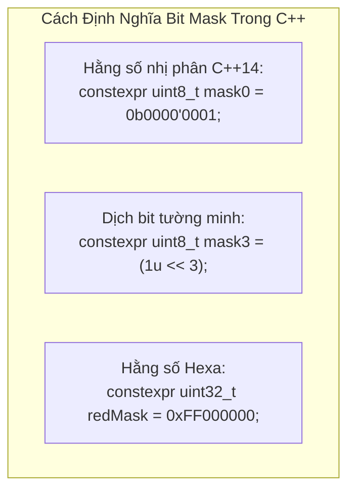
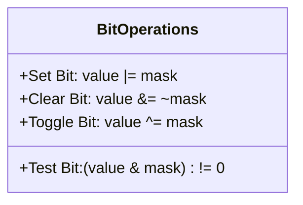

# O.3 — Kỹ Thuật Thao Tác Bit Với Mặt Nạ Bit (Bit Manipulation with Bit Masks)

---

## 🎯 Mục Tiêu Bài Học
- Hiểu khái niệm **Mặt nạ bit (Bit Mask)** và cách tạo mặt nạ bằng tiền tố nhị phân `0b` hoặc toán tử dịch bit `1u << n`.
- Làm chủ 4 thao tác kinh điển không thể thiếu trong lập trình hệ thống:
  1. **Kiểm tra bit (Test bit)**
  2. **Bật bit (Set bit)**
  3. **Tắt bit (Clear bit)**
  4. **Đảo bit (Toggle bit)**
- Ứng dụng thực tế: Đóng gói và giải nén màu sắc RGBA 32-bit (Color packing/unpacking).
- Cập nhật các hàm `std::bit_cast` (C++20) và `std::byteswap` (C++23).

---

## 1. Mặt Nạ Bit (Bit Mask) Là Gì?

Một **mặt nạ bit (Bit Mask)** là một hằng số nhị phân có các bit được thiết kế đặc biệt (thường chỉ có 1 bit duy nhất bật `1`, hoặc một cụm bit xác định) nhằm phục vụ việc đọc, sửa đổi hoặc xóa các bit cụ thể trên một biến số mục tiêu mà **không làm ảnh hưởng đến các bit còn lại**.



---

## 2. Bốn Thao Tác Thần Thánh Với Mặt Nạ Bit

Dưới đây là 4 thao tác mà mọi kỹ sư lập trình nhúng, game engine, hệ điều hành và an ninh mạng bắt buộc phải thuộc lòng:



### 2.1. Kiểm Tra Bit (Testing a Bit)
Dùng toán tử **Bitwise AND (`&`)**:
```cpp
constexpr std::uint8_t mask2 { 1u << 2 }; // Mặt nạ bit 2: 0000 0100

if ((flags & mask2) != 0)
{
    // Bit 2 đang BẬT (1)
}
```

### 2.2. Bật Bit (Setting a Bit)
Dùng toán tử **Bitwise OR (`|=`)**:
Bất kỳ bit nào kết hợp OR với 1 đều biến thành 1; kết hợp OR với 0 giữ nguyên giá trị cũ.
```cpp
flags |= mask2; // Bật bit 2 thành 1 (các bit khác không đổi)
```

### 2.3. Tắt Bit (Clearing a Bit)
Dùng toán tử **Bitwise AND kết hợp NOT (`&= ~mask`)**:
`~mask` sẽ biến bit mục tiêu thành 0 và biến tất cả các bit còn lại thành 1!
```
  flags:  1101 1101
  mask2:  0000 0100
 ~mask2:  1111 1011
-------------------
  flags & ~mask2 = 1101 1001 (Bit 2 đã bị tắt về 0!)
```
```cpp
flags &= ~mask2; // Tắt bit 2 về 0
```

### 2.4. Đảo Bit (Toggling a Bit)
Dùng toán tử **Bitwise XOR (`^=`)**:
Bit nào XOR với 1 sẽ bị đảo ngược ($0 \to 1, 1 \to 0$); XOR với 0 giữ nguyên.
```cpp
flags ^= mask2; // Đảo trạng thái bit 2
```

---

## 3. Ứng Dụng Thực Chiến: Nén và Giải Nén Màu Sắc RGBA (32-bit Color)

Một pixel màu RGBA bao gồm 4 kênh: Đỏ (Red), Lục (Green), Lam (Blue) và Độ trong suốt (Alpha). Mỗi kênh là một giá trị 8-bit từ $0$ đến $255$.
Ta có thể nén cả 4 kênh vào đúng 1 số nguyên không dấu 32-bit `std::uint32_t`:

```cpp
#include <iostream>
#include <cstdint>

// Hàm đóng gói 4 kênh 8-bit thành 1 số 32-bit
std::uint32_t packRGBA(std::uint8_t r, std::uint8_t g, std::uint8_t b, std::uint8_t a)
{
    return (static_cast<std::uint32_t>(r) << 24) |
           (static_cast<std::uint32_t>(g) << 16) |
           (static_cast<std::uint32_t>(b) << 8)  |
           (static_cast<std::uint32_t>(a));
}

int main()
{
    // Màu cam rực rỡ với độ trong suốt 50%: R=255, G=128, B=0, A=128
    std::uint32_t pixel = packRGBA(255, 128, 0, 128);

    // Giải nén kênh Green (Lục) bằng Bit Mask và dịch bit
    constexpr std::uint32_t greenMask { 0x00FF0000 };
    std::uint8_t extractedGreen = static_cast<std::uint8_t>((pixel & greenMask) >> 16);

    std::cout << "Kenh Green duoc giai nen: " << static_cast<int>(extractedGreen) << '\n'; // 128
    return 0;
}
```

---

## 4. 🚀 Cập Nhật C++20 và C++23: An Toàn Bộ Nhớ

::: info 🚀 C++20: `std::bit_cast`
Trong C/C++ cũ, lập trình viên thường dùng ép kiểu con trỏ `*(int*)&float_var` để đọc biểu diễn nhị phân của số thực. Điều này vi phạm nghiêm trọng **Quy tắc biệt danh nghiêm ngặt (Strict Aliasing Rule)** và là Undefined Behavior!
C++20 mang đến `std::bit_cast` trong `<bit>`, cho phép sao chép bit trực tiếp an toàn tuyệt đối ngay tại compile-time:
```cpp
#include <bit>
#include <cstdint>

float f = 1.0f;
auto bits = std::bit_cast<std::uint32_t>(f); // An toàn chuẩn ISO!
```
:::

::: info 🚀 C++23: `std::byteswap`
C++23 bổ sung hàm `std::byteswap` trong `<bit>` giúp đảo ngược thứ tự các byte (Big Endian <-> Little Endian) siêu nhanh mà không cần viết hàm thủ công.
:::

---

## 📝 Hệ Thống Quiz & Bài Tập Tự Luyện

### Câu hỏi 1:
Nếu viết `flags &= mask;` thay vì `flags &= ~mask;`, điều gì thảm khốc sẽ xảy ra?
::: details [Xem lời giải]
`flags &= mask;` sẽ xóa sạch TẤT CẢ các bit khác về 0, và chỉ giữ lại bit được chỉ định trong mask! Trong khi ý đồ của "Clear bit" là chỉ xóa duy nhất bit mục tiêu và BẢO LƯU tất cả các bit còn lại. Quên dấu `~` là một trong những lỗi kinh hoàng nhất trong lập trình vi điều khiển.
:::
