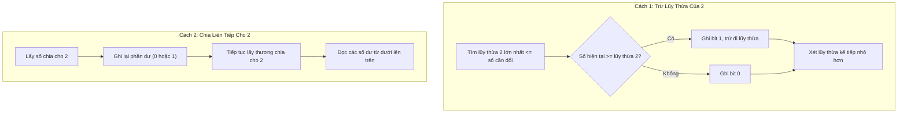

# O.4 — Chuyển Đổi Số Nguyên Giữa Hệ Nhị Phân và Thập Phân (Binary and Decimal Conversion)

---

## 🎯 Mục Tiêu Bài Học
- Hiểu sâu sắc bản chất hệ cơ số 2 (Base-2 / Binary) và hệ cơ số 10 (Base-10 / Decimal).
- Nắm vững trọng số của từng bit nhị phân ($2^0, 2^1, 2^2, 2^3, ..., 2^7$).
- Thành thạo 2 thuật toán chuyển đổi:
  1. Thuật toán trừ dần lũy thừa của 2.
  2. Thuật toán chia liên tiếp cho 2 (Short division by 2).
- Tự tay viết chương trình C++ in ra chuỗi nhị phân của số nguyên bất kỳ.
- Sử dụng các tính năng hiện đại: `std::format` (C++20) và `std::println` (C++23).

---

## 1. Trọng Số Của Các Bit Nhị Phân

Trong hệ thập phân, mỗi chữ số có trọng số là lũy thừa của 10 ($10^0, 10^1, 10^2$). Trong hệ nhị phân, mỗi bit chỉ có thể nhận giá trị `0` hoặc `1`, và trọng số của nó là **lũy thừa của 2**:

| Vị trí bit | Bit 7 | Bit 6 | Bit 5 | Bit 4 | Bit 3 | Bit 2 | Bit 1 | Bit 0 |
| :---: | :---: | :---: | :---: | :---: | :---: | :---: | :---: | :---: |
| **Trọng số ($2^n$)** | **128** | **64** | **32** | **16** | **8** | **4** | **2** | **1** |
| Giá trị bit | 1 | 0 | 1 | 0 | 1 | 1 | 0 | 1 |

Số trên tương đương:
$$1 \times 128 + 0 \times 64 + 1 \times 32 + 0 \times 16 + 1 \times 8 + 1 \times 4 + 0 \times 2 + 1 \times 1 = 173_{10}$$

---

## 2. Hai Thuật Toán Đổi Thập Phân Sang Nhị Phân



---

## 3. Cài Đặt Chương Trình C++ Tự Động In Nhị Phân

Dưới đây là chương trình sử dụng toán tử dịch bit và bit mask để duyệt qua từng bit và in ra màn hình:

```cpp
#include <iostream>
#include <cstdint>

void printBinary8(std::uint8_t n)
{
    // Duyệt từ bit cao nhất (Bit 7) về bit thấp nhất (Bit 0)
    for (int i = 7; i >= 0; --i)
    {
        // Tạo mask: 1u << i
        if ((n & (1u << i)) != 0)
            std::cout << '1';
        else
            std::cout << '0';

        // In dấu phân tách cho dễ đọc ở giữa 4 bit
        if (i == 4)
            std::cout << '\'';
    }
    std::cout << '\n';
}

int main()
{
    std::cout << "173 sang nhi phan: ";
    printBinary8(173); // In ra: 1010'1101
    return 0;
}
```

---

## 4. 🚀 In Định Dạng Nhị Phân Trong C++ Hiện Đại (C++20 và C++23)

Nếu bạn sử dụng C++20 trở lên, bạn không cần phải tự viết vòng lặp in nhị phân nữa!

::: code-group
```cpp [C++20: std::format]
#include <format>
#include <iostream>

int main()
{
    int val = 173;
    // {:08b} nghĩa là: định dạng nhị phân, độ rộng tối thiểu 8 ký tự, điền số 0 phía trước
    std::string binStr = std::format("{:08b}", val);
    std::cout << binStr << '\n'; // 10101101
}
```

```cpp [C++23: std::println]
#include <print>

int main()
{
    int val = 173;
    std::println("Gia tri nhi phan: {:08b}", val);
}
```
:::

---

## 📝 Hệ Thống Quiz & Bài Tập Tự Luyện

### Câu hỏi 1:
Số nhị phân `1101'0010` đổi sang hệ thập phân là bao nhiêu?
::: details [Xem lời giải]
Tính tổng các trọng số có bit 1:
- Bit 7: 128
- Bit 6: 64
- Bit 4: 16
- Bit 1: 2
Tổng: $128 + 64 + 16 + 2 = 210_{10}$.
:::

### Câu hỏi 2:
Số thập phân `93` đổi sang nhị phân 8-bit là bao nhiêu?
::: details [Xem lời giải]
- $93 - 64 = 29$ (Bit 6 = 1)
- $29 - 16 = 13$ (Bit 4 = 1)
- $13 - 8 = 5$ (Bit 3 = 1)
- $5 - 4 = 1$ (Bit 2 = 1)
- $1 - 1 = 0$ (Bit 0 = 1)
Các bit còn lại (7, 5, 1) là 0.
Kết quả: `0101'1101`.
:::
