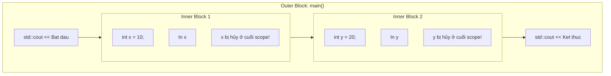

# 7.1 — Câu Lệnh Phức Hợp: Khối Mã (Compound Statements / Blocks)

---

## 🎯 Mục Tiêu Bài Học
- Hiểu định nghĩa câu lệnh phức hợp (**Compound Statement**) hay còn gọi là **Khối mã (Block)**.
- Phân biệt câu lệnh đơn và khối lệnh được bao bọc bởi cặp ngoặc nhọn `{}`.
- Nắm vững khái niệm Khối lồng nhau (Nested Blocks).
- Hiểu cách các khối mã tạo ra ranh giới phạm vi (**Scope**) và điều khiển vòng đời biến trong ngăn xếp (Stack).

---

## 1. Khối Mã (Block) Là Gì?

Một **câu lệnh phức hợp (Compound Statement)**, thường được gọi ngắn gọn là một **khối mã (Block)**, là một nhóm gồm không hoặc nhiều câu lệnh được đặt bên trong cặp dấu ngoặc nhọn `{}`. Trình biên dịch C++ coi toàn bộ khối mã này như **một câu lệnh đơn nhất**.

```cpp
#include <iostream>

int main()
{ // Bắt đầu khối mã của hàm main
    std::cout << "Xin chao!\n";
    std::cout << "Tam biet!\n";
    return 0;
} // Kết thúc khối mã của hàm main
```

Lưu ý: Không có dấu chấm phẩy `;` ở sau dấu ngoặc nhọn đóng `}` của một khối mã thông thường.

---

## 2. Khối Mã Lồng Nhau (Nested Blocks)

Một khối mã có thể được đặt bên trong một khối mã khác. Khối bao bọc bên ngoài được gọi là **Outer Block**, khối nằm bên trong được gọi là **Inner Block** hoặc **Nested Block**:

```cpp
#include <iostream>

int main() // Outer block
{
    std::cout << "Bat dau outer block\n";

    { // Inner block 1
        int x { 10 };
        std::cout << "Inner block 1: x = " << x << '\n';
    } // x bi tieu huy tai day!

    { // Inner block 2
        int y { 20 };
        std::cout << "Inner block 2: y = " << y << '\n';
    } // y bi tieu huy tai day!

    std::cout << "Ket thuc outer block\n";
    return 0;
}
```



---

## 3. Tác Động Của Khối Mã Lên Vòng Đời Biến Số

Một biến được khai báo bên trong một khối mã chỉ tồn tại từ điểm nó được khai báo cho đến dấu ngoặc nhọn đóng `}` của khối mã đó:
- **Phạm vi (Scope)**: Biến chỉ có thể được truy cập bên trong khối mã chứa nó (Block Scope).
- **Vòng đời (Lifetime / Duration)**: Biến được cấp phát trên Stack khi thực thi đến dòng khai báo, và **tự động bị giải phóng (destroyed)** ngay khi luồng chạy vượt qua dấu `}`.

::: warning ⚠️ Cạm Bẫy: Cố Gắng Truy Cập Biến Ngoài Scope
```cpp
int main()
{
    {
        int secret { 42 };
    }

    std::cout << secret; // 💥 LỖI BIÊN DỊCH: 'secret' was not declared in this scope!
    return 0;
}
```
:::

---

## 4. Thực Hành Tốt Nhất (Best Practices)

::: tip 💡 Lời Khuyên Chuyên Gia
1. **Luôn sử dụng khối mã `{}` cho các cấu trúc điều khiển**:
   Dù câu lệnh `if`, `for`, `while` chỉ có 1 dòng lệnh duy nhất, hãy luôn bọc nó trong cặp ngoặc `{}`. Điều này giúp ngăn ngừa 100% các lỗi nghiêm trọng kiểu *Apple Goto Fail bug* khi bổ sung thêm code sau này.
2. **Tận dụng khối mã để giải phóng tài nguyên sớm (RAII)**:
   Nếu bạn có một tài nguyên chiếm nhiều RAM hoặc một khóa đồng bộ luồng (Mutex lock), việc bọc nó trong một khối mã riêng biệt `{ ... }` sẽ khiến tài nguyên tự động được giải phóng ngay khi ra khỏi khối, giải tỏa bộ nhớ sớm cho hệ thống.
:::

---

## 📝 Hệ Thống Quiz & Bài Tập Tự Luyện

### Câu hỏi 1:
Đoạn mã sau có biên dịch thành công không? Nếu có, nó in ra gì?
```cpp
int main()
{
    int a { 5 };
    {
        int b { 10 };
        a = a + b;
    }
    std::cout << a;
    return 0;
}
```
::: details [Xem lời giải]
Biên dịch thành công!  
Khối bên trong (Inner block) có thể nhìn thấy và truy cập hợp lệ các biến của khối bên ngoài (Outer block). Biến `a` được cộng thêm 10 thành 15. Sau khi ra khỏi inner block, biến `b` bị hủy nhưng `a` vẫn tồn tại với giá trị mới. In ra màn hình: `15`.
:::
