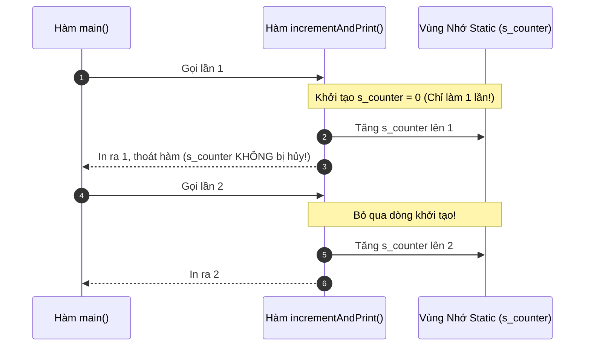

# 7.11 — Biến Cục Bộ Tĩnh (Static Local Variables)

---

## 🎯 Mục Tiêu Bài Học
- Hiểu khái niệm **Biến cục bộ tĩnh (Static Local Variable)** bằng từ khóa `static`.
- Nhận thức sự kết hợp độc đáo: **Phạm vi cục bộ (Block Scope)** nhưng **Vòng đời toàn cục (Static Duration)**.
- Phân tích cơ chế khởi tạo đúng 1 lần duy nhất trong lần gọi hàm đầu tiên.
- Tính năng an toàn đa luồng (**Thread-safe Initialization**) chuẩn C++11.

---

## 1. Biến Cục Bộ Tĩnh Là Gì?

Khi áp dụng từ khóa `static` cho một biến cục bộ bên trong hàm, biến đó sẽ thay đổi hoàn toàn vòng đời:
- **Scope (Phạm vi)**: Vẫn là **Block Scope** (chỉ có thể truy cập bên trong hàm đó).
- **Duration (Vòng đời)**: Trở thành **Static Duration** (tồn tại liên tục trong suốt thời gian chương trình chạy, không bị tiêu hủy khi hàm kết thúc!).

```cpp
#include <iostream>

void incrementAndPrint()
{
    static int s_counter { 0 }; // Chỉ khởi tạo DUY NHẤT 1 LẦN trong lần gọi đầu tiên!
    ++s_counter;
    std::cout << s_counter << ' ';
}

int main()
{
    incrementAndPrint(); // In ra: 1
    incrementAndPrint(); // In ra: 2
    incrementAndPrint(); // In ra: 3
    return 0;
}
```



---

## 2. Ứng Dụng Đỉnh Cao: Bộ Sinh ID Tự Động (ID Generator)

```cpp
int generateUniqueID()
{
    static int s_id { 1000 };
    return ++s_id; // Mỗi lần gọi sinh ra 1 ID duy nhất không trùng lặp!
}
```

::: tip 💡 C++11 Magic: An Toàn Đa Luồng (Thread-Safety)
Từ chuẩn C++11, việc khởi tạo biến cục bộ tĩnh được đảm bảo **Thread-safe** bởi trình biên dịch. Nếu có 10 luồng cùng gọi hàm lần đầu tiên đồng thời, trình biên dịch sẽ tự động chèn khóa ngầm định để đảm bảo biến được khởi tạo chính xác 1 lần duy nhất mà không bị Data Race!
:::
