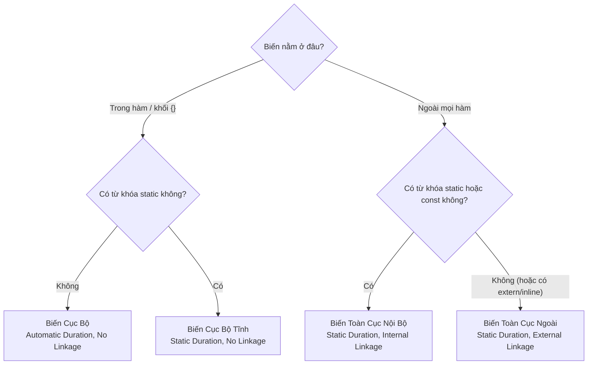

# 7.12 — Tổng Kết Toàn Diện Về Phạm Vi, Vòng Đời và Liên Kết (Summary)

---

## 🎯 Mục Tiêu Bài Học
- Hệ thống hóa bảng ma trận 3 chiều: **Scope**, **Duration**, và **Linkage**.
- Khắc sâu các quy tắc phân biệt loại biến trong C++.

---

## 1. Bảng Ma Trận Tổng Kết Toàn Diện

| Loại Biến | Vị trí định nghĩa | Scope (Phạm vi) | Duration (Vòng đời) | Linkage (Liên kết) |
| :--- | :--- | :--- | :--- | :--- |
| **Biến cục bộ thông thường** | Trong khối `{}` | Block scope | Automatic (trên Stack) | None |
| **Biến cục bộ tĩnh (`static`)** | Trong khối `{}` có `static` | Block scope | **Static** (suốt chương trình) | None |
| **Tham số hàm** | Danh sách tham số hàm | Block scope | Automatic | None |
| **Biến toàn cục nội bộ (`static`)** | Ngoài hàm có `static` | File / Global scope | Static | **Internal** (chỉ trong 1 file) |
| **Hằng toàn cục nội bộ (`const`)** | Ngoài hàm có `const` | File / Global scope | Static | **Internal** |
| **Biến toàn cục ngoài (thường)** | Ngoài hàm không `static` | File / Global scope | Static | **External** (toàn dự án) |
| **Biến toàn cục ngoài (`extern`)** | Ngoài hàm có `extern` | File / Global scope | Static | **External** |
| **Biến toàn cục inline (C++17)** | Header có `inline` | File / Global scope | Static | **External** (Khử trùng ODR) |

---

## 2. Sơ Đồ Cây Quyết Định (Decision Tree)

