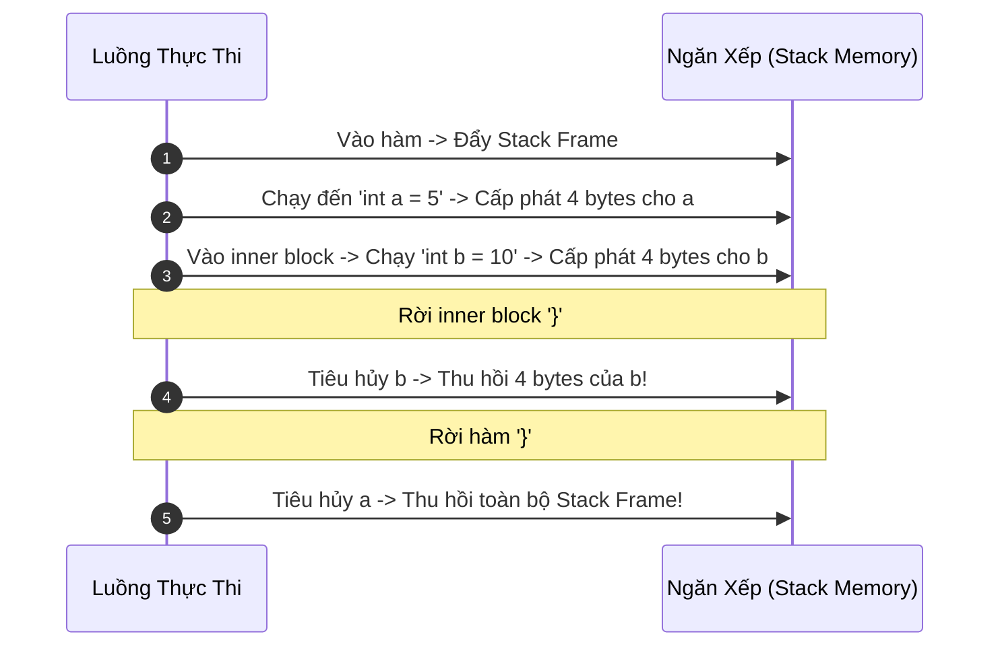

# 7.3 — Biến Cục Bộ: Phạm Vi và Vòng Đời Tự Động (Local Variables)

---

## 🎯 Mục Tiêu Bài Học
- Nắm vững định nghĩa **Biến cục bộ (Local Variables)** và tham số hàm.
- Hiểu rõ **Phạm vi khối mã (Block Scope)**: Thời điểm biến bắt đầu nhìn thấy và biến mất.
- Hiểu cơ chế **Vòng đời tự động (Automatic Storage Duration)** trên vùng nhớ Stack.
- Nguyên tắc vàng: Khai báo biến càng gần nơi sử dụng đầu tiên càng tốt (Declare near first use).

---

## 1. Biến Cục Bộ Có Block Scope

Một biến được định nghĩa bên trong một hàm (bao gồm cả các tham số của hàm) hoặc bên trong một khối mã `{}` được gọi là **Biến cục bộ (Local variable)**.

```cpp
void printValue(int x) // x là biến cục bộ (tham số) của hàm printValue
{
    int y { 10 };      // y là biến cục bộ
    std::cout << x + y << '\n';
} // x và y kết thúc phạm vi (out of scope) tại đây
```

Đặc điểm phạm vi:
- **Block Scope (hoặc Local Scope)**: Biến chỉ có thể nhìn thấy và truy cập được từ dòng nó được định nghĩa cho đến dấu ngoặc nhọn đóng `}` của khối chứa nó.
- Mã nguồn nằm bên ngoài khối hoàn toàn không biết đến sự tồn tại của biến đó.

---

## 2. Vòng Đời Tự Động (Automatic Storage Duration)

**Vòng đời (Lifetime / Duration)** là khoảng thời gian mà một đối tượng thực sự tồn tại trong bộ nhớ RAM của máy tính.

Biến cục bộ có thời gian lưu trữ tự động (**Automatic Duration**):
1. **Khởi tạo**: Biến được cấp phát trên Stack Frame của hàm khi luồng thực thi chạy tới câu lệnh định nghĩa.
2. **Tiêu hủy**: Khi luồng thực thi rời khỏi khối mã (chạm dấu `}`), biến sẽ được **tự động tiêu hủy (destroyed)**: vùng nhớ trên Stack được thu hồi, và hàm hủy (Destructor) của đối tượng được gọi nếu có.



---

## 3. Cạm Bẫy Thực Chiến: Tham Chiếu / Con Trỏ Lơ Lửng (Dangling Pointer)

::: danger ⚠️ Cực Kỳ Nguy Hiểm: Trả Về Con Trỏ / Tham Chiếu Tới Biến Cục Bộ!
Vì biến cục bộ bị tiêu hủy ngay khi ra khỏi hàm, việc trả về địa chỉ hoặc tham chiếu của nó là một lỗi thảm họa:

```cpp
int* getDanglingPointer()
{
    int val { 100 };
    return &val; // 💥 CẢNH BÁO: val sẽ bị hủy ngay lập tức khi hàm return!
}

int main()
{
    int* ptr = getDanglingPointer();
    // ptr đang trỏ vào vùng nhớ rác đã bị thu hồi (Dangling pointer)!
    std::cout << *ptr << '\n'; // ⚠️ UNDEFINED BEHAVIOR!
}
```
:::

---

## 4. Thực Hành Tốt Nhất: Khai Báo Biến Càng Gần Nơi Sử Dụng Càng Tốt

Trong ngôn ngữ C cổ điển (C89), mọi biến đều bắt buộc phải khai báo ở đầu hàm. **Trong Modern C++, điều này là một Anti-pattern (thói quen xấu)!**

::: tip 💡 Thực Hành Tốt Nhất (Best Practice)
1. **Định nghĩa biến gần nhất có thể với nơi nó được dùng lần đầu**: Giúp người đọc mã không phải cuộn trang lên đầu hàm để tìm kiểu dữ liệu, đồng thời thu hẹp phạm vi biến để tránh tái sử dụng biến sai mục đích.
2. **Luôn khởi tạo giá trị cho biến ngay khi định nghĩa**: Tuyệt đối không để biến ở trạng thái rác (`int x;`).
:::

---

## 📝 Hệ Thống Quiz & Bài Tập Tự Luyện

### Câu hỏi 1:
Giải thích sự khác nhau giữa **Scope (Phạm vi)** và **Lifetime (Vòng đời)** của một biến.
::: details [Xem lời giải]
- **Scope (Phạm vi)** là một khái niệm thuộc về **Mã Nguồn (Compile-time)**: Nó quy định vùng văn bản mã nguồn mà tên biến có thể được nhìn thấy và sử dụng bởi trình biên dịch.
- **Lifetime (Vòng đời)** là một khái niệm thuộc về **Thời Gian Chạy (Runtime)**: Nó là khoảng thời gian thực tế mà biến chiếm dụng bộ nhớ RAM (từ lúc được cấp phát đến khi bị giải phóng).
:::
