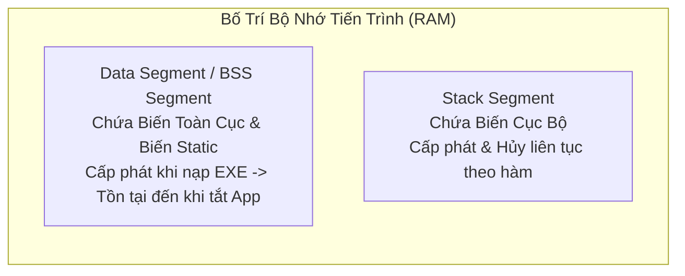

# 7.4 — Nhập Môn Biến Toàn Cục (Introduction to Global Variables)

---

## 🎯 Mục Tiêu Bài Học
- Hiểu định nghĩa **Biến toàn cục (Global Variables)**: Được khai báo bên ngoài mọi hàm.
- Nắm vững **Phạm vi tệp (File Scope / Global Namespace Scope)**.
- Hiểu cơ chế **Thời gian sống tĩnh (Static Storage Duration)**: Tồn tại trong suốt vòng đời của chương trình.
- Khởi tạo mặc định bằng 0 (Zero-initialization) của biến toàn cục.

---

## 1. Biến Toàn Cục Là Gì?

Trong C++, một biến được định nghĩa bên ngoài tất cả các khối mã, hàm hoặc class được gọi là **Biến toàn cục (Global Variable)**.

```cpp
#include <iostream>

// Biến toàn cục g_x được định nghĩa ngoài mọi hàm
int g_x { 5 }; 

void doSomething()
{
    std::cout << "Gia tri g_x trong doSomething: " << g_x << '\n';
    g_x = 10; // Thay đổi giá trị biến toàn cục
}

int main()
{
    std::cout << "Gia tri g_x trong main truoc do: " << g_x << '\n'; // 5
    doSomething();
    std::cout << "Gia tri g_x trong main sau do: " << g_x << '\n';   // 10
    return 0;
}
```

::: tip 💡 Quy Ước Đặt Tên (Naming Convention)
Nhiều kỹ sư C++ chuyên nghiệp sử dụng tiền tố `g_` (ví dụ: `g_x`, `g_mode`) cho các biến toàn cục để phân biệt rõ ràng ngay lập tức với các biến cục bộ trong thân hàm.
:::

---

## 2. Phạm Vi và Vòng Đời Của Biến Toàn Cục



| Tiêu chí | Biến Cục Bộ (Local) | Biến Toàn Cục (Global) |
| :--- | :--- | :--- |
| **Vị trí định nghĩa** | Bên trong hàm / khối mã `{}` | Bên ngoài mọi hàm |
| **Phạm vi (Scope)** | Block Scope (chỉ trong khối) | File Scope (toàn tệp từ dòng định nghĩa) |
| **Vòng đời (Duration)** | Automatic Duration (trên Stack) | **Static Duration** (trên Data Segment) |
| **Khởi tạo mặc định** | Giá trị rác (Không xác định) | **Tự động bằng 0 (Zero-initialized)** |

---

## 3. Khởi Tạo Tự Động Bằng 0 (Zero-initialization)

Không giống như các biến cục bộ (nếu không khởi tạo sẽ mang giá trị rác ngẫu nhiên), các biến có **Static Duration** luôn được đảm bảo khởi tạo bằng `0` trước khi hàm `main()` bắt đầu chạy:

```cpp
#include <iostream>

int g_uninitialized; // Tự động bằng 0!

int main()
{
    int local_uninitialized; // ⚠️ Giá trị rác ngẫu nhiên (UB nếu đọc)!
    
    std::cout << "Global: " << g_uninitialized << '\n'; // An toàn: In ra 0
    // std::cout << local_uninitialized; // Nguy hiểm!
    return 0;
}
```

---

## 📝 Hệ Thống Quiz & Bài Tập Tự Luyện

### Câu hỏi 1:
Biến toàn cục được lưu trữ tại phân vùng bộ nhớ nào của chương trình khi thực thi?
::: details [Xem lời giải]
Biến toàn cục không nằm trên Stack, cũng không nằm trên Heap. Chúng được lưu trữ trong phân vùng **Data Segment** (nếu đã được khởi tạo giá trị khác 0) hoặc **BSS Segment** (Block Started by Symbol - nếu chưa khởi tạo hoặc khởi tạo bằng 0). Vùng nhớ này được hệ điều hành nạp ngay khi chương trình bắt đầu và chỉ được giải phóng khi chương trình kết thúc hoàn toàn.
:::
