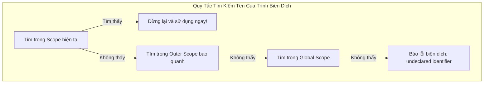

# 7.5 — Che Khuất Biến: Ẩn Tên Định Danh (Variable Shadowing / Name Hiding)

---

## 🎯 Mục Tiêu Bài Học
- Hiểu hiện tượng **Che khuất biến (Variable Shadowing)** hay **Ẩn tên (Name Hiding)**.
- Phân tích cơ chế trình biên dịch ưu tiên tìm kiếm định danh từ phạm vi hẹp nhất ra ngoài.
- Tác hại nguy hiểm của việc che khuất biến vô ý và cảnh báo từ compiler (`-Wshadow`).
- Cách dùng toán tử `::` để giải cứu biến toàn cục bị che khuất.

---

## 1. Hiện Tượng Che Khuất Biến Là Gì?

Khi một biến được khai báo bên trong một khối mã con (Inner scope) có **cùng tên** với một biến đã tồn tại ở khối cha (Outer scope) hoặc biến toàn cục, biến ở khối trong sẽ **che khuất (shadow/hide)** biến ở khối ngoài.

Mọi truy cập tên biến đó bên trong inner scope sẽ được ánh xạ tới biến cục bộ mới, khiến biến bên ngoài trở nên "vô hình":

```cpp
#include <iostream>

int main()
{
    int apples { 5 }; // apples của outer block

    {
        std::cout << "Apples outer: " << apples << '\n'; // 5

        // Định nghĩa biến trùng tên trong inner block!
        int apples { 10 }; // Biến này che khuất biến apples ở ngoài!

        std::cout << "Apples inner: " << apples << '\n'; // 10
    } // apples inner bị hủy tại đây!

    std::cout << "Apples outer sau do: " << apples << '\n'; // 5 (không hề bị thay đổi!)
    return 0;
}
```



---

## 2. Che Khuất Biến Toàn Cục và Cách Dùng Toán Tử `::`

Một biến cục bộ có thể che khuất một biến toàn cục:

```cpp
#include <iostream>

int value { 7 }; // Biến toàn cục

int main()
{
    int value { 42 }; // Che khuất biến toàn cục value!

    std::cout << "Gia tri bien cuc bo: " << value << '\n';   // In ra 42
    std::cout << "Gia tri bien toan cuc: " << ::value << '\n'; // Dùng :: để vượt qua che khuất: In ra 7
    return 0;
}
```

---

## 3. Cạm Bẫy và Khuyến Cáo Thực Hành

::: warning ⚠️ Cực Kỳ Nguy Hiểm: Lỗi Logic Khó Gỡ Lỗi
Che khuất biến là thủ phạm số 1 gây ra các lỗi logic bí ẩn: Lập trình viên tưởng rằng mình đang thay đổi giá trị của biến bên ngoài, nhưng thực tế lại đang cập nhật biến tạm thời bên trong!

```cpp
int totalCount { 0 };

void calculate()
{
    for (int i = 0; i < 5; ++i)
    {
        int totalCount { 0 }; // 💥 LỖI: Vô tình khai báo biến mới thay vì cộng dồn!
        totalCount += i;
    }
    // Ra ngoài vòng lặp, totalCount toàn cục vẫn là 0!
}
```
:::

::: tip 💡 Thực Hành Tốt Nhất (Best Practice)
1. **Bật cờ cảnh báo của Compiler**: Luôn biên dịch với cờ `-Wshadow` trên GCC/Clang để trình biên dịch phát hiện và báo lỗi ngay khi có biến bị che khuất.
2. **Tránh đặt trùng tên biến**: Đặt tên biến rõ nghĩa theo ngữ cảnh cụ thể (ví dụ: `totalApples`, `currentApples`).
:::

---

## 📝 Hệ Thống Quiz & Bài Tập Tự Luyện

### Câu hỏi 1:
Đoạn mã sau in ra giá trị gì?
```cpp
int x { 1 };
{
    int x { 2 };
    {
        x = 3;
    }
    std::cout << x << ' ';
}
std::cout << x;
```
::: details [Xem lời giải]
- Biểu thức `x = 3` nằm trong khối sâu nhất, nơi không có khai báo `x` mới. Trình biên dịch tìm ra ngoài và thấy `int x { 2 }`, do đó gán `x` của khối giữa thành 3.
- Thoát khối trong cùng, dòng `std::cout << x` in ra `3`.
- Thoát khối giữa, biến `x` của khối giữa bị hủy. Dòng `std::cout << x` ngoài cùng truy cập biến `x { 1 }` ban đầu.
- In ra: `3 1`.
:::
