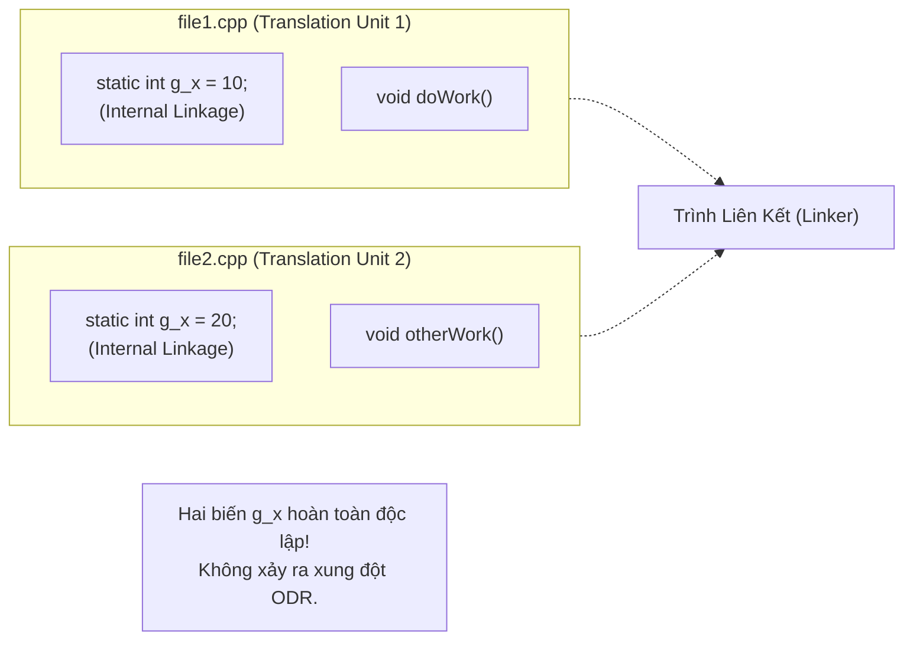

# 7.6 — Liên Kết Nội Bộ (Internal Linkage)

---

## 🎯 Mục Tiêu Bài Học
- Hiểu khái niệm **Liên kết (Linkage)** và **Đơn vị biên dịch (Translation Unit)**.
- Phân biệt định danh có **Liên kết nội bộ (Internal Linkage)**: Chỉ có thể nhìn thấy trong phạm vi 1 tệp mã nguồn đơn lẻ.
- Sử dụng từ khóa `static` cho biến toàn cục và hàm để kích hoạt internal linkage.
- Tính chất internal linkage mặc định của hằng số `const` và `constexpr`.

---

## 1. Liên Kết (Linkage) Là Gì?

Một chương trình C++ thường bao gồm nhiều tệp mã nguồn `.cpp`. Mỗi tệp `.cpp` (kèm theo tất cả các tệp header mà nó `#include`) được trình biên dịch biên dịch hoàn toàn độc lập thành một tệp đối tượng nhị phân (`.obj` hoặc `.o`), gọi là một **Đơn vị biên dịch (Translation Unit - TU)**.

Sau đó, **Trình liên kết (Linker)** có nhiệm vụ kết nối các tệp đối tượng này lại với nhau để tạo thành tệp thực thi cuối cùng (`.exe` hoặc binary ELF).

**Liên kết (Linkage)** quy định xem một định danh (tên hàm, tên biến) có thể được Trình liên kết nhìn thấy và tham chiếu giữa các đơn vị biên dịch khác nhau hay không:
- **No Linkage**: Chỉ tồn tại trong khối mã cục bộ.
- **Internal Linkage**: Chỉ nhìn thấy bên trong đơn vị biên dịch hiện tại.
- **External Linkage**: Có thể được nhìn thấy và sử dụng từ các tệp `.cpp` khác!



---

## 2. Kích Hoạt Internal Linkage Bằng Từ Khóa `static`

Khi đặt từ khóa `static` trước một biến toàn cục hoặc một hàm ở phạm vi file, định danh đó sẽ có **Internal Linkage**:

```cpp
// a.cpp
static int g_secret { 42 }; // Internal linkage: Chỉ nhìn thấy trong a.cpp

static void helperFunction() // Internal linkage: Không thể gọi từ tệp khác
{
    // ...
}
```

Nếu một tệp `b.cpp` khác cũng định nghĩa `static int g_secret { 99 };`, hai biến này là **hoàn toàn độc lập** ở hai vùng nhớ khác nhau. Linker sẽ không bao giờ báo lỗi trùng tên!

---

## 3. Biến Hằng `const` và `constexpr` Toàn Cục Mặc Định Có Internal Linkage

Trong C++, các biến toàn cục không phải const (`int g_x`) mặc định có **External Linkage**.
Tuy nhiên, để tối ưu hóa và an toàn, chuẩn C++ quy định:
**Các biến toàn cục `const` và `constexpr` mặc định có Internal Linkage!**

```cpp
const int g_y { 1 };       // Mặc định có Internal Linkage!
constexpr int g_z { 2 };   // Mặc định có Internal Linkage!
```

---

## 📝 Hệ Thống Quiz & Bài Tập Tự Luyện

### Câu hỏi 1:
Tại sao việc sử dụng Internal Linkage cho các hàm trợ giúp (helper functions) bên trong tệp `.cpp` lại là một thói quen lập trình xuất sắc?
::: details [Xem lời giải]
1. **Đóng gói thông tin (Encapsulation)**: Ngăn chặn các tệp khác vô tình gọi trực tiếp các hàm nội bộ không thuộc về giao diện công khai (API).
2. **Tránh xung đột tên**: Bạn có thể đặt tên các hàm phụ trợ phổ biến (như `init()`, `clean()`, `helper()`) mà không lo bị trùng lặp với các thư viện hoặc tệp khác trong toàn bộ dự án.
:::
