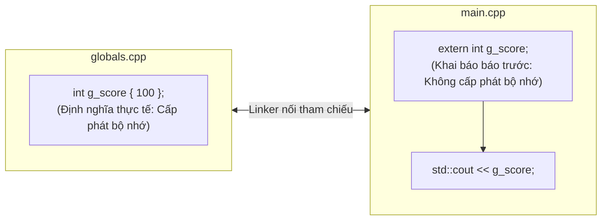

# 7.7 — Liên Kết Ngoài và Khai Báo Báo Trước Biến (External Linkage and Variable Forward Declarations)

---

## 🎯 Mục Tiêu Bài Học
- Hiểu định nghĩa **Liên kết ngoài (External Linkage)**: Cho phép chia sẻ biến và hàm giữa nhiều tệp `.cpp`.
- Sử dụng từ khóa `extern` để tạo **Khai báo báo trước (Forward Declaration)** cho biến.
- Phân biệt rõ giữa **Khai báo biến (Declaration)** và **Định nghĩa biến (Definition)**.
- Biến hằng toàn cục với `extern const`.

---

## 1. Liên Kết Ngoài (External Linkage) Là Gì?

Một định danh có **External Linkage** có thể được nhìn thấy và sử dụng bởi bất kỳ đơn vị biên dịch (tệp `.cpp`) nào trong toàn bộ dự án.
- Các hàm thông thường mặc định có External Linkage.
- Các biến toàn cục không phải const (`int g_x { 5 };`) mặc định có External Linkage.

Để sử dụng một biến toàn cục được định nghĩa ở tệp này từ một tệp khác, bạn phải thông báo cho trình biên dịch biết sự tồn tại của biến đó qua một **Khai báo báo trước (Forward Declaration)** bằng từ khóa `extern`.



---

## 2. Khai Báo (Declaration) vs Định Nghĩa (Definition) Với `extern`

- **Định nghĩa (Definition)**: Cấp phát bộ nhớ thực sự cho biến.
- **Khai báo (Declaration)**: Chỉ báo tên và kiểu, không cấp phát bộ nhớ.

```cpp
int g_x;             // ĐỊNH NGHĨA (không khởi tạo, tự động bằng 0)
int g_x { 5 };       // ĐỊNH NGHĨA (có khởi tạo)
extern int g_x { 5 };// ĐỊNH NGHĨA (có gán giá trị thì từ khóa extern bị vô hiệu hóa!)

extern int g_y;      // KHAI BÁO (Báo rằng g_y được định nghĩa ở đâu đó khác!)
```

### Ví dụ chia sẻ biến giữa 2 tệp:
::: code-group
```cpp [data.cpp]
// Định nghĩa biến toàn cục thực tế tại đây
int g_globalCounter { 42 };
```

```cpp [main.cpp]
#include <iostream>

// Khai báo báo trước cho trình biên dịch biết g_globalCounter tồn tại
extern int g_globalCounter; 

int main()
{
    std::cout << "Gia tri tu data.cpp: " << g_globalCounter << '\n'; // 42
    g_globalCounter = 100; // Thay đổi trực tiếp biến toàn cục
    return 0;
}
```
:::

---

## 3. Chia Sẻ Hằng Số Toàn Cục Với `extern const`

Vì biến `const` mặc định có Internal Linkage, nếu bạn muốn biến const có External Linkage để chia sẻ, bạn **bắt buộc phải thêm từ khóa `extern` ở cả nơi định nghĩa lẫn nơi khai báo**:

::: code-group
```cpp [constants.cpp]
// Phải có extern ở nơi định nghĩa để biến const có external linkage
extern const double g_pi { 3.14159 };
```

```cpp [main.cpp]
#include <iostream>

extern const double g_pi; // Khai báo

int main()
{
    std::cout << "Pi = " << g_pi << '\n';
    return 0;
}
```
:::

---

## 📝 Hệ Thống Quiz & Bài Tập Tự Luyện

### Câu hỏi 1:
Nếu bạn viết `extern int g_val;` trong `main.cpp` nhưng quên không định nghĩa `int g_val { 10 };` trong bất kỳ tệp `.cpp` nào, lỗi sẽ phát sinh ở giai đoạn nào?
::: details [Xem lời giải]
Lỗi sẽ phát sinh ở giai đoạn **Liên kết (Linking stage)**!  
Trình biên dịch (Compiler) xử lý `main.cpp` hoàn toàn trơn tru vì nó tin lời khai báo `extern`. Nhưng khi Linker gom các tệp lại, nó không tìm thấy địa chỉ bộ nhớ nào được cấp phát cho `g_val`, dẫn đến lỗi kinh điển:
`undefined reference to 'g_val'` hoặc `LNK2001: unresolved external symbol g_val`.
:::
