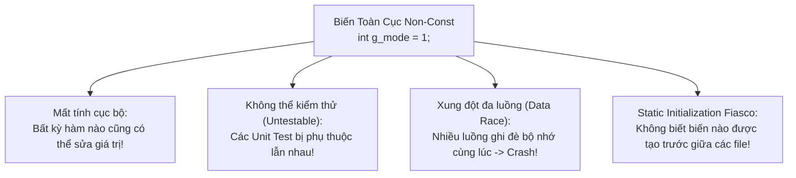

# 7.8 — Tại Sao Biến Toàn Cục Không Phải Hằng Số Là "Ác Quỷ"? (Why Non-Const Globals Are Evil)

---

## 🎯 Mục Tiêu Bài Học
- Hiểu tại sao các kỹ sư phần mềm hàng đầu coi biến toàn cục không phải hằng (**Non-const global variables**) là "tội đồ" trong thiết kế phần mềm.
- Phân tích hiện tượng ô nhiễm trạng thái toàn cục (Global State Pollution) và mất tính cục bộ (Loss of locality).
- Nguy cơ xảy ra xung đột đa luồng (**Race Conditions** / Đua dữ liệu).
- Thứ tự khởi tạo biến toàn cục không xác định (Static Initialization Order Fiasco).
- Các giải pháp thay thế văn minh và an toàn.

---

## 1. Những Tác Hại Khủng Khiếp Của Biến Toàn Cục Non-Const



1. **Phá vỡ tính đóng gói và mất tính cục bộ**: Khi đọc một hàm, bạn chỉ cần nhìn vào các tham số truyền vào là hiểu hàm hoạt động ra sao. Nhưng nếu hàm đọc/ghi biến toàn cục, bạn buộc phải đọc toàn bộ mã nguồn của cả dự án để biết biến đó đã bị ai sửa đổi trước đó!
2. **Khó khăn tột cùng khi gỡ lỗi (Debugging)**: Biến `g_state` đột nhiên mang giá trị sai `-1`. Trong số 500 hàm của dự án, hàm nào đã gán `-1`? Bạn không thể đặt breakpoint hiệu quả.
3. **Cực kỳ nguy hiểm trong lập trình đa luồng (Multi-threading)**: Nếu hai luồng cùng đọc và ghi vào biến toàn cục mà không có cơ chế khóa (Mutex), chương trình sẽ bị Data Race và sập bất cứ lúc nào.

---

## 2. Vấn Nạn Trật Tự Khởi Tạo Tĩnh (Static Initialization Order Fiasco)

Nếu bạn có 2 biến toàn cục ở 2 tệp `.cpp` khác nhau, và biến này phụ thuộc vào giá trị của biến kia:

::: code-group
```cpp [a.cpp]
int initValue() { return 42; }
int g_a { initValue() }; // Khởi tạo động
```

```cpp [b.cpp]
extern int g_a;
int g_b { g_a + 10 }; // Phụ thuộc vào g_a!
```
:::

Chuẩn C++ **hoàn toàn không quy định** tệp `a.cpp` hay `b.cpp` được khởi tạo trước! Nếu `b.cpp` được khởi tạo trước `a.cpp`, `g_a` lúc này vẫn chỉ là `0`, dẫn đến `g_b` mang giá trị `10` thay vì `52`. Đây là một lỗi cực kỳ khó phát hiện.

---

## 3. Các Giải Pháp Thay Thế Văn Minh

::: tip 💡 Cách Thiết Kế Đúng Đắn
1. **Truyền dữ liệu qua tham số hàm**: Thay vì đọc biến toàn cục, hãy truyền biến đó vào hàm qua tham chiếu (`const Type&`).
2. **Đóng gói vào Class / Struct**: Biến dữ liệu thành thuộc tính của lớp, chỉ cho phép truy cập qua các phương thức được kiểm soát.
3. **Sử dụng Mẫu Thiết Kế Singleton Meyers (Meyers' Singleton)** nếu thực sự bắt buộc chỉ có 1 đối tượng duy nhất:
   ```cpp
   class GlobalConfig
   {
   public:
       static GlobalConfig& instance()
       {
           static GlobalConfig s_instance; // Khởi tạo an toàn luồng trong C++11
           return s_instance;
       }
   private:
       GlobalConfig() = default;
   };
   ```
:::
