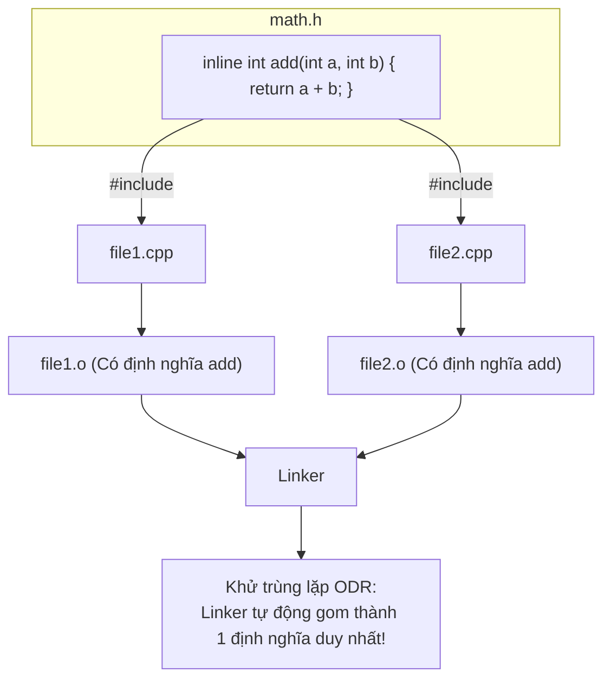

# 7.9 — Hàm Nội Tuyến và Biến Nội Tuyến (Inline Functions and Variables)

---

## 🎯 Mục Tiêu Bài Học
- Hiểu ý nghĩa lịch sử của từ khóa `inline`: Gợi ý thay thế lời gọi hàm bằng mã máy thực tế.
- Nắm vững ý nghĩa hiện đại chuẩn ISO C++ của `inline`: **Miễn trừ Quy tắc Một Định Nghĩa (One Definition Rule - ODR)**.
- Đặt định nghĩa hàm inline vào tệp Header an toàn mà không bị lỗi trùng lặp từ Linker.
- 🚀 Tính năng đột phá từ C++17: **Biến nội tuyến (`inline` variables)**.

---

## 1. Ý Nghĩa Lịch Sử vs Hiện Đại Của Từ Khóa `inline`

- **Thời kỳ đầu**: Mỗi khi gọi một hàm, CPU phải thực hiện nhảy địa chỉ, lưu thanh ghi, đẩy stack frame... Đối với các hàm siêu nhỏ (như `int min(int a, int b) { return a < b ? a : b; }`), chi phí gọi hàm còn tốn thời gian hơn cả phép so sánh! Từ khóa `inline` ra đời để gợi ý compiler chèn thẳng thân hàm vào nơi gọi.
- **Hiện đại**: Ngày nay, các trình biên dịch tối ưu hóa cực kỳ thông minh. Compiler tự quyết định hàm nào nên inline hay không dựa trên phân tích hiệu năng, **bất kể bạn có viết từ khóa `inline` hay không**!

Vậy từ khóa `inline` trong C++ hiện đại dùng để làm gì?
**Nó dùng để cho phép một hàm hoặc một biến được định nghĩa ở NHIỀU ĐƠN VỊ BIÊN DỊCH khác nhau mà không vi phạm Quy tắc Một Định Nghĩa (One Definition Rule - ODR)!**



---

## 2. Biến Nội Tuyến (`inline` Variables) Từ C++17

Trước C++17, bạn chỉ có thể inline hàm, không thể inline biến. Muốn định nghĩa biến toàn cục, bạn phải tách: khai báo `extern` trong header, định nghĩa thực tế trong 1 tệp `.cpp`.

Từ **C++17**, bạn có thể thêm từ khóa `inline` trước biến toàn cục và **đặt trực tiếp định nghĩa của nó trong tệp header**:

```cpp
// constants.h (C++17)
#pragma once

namespace Constants
{
    inline constexpr double pi { 3.141592653589793 };
    inline constexpr double gravity { 9.80665 };
}
```

Bất kỳ tệp `.cpp` nào `#include "constants.h"` đều có thể truy cập `Constants::pi`. Linker sẽ tự động khử trùng lặp và đảm bảo chỉ có đúng một bản sao bộ nhớ duy nhất!

---

## 📝 Hệ Thống Quiz & Bài Tập Tự Luyện

### Câu hỏi 1:
Điều gì xảy ra nếu bạn định nghĩa một hàm thông thường (không có từ khóa `inline`) bên trong một tệp header, và tệp header đó được `#include` bởi 2 tệp `.cpp` khác nhau?
::: details [Xem lời giải]
Trình biên dịch sẽ biên dịch từng tệp `.cpp` thành công. Nhưng khi Linker gom các tệp lại, nó sẽ thấy 2 định nghĩa trùng lặp của cùng một hàm, và báo lỗi vi phạm ODR:
`fatal error LNK1169: one or more multiply defined symbols found` (hoặc `multiple definition of ...`).
Bổ sung từ khóa `inline` sẽ giải quyết dứt điểm lỗi này!
:::
