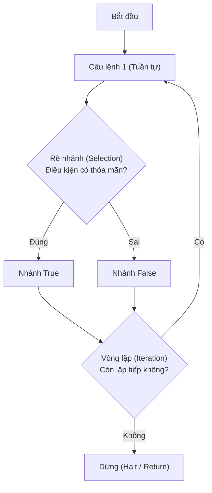

# 8.1 — Nhập Môn Luồng Điều Khiển (Control Flow Introduction)

---

## 🎯 Mục Tiêu Bài Học
- Hiểu khái niệm **Luồng điều khiển (Control Flow)** và điểm thực thi của CPU (Program Counter).
- Nắm vững 6 cơ chế điều khiển luồng trong C++:
  1. Thực thi tuần tự (Sequential Execution)
  2. Rẽ nhánh (Selection / Branching: `if`, `switch`)
  3. Vòng lặp (Iteration / Loops: `while`, `do-while`, `for`)
  4. Nhảy địa chỉ (Jumps: `goto`, `break`, `continue`)
  5. Dừng chương trình (Halts: `std::exit`, `std::abort`)
  6. Xử lý ngoại lệ (Exception Handling: `try`, `catch`, `throw`)

---

## 1. Luồng Điều Khiển (Control Flow) Là Gì?

Khi một chương trình C++ thực thi, CPU sử dụng một thanh ghi đặc biệt gọi là **Bộ đếm chương trình (Program Counter - PC)** để lưu địa chỉ của câu lệnh kế tiếp sẽ được chạy.

Theo mặc định, CPU thực thi các câu lệnh theo thứ tự **Tuần tự (Sequential)** từ trên xuống dưới. Tuy nhiên, để tạo ra phần mềm thông minh, chúng ta cần thay đổi hướng đi của con trỏ lệnh dựa trên dữ liệu người dùng hoặc kết quả tính toán. Cơ chế này được gọi là **Luồng điều khiển (Control Flow)**.

---

## 2. Các Danh Mục Cấu Trúc Điều Khiển

| Danh Mục | Từ Khóa / Cấu Trúc | Mô Tả |
| :--- | :--- | :--- |
| **Rẽ nhánh (Conditional / Branching)** | `if`, `else`, `switch`, `?:` | Chọn 1 trong nhiều nhánh thực thi dựa trên điều kiện |
| **Vòng lặp (Loops / Iteration)** | `while`, `do-while`, `for`, Range-for | Lặp đi lặp lại một khối mã nhiều lần |
| **Nhảy (Jumps)** | `break`, `continue`, `goto`, `return` | Chuyển dịch tức thì điểm thực thi đến vị trí khác |
| **Dừng sớm (Halts)** | `std::exit()`, `std::abort()` | Kết thúc chương trình ngay lập tức tại bất kỳ đâu |
| **Ngoại lệ (Exceptions)** | `try`, `catch`, `throw` | Xử lý các lỗi bất thường phát sinh tại runtime |
