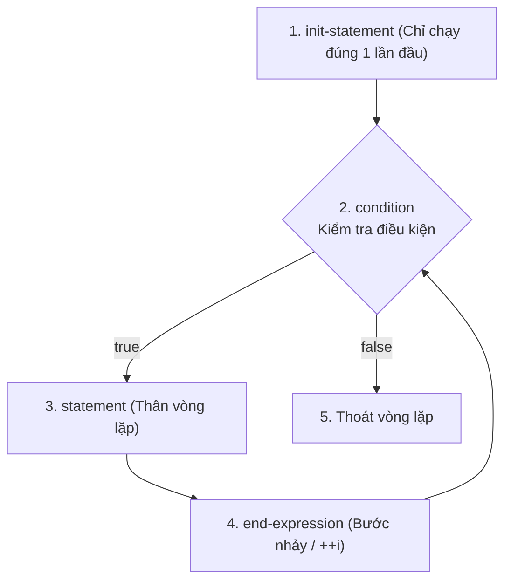

# 8.10 — Câu Lệnh For (For Statements)

---

## 🎯 Mục Tiêu Bài Học
- Nắm vững cấu trúc 3 phần hoàn hảo của vòng lặp `for`: `for (init; condition; end_expression)`.
- Thứ tự thực thi chuẩn xác của từng mệnh đề trong mỗi bước lặp.
- Cạm bẫy tràn số số nguyên không dấu (Unsigned Underflow Trap) khi đếm lùi.

---

## 1. Cấu Trúc Toàn Diện Của Vòng Lặp `for`

```cpp
for (init-statement; condition; end-expression)
    statement;
```



---

## 2. Cạm Bẫy Chết Người: Biến Không Dấu Đếm Lùi (Unsigned Underflow)

::: danger ⚠️ Vòng Lặp Vô Tận Vì Tràn Số Không Dấu!
Xem xét đoạn mã sau:
```cpp
// Cố gắng đếm lùi từ 9 về 0 bằng unsigned int:
for (unsigned int i { 9 }; i >= 0; --i)
{
    std::cout << i << ' ';
}
```
**Điều gì xảy ra khi `i = 0`?**
- Vòng lặp in ra `0`.
- Bước nhảy `--i` chạy: Số nguyên không dấu `0` trừ `1` sẽ bị **quay vòng (underflow)** thành $4,294,967,295$!
- Điều kiện $4,294,967,295 \ge 0$ vẫn là `true`! Vòng lặp chạy vô tận và làm sập chương trình.

**Lời khuyên vàng**: Luôn ưu tiên dùng số nguyên có dấu `int` cho các biến đếm vòng lặp thông thường!
:::
