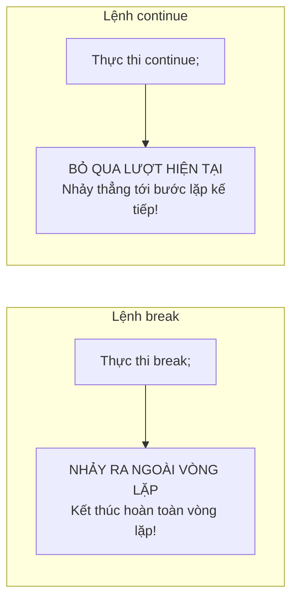

# 8.11 — Lệnh Break và Continue (Break and Continue)

---

## 🎯 Mục Tiêu Bài Học
- Phân biệt rõ sự khác nhau cốt lõi giữa `break` và `continue`.
- Cơ chế của `break`: Thoát ngay lập tức khỏi vòng lặp bao quanh gần nhất.
- Cơ chế của `continue`: Bỏ qua các câu lệnh còn lại trong lượt lặp hiện tại và nhảy tới bước lặp kế tiếp.
- Hành vi khác biệt của `continue` trong vòng lặp `while` vs `for`.

---

## 1. Break vs Continue



### Ví dụ minh họa:
```cpp
#include <iostream>

int main()
{
    for (int i = 1; i <= 10; ++i)
    {
        if (i == 4)
            continue; // Bỏ qua số 4, nhảy sang i = 5
        if (i == 8)
            break;    // Dừng vòng lặp khi gặp số 8

        std::cout << i << ' ';
    }
    // In ra: 1 2 3 5 6 7
    return 0;
}
```

::: warning ⚠️ Cạm Bẫy Continue Trong Vòng Lặp While
Trong vòng lặp `while`, nếu bạn gọi `continue` trước khi cập nhật bước nhảy `++i`, biến đếm sẽ không bao giờ được tăng, dẫn đến **vòng lặp vô tận**!
:::
