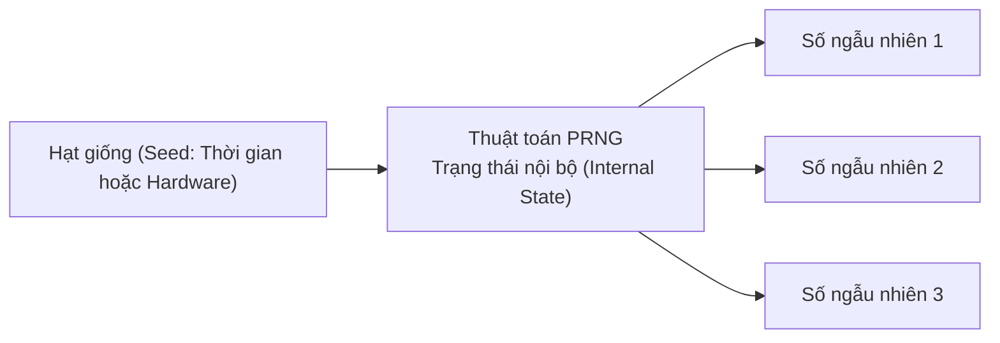

# 8.13 — Nhập Môn Sinh Số Ngẫu Nhiên (Introduction to PRNG)

---

## 🎯 Mục Tiêu Bài Học
- Hiểu nguyên lý hoạt động của **Bộ sinh số giả ngẫu nhiên (Pseudo-Random Number Generator - PRNG)**.
- Phân biệt số ngẫu nhiên thực tế (True Randomness) và số giả ngẫu nhiên xác định (Deterministic PRNG).
- Hiểu khái niệm **Hạt giống (Seed)** và vai trò của nó.
- Vì sao các hàm cổ điển `rand()` và `srand()` từ ngôn ngữ C bị cấm sử dụng trong C++ hiện đại.

---

## 1. Bản Chất Của Bộ Sinh Số Giả Ngẫu Nhiên (PRNG)

Máy tính là thiết bị hoạt động hoàn toàn xác định (deterministic). Nó không thể tự "suy nghĩ" ra một số ngẫu nhiên. Thay vào đó, nó sử dụng một thuật toán toán học nhận vào một giá trị ban đầu gọi là **Hạt giống (Seed)**, sau đó tính toán một chuỗi các số trông có vẻ ngẫu nhiên.

Nếu hai lần chạy chương trình được cấp **cùng một hạt giống (seed)**, chuỗi số ngẫu nhiên sinh ra sẽ **hoàn toàn giống nhau 100%**!
