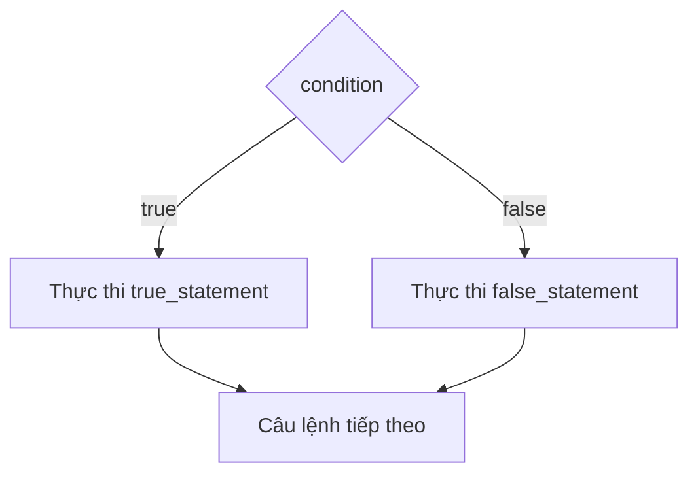

# 8.2 — Câu Lệnh If và Khối Mã (If Statements and Blocks)

---

## 🎯 Mục Tiêu Bài Học
- Nắm vững cú pháp chuẩn của câu lệnh `if`, `else`, và chuỗi `else if`.
- Hiểu cách biểu thức điều kiện được chuyển đổi ngầm định sang kiểu `bool`.
- Tầm quan trọng sống còn của việc luôn sử dụng khối mã `{}`.
- 🚀 Tính năng hiện đại C++17: **`if` với khối khởi tạo (`if with initializer`)**.

---

## 1. Cú Pháp Câu Lệnh `if` và `else`

```cpp
if (condition)
    true_statement;
else
    false_statement;
```

Nếu `condition` trả về `true` (hoặc một số nguyên khác 0), `true_statement` được thực thi. Nếu `condition` trả về `false` (hoặc 0), `false_statement` được thực thi.



---

## 2. 🚀 Tính Năng Đột Phá C++17: If With Initializer

Từ C++17, bạn có thể **khởi tạo một biến trực tiếp bên trong câu lệnh `if`**, trước phần điều kiện:
```cpp
if (init_statement; condition)
{
    // ...
}
```

```cpp
#include <iostream>

int getErrorCode() { return 404; }

int main()
{
    // C++17 if with initializer:
    // Biến err chỉ tồn tại trong phạm vi của khối if và else!
    if (int err { getErrorCode() }; err != 0)
    {
        std::cout << "Phat hien ma loi: " << err << '\n';
    }
    else
    {
        std::cout << "Moi thu hoan hao!\n";
    }

    // std::cout << err; // ❌ Lỗi biên dịch: err đã hết scope! Không làm ô nhiễm scope ngoài!
    return 0;
}
```

::: tip 💡 Thực Hành Tốt Nhất (Best Practice)
Sử dụng `if with initializer` bất cứ khi nào bạn cần tạo một biến tạm thời phục vụ riêng cho việc kiểm tra điều kiện. Nó giúp biến tự động bị tiêu hủy ngay sau khi khối `if-else` kết thúc, giữ cho không gian tên của hàm luôn sạch sẽ.
:::
