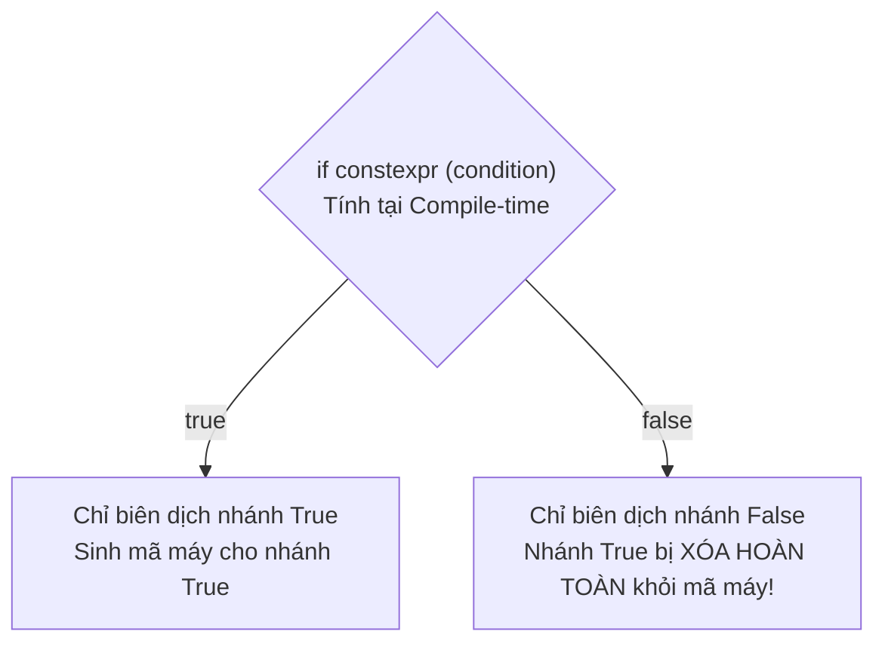

# 8.4 — Câu Lệnh Constexpr If: Rẽ Nhánh Tại Compile-Time (Constexpr If)

---

## 🎯 Mục Tiêu Bài Học
- Hiểu giới hạn của câu lệnh `if` thông thường: Tất cả các nhánh đều phải được biên dịch và sinh mã máy.
- Khám phá tính năng đột phá từ C++17: **`if constexpr`**.
- Cơ chế cắt tỉa nhánh chết tại Compile-time (Dead-code elimination).
- Ứng dụng trong lập trình mẫu (Template Metaprogramming).

---

## 1. Giới Hạn Của Câu Lệnh `if` Thông Thường

Với câu lệnh `if` thông thường, ngay cả khi điều kiện là một hằng số `constexpr` đã biết trước lúc biên dịch, trình biên dịch **vẫn bắt buộc phải kiểm tra cú pháp và biên dịch cả hai nhánh**:

```cpp
template <typename T>
void printValue(T val)
{
    if (std::is_pointer_v<T>)
        std::cout << *val; // 💥 LỖI BIÊN DỊCH khi T là int! Vì không thể dereference một số nguyên int!
    else
        std::cout << val;
}
```

---

## 2. Giải Pháp Tối Thượng C++17: `if constexpr`

Từ C++17, nếu điều kiện là một biểu thức hằng số (Constant expression), bạn có thể dùng **`if constexpr`**:



```cpp
#include <iostream>
#include <type_traits>

template <typename T>
void printValue(T val)
{
    // Rẽ nhánh ngay tại thời điểm biên dịch!
    if constexpr (std::is_pointer_v<T>)
    {
        std::cout << *val << '\n'; // Nhánh này bị vứt bỏ hoàn toàn nếu T không phải con trỏ!
    }
    else
    {
        std::cout << val << '\n';
    }
}

int main()
{
    int a { 42 };
    int* ptr { &a };

    printValue(a);   // Gọi nhánh else: in ra 42 (không bị lỗi biên dịch *val!)
    printValue(ptr); // Gọi nhánh if: in ra 42
    return 0;
}
```
