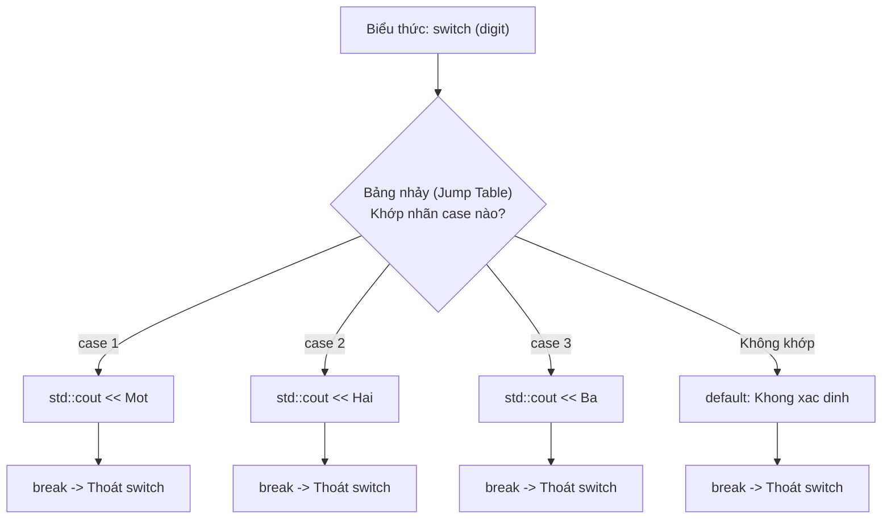

# 8.5 — Căn Bản Về Câu Lệnh Switch (Switch Statement Basics)

---

## 🎯 Mục Tiêu Bài Học
- Hiểu lý do câu lệnh `switch` được ưu tiên hơn chuỗi dài `if-else if-else` khi so sánh một biến với nhiều giá trị nguyên.
- Nắm vững các thành phần: Biểu thức điều kiện, Nhãn `case`, Nhãn `default`, và lệnh `break`.
- Hiểu cơ chế tối ưu hóa **Bảng nhảy (Jump Table)** của trình biên dịch giúp `switch` đạt hiệu năng $O(1)$.

---

## 1. Cấu Trúc Câu Lệnh `switch`

```cpp
#include <iostream>

void printDigitName(int digit)
{
    switch (digit)
    {
    case 1:
        std::cout << "Mot\n";
        break; // Thoát khỏi khối switch
    case 2:
        std::cout << "Hai\n";
        break;
    case 3:
        std::cout << "Ba\n";
        break;
    default: // Chạy khi không khớp với bất kỳ case nào ở trên
        std::cout << "Khong xac dinh\n";
        break;
    }
}
```



---

## 2. Quy Tắc Bắt Buộc Của `switch`

1. **Kiểu dữ liệu**: Biểu thức trong `switch` **bắt buộc phải là kiểu số nguyên (Integral type)** (`int`, `char`, `short`, `long`, `enum`). Bạn **KHÔNG THỂ** dùng `switch` với chuỗi ký tự (`std::string`) hay số thực (`double`, `float`).
2. **Nhãn `case`**: Giá trị sau `case` bắt buộc phải là một **Biểu thức hằng số (Compile-time Constant)**. Không thể dùng biến số sau `case`!
3. **Tính duy nhất**: Các nhãn `case` không được phép trùng lặp giá trị.
