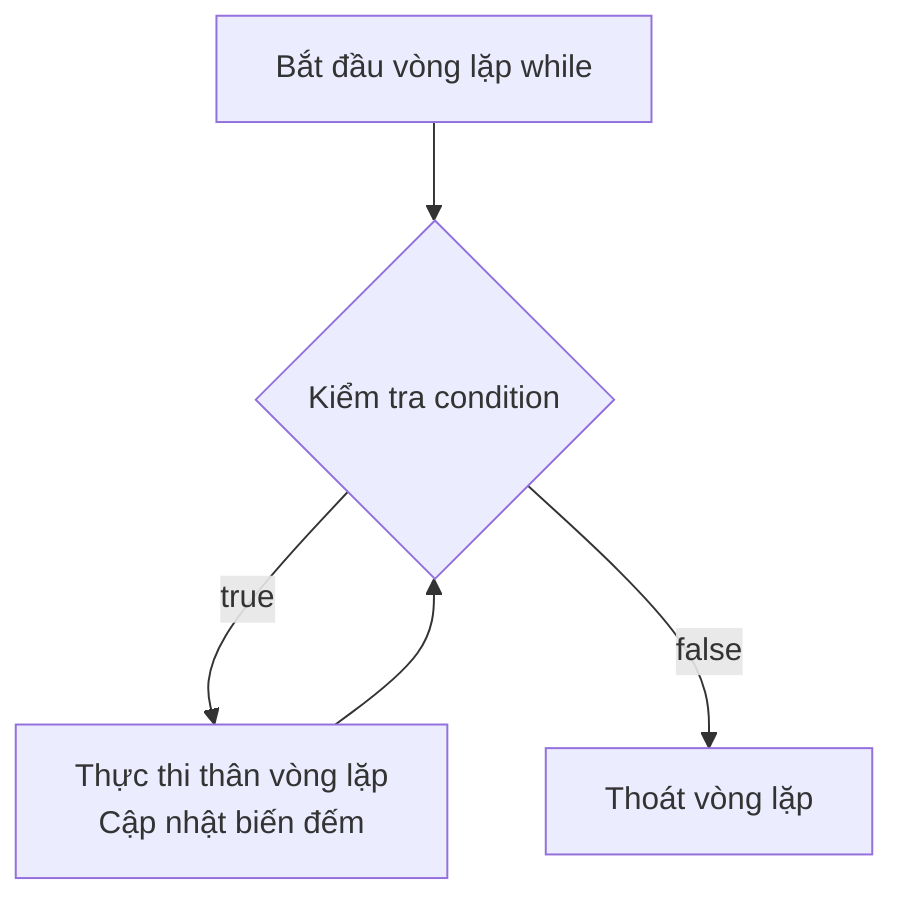

# 8.8 — Nhập Môn Vòng Lặp và Câu Lệnh While (While Statements)

---

## 🎯 Mục Tiêu Bài Học
- Hiểu nguyên lý hoạt động của cấu trúc lặp: Khởi tạo, Điều kiện kiểm tra, Thân vòng lặp, và Cập nhật bước nhảy.
- Câu lệnh `while` (Kiểm tra điều kiện trước - Pre-test loop).
- Tạo và kiểm soát vòng lặp vô tận (`while (true)`).
- Nhận diện lỗi lệch một đơn vị (Off-by-one error - OBOE).

---

## 1. Cấu Trúc Vòng Lặp `while`

```cpp
while (condition)
    statement;
```



```cpp
#include <iostream>

int main()
{
    int count { 1 };
    while (count <= 5)
    {
        std::cout << count << ' ';
        ++count; // Cập nhật biến đếm
    }
    std::cout << "Xong!\n"; // In ra: 1 2 3 4 5 Xong!
    return 0;
}
```

::: warning ⚠️ Cạm Bẫy OBOE (Off-by-One Error)
Lỗi lặp thừa hoặc thiếu đúng 1 lần (ví dụ: dùng `<=` thay vì `<`). Đây là nguồn gốc của 30% lỗi bảo mật tràn bộ đệm trong lịch sử phần mềm!
:::
