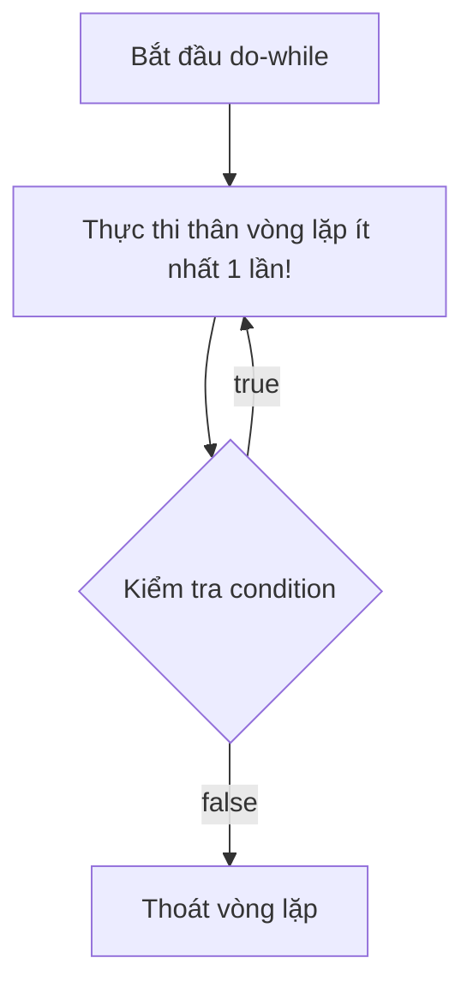

# 8.9 — Câu Lệnh Do-While (Do-While Statements)

---

## 🎯 Mục Tiêu Bài Học
- Phân biệt sự khác nhau cơ bản giữa `while` (kiểm tra trước) và `do-while` (kiểm tra sau).
- Đặc tính quan trọng: Thân vòng lặp `do-while` **luôn luôn được thực thi ít nhất một lần**.
- Ứng dụng thực tế: Hiển thị Menu lựa chọn cho người dùng.

---

## 1. Cú Pháp và Luồng Thực Thi Của `do-while`

```cpp
do
{
    statement;
} while (condition); // Bắt buộc phải có dấu chấm phẩy ; ở cuối!
```



### Ví dụ kinh điển: Hiển thị Menu
```cpp
#include <iostream>

int main()
{
    int choice {};
    do
    {
        std::cout << "=== MENU CHINH ===\n";
        std::cout << "1. Bat dau tro choi\n";
        std::cout << "2. Cai dat\n";
        std::cout << "3. Thoat\n";
        std::cout << "Chon (1-3): ";
        std::cin >> choice;
    } while (choice < 1 || choice > 3); // Lặp lại nếu người dùng nhập sai

    std::cout << "Ban da chon: " << choice << '\n';
    return 0;
}
```
