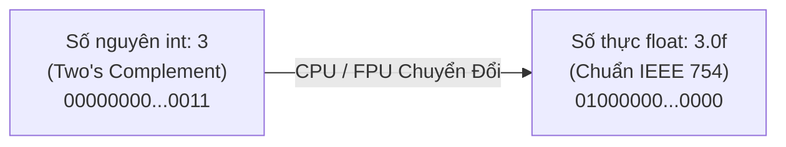
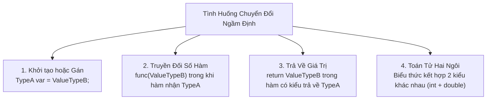

# 10.1 — Chuyển Đổi Kiểu Ngầm Định (Implicit Type Conversion)

---

## 🎯 Mục Tiêu Bài Học
- Hiểu rõ bản chất chuyển đổi kiểu dữ liệu (type conversion) ở cấp độ bit và bộ nhớ phần cứng.
- Phân biệt giữa chuyển đổi ngầm định (implicit type conversion / coercion) và tường minh (explicit cast).
- Nắm vững khái niệm đối tượng tạm thời (temporary object) sinh ra trong quá trình chuyển đổi.
- Tránh các sai lầm phổ biến khi gán dữ liệu giữa các kiểu khác nhau.

---

## 1. Bản Chất Của Dữ Liệu Trong Bộ Nhớ RAM

Trong kiến trúc máy tính, mọi dữ liệu đều chỉ là một chuỗi các bit nhị phân `0` và `1` được lưu trữ trong các ô nhớ RAM. **Kiểu dữ liệu (Data Type)** chính là chiếc "kính giải mã" báo cho trình biên dịch (compiler) và CPU biết phải diễn giải chuỗi bit đó thành giá trị gì.

Hai kiểu dữ liệu khác nhau có thể biểu diễn cùng một giá trị toán học theo những cách hoàn toàn khác nhau:
- Số nguyên `3` kiểu `int` (32-bit two's complement):
  `00000000 00000000 00000000 00000011`
- Số thực `3.0f` kiểu `float` (32-bit chuẩn IEEE 754):
  `01000000 01000000 00000000 00000000` (1 bit dấu, 8 bit mũ, 23 bit phần định trị)



Nếu CPU chỉ đơn thuần copy chuỗi bit của `int 3` sang vùng nhớ `float`, giá trị đọc được sẽ là một con số kỳ dị xấp xỉ `4.2 x 10^-45`, chứ tuyệt đối không phải là `3.0`!

---

## 2. Chuyển Đổi Kiểu Ngầm Định Là Gì?

**Chuyển đổi kiểu ngầm định (Implicit Type Conversion)**, còn được gọi là **ép kiểu tự động (Automatic Type Conversion)** hoặc **Coercion**, xảy ra khi một biểu thức yêu cầu một kiểu dữ liệu nhất định, nhưng bạn lại cung cấp một kiểu dữ liệu khác.

Compiler sẽ tự động chèn các chỉ thị mã máy để biến đổi giá trị đầu vào thành một **đối tượng tạm thời (temporary object)** mang kiểu dữ liệu đích.

```cpp
#include <iostream>

void printDouble(double d)
{
    std::cout << d << '
';
}

int main()
{
    // 1. Khởi tạo biến float bằng giá trị int
    float f{ 3 }; // int 3 được chuyển ngầm định thành float 3.0f

    // 2. Truyền đối số int vào hàm nhận double
    int x{ 10 };
    printDouble(x); // int 10 được chuyển ngầm định thành double 10.0

    // 3. Phép gán khác kiểu
    double pi;
    pi = 3.14159f; // float được chuyển ngầm định thành double

    return 0;
}
```

::: tip Lưu Ý Cốt Lõi
Chuyển đổi kiểu **KHÔNG BAO GIỜ** thay đổi biến gốc! Quá trình chuyển đổi chỉ đọc giá trị của biến gốc, tính toán và tạo ra một giá trị mới mang kiểu đích.
:::

---

## 3. Các Tình Huống Kích Hoạt Chuyển Đổi Ngầm Định

Trình biên dịch sẽ tự động thực hiện chuyển đổi ngầm định trong 4 trường hợp kinh điển:



---

## 4. Phân Loại Chuẩn Chuyển Đổi Trong C++

Theo tiêu chuẩn ISO C++, các chuyển đổi kiểu cơ bản được chia làm 2 cấp bậc:

1. **Thăng cấp số học (Numeric Promotions)**: Chuyển đổi từ kiểu nhỏ hơn lên kiểu lớn hơn một cách tự nhiên (ví dụ `char` lên `int`, `float` lên `double`). Luôn bảo toàn 100% giá trị, không bao giờ mất mát dữ liệu.
2. **Chuyển đổi số học (Numeric Conversions)**: Các chuyển đổi phức tạp hơn (ví dụ `int` sang `double`, `double` sang `int`, `int` sang `bool`). Có thể gây sai số làm tròn hoặc mất mát dữ liệu (narrowing).

---

## ⚠️ Cạm Bẫy Thực Chiến & Undefined Behavior

::: danger Cạm bẫy: Cắt cụt dữ liệu khi chuyển đổi số thực sang số nguyên
Khi chuyển một số thực (`float`/`double`) sang số nguyên (`int`), compiler sẽ **cắt bỏ hoàn toàn phần thập phân** chứ không làm tròn!
```cpp
int x = 3.99; // x nhận giá trị 3, mất trắng 0.99!
```
Nếu giá trị số thực vượt quá phạm vi biểu diễn của kiểu số nguyên đích (ví dụ gán `1e20` vào `int`), hành vi là **Hành vi không xác định (Undefined Behavior - UB)**!
:::

---

## 🚀 Cập Nhật C++20 / C++23: Khởi Tạo Danh Sách Ngăn Chặn Narrowing

Trong C++ hiện đại, hãy luôn sử dụng **Khởi tạo danh sách (Brace Initialization `{}`)** để compiler cảnh báo hoặc báo lỗi ngay khi có chuyển đổi thu hẹp dữ liệu nguy hiểm:

```cpp
int a = 4.5;   // Hợp lệ trong C++ cũ, nhưng a bị cắt thành 4 trong im lặng (nguy hiểm!)
// int b { 4.5 }; // LỖI BIÊN DỊCH (Compile Error): Chặn đứng narrowing conversion!
```

---

## 📝 Bài Tập Tự Luyện & Quiz Củng Cố

### Câu hỏi 1:
Điều gì thực sự xảy ra với biến `n` khi chạy đoạn mã sau?
```cpp
int n{ 5 };
double d = n;
```
A) Vùng nhớ của `n` được nới rộng từ 4 bytes thành 8 bytes trên Stack.  
B) Kiểu dữ liệu của `n` biến thành `double`.  
C) Giá trị của `n` được đọc ra, chuyển đổi thành `double 5.0` tạm thời và gán vào `d`. Biến `n` vẫn là `int 5`.  
D) Gây ra lỗi biên dịch vì không thể gán `int` cho `double`.

::: details [Xem lời giải]
**Đáp án đúng: C**  
Giải thích: Chuyển đổi kiểu không làm thay đổi đối tượng ban đầu. Biến `n` vẫn giữ nguyên kiểu `int`, vùng nhớ không đổi. Compiler đọc giá trị `5` của `n`, sinh ra giá trị tạm thời `5.0` kiểu `double` và nạp vào ô nhớ của biến `d`.
:::
