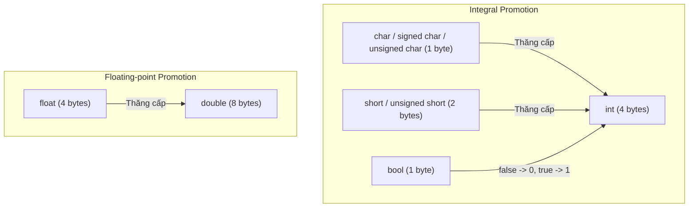

# 10.2 — Thăng Cấp Kiểu Số Thực & Số Nguyên (Promotions)

---

## 🎯 Mục Tiêu Bài Học
- Hiểu rõ cơ chế thăng cấp số nguyên (Integral Promotion) và thăng cấp số thực (Floating-point Promotion).
- Nắm bắt quy tắc thiết kế phần cứng: Tại sao CPU tính toán số nguyên 32-bit nhanh hơn số nguyên 8-bit hoặc 16-bit.
- Phân biệt giữa "Thăng cấp bảo toàn giá trị" (Value-preserving) và "Chuyển đổi số học thông thường".

---

## 1. Thăng Cấp Kiểu (Promotion) Là Gì?

**Thăng cấp kiểu (Type Promotion)** là một dạng chuyển đổi kiểu ngầm định đặc biệt, trong đó một kiểu dữ liệu có kích thước nhỏ hơn được chuyển đổi thành một kiểu dữ liệu lớn hơn mà **tất cả mọi giá trị của kiểu ban đầu đều có thể biểu diễn chính xác 100% trong kiểu mới**.



### Đặc điểm sống còn:
- **Tuyệt đối an toàn**: Không bao giờ xảy ra tràn số (overflow) hay mất mát độ chính xác.
- **Thực hiện ở cấp độ phần cứng**: Được CPU hỗ trợ trực tiếp thông qua các tập lệnh mở rộng dấu (sign-extension) hoặc thêm số 0 (zero-extension).

---

## 2. Thăng Cấp Số Nguyên (Integral Promotion)

Trong C++, các kiểu số nguyên nhỏ hơn `int` gồm: `bool`, `char`, `signed char`, `unsigned char`, `short`, `unsigned short`.

Quy tắc chuẩn:
- Bất kỳ kiểu số nguyên nhỏ nào cũng sẽ được thăng cấp lên `int` nếu kiểu `int` có thể chứa trọn vẹn toàn bộ dải giá trị của kiểu đó.
- Nếu `int` không đủ sức chứa (ví dụ trường hợp hy hữu `unsigned short` có cùng kích thước với `int`), nó sẽ được thăng cấp lên `unsigned int`.

```cpp
#include <iostream>

void printInt(int x)
{
    std::cout << "printInt: " << x << '
';
}

int main()
{
    short s{ 120 };
    printInt(s); // short s được thăng cấp thành int trước khi truyền vào hàm

    char c{ 'A' };
    printInt(c); // char 'A' (mã ASCII 65) được thăng cấp thành int 65

    bool b{ true };
    printInt(b); // bool true được thăng cấp thành int 1

    return 0;
}
```

---

## 3. Tại Sao Phần Cứng Cần Thăng Cấp Số Nguyên?

Nhiều người mới học thường thắc mắc: *"Tại sao CPU không tính toán trực tiếp trên 1 byte `char` hay 2 byte `short` cho tiết kiệm RAM?"*

**Bí mật kiến trúc CPU**:
1. Các thanh ghi (Registers) và ALU (Arithmetic Logic Unit) của CPU hiện đại (x86-64, ARM64) được thiết kế tối ưu hóa cho các từ máy 32-bit hoặc 64-bit.
2. Việc xử lý một giá trị 8-bit hoặc 16-bit đòi hỏi CPU phải thực hiện thêm các thao tác mặt nạ bit (masking) để bảo vệ các bit còn lại trong thanh ghi, dẫn đến **chạy chậm hơn** so với xử lý trực tiếp trên 32-bit!
3. Do đó, C++ quy định tự động thăng cấp các số nguyên nhỏ lên `int` để đạt hiệu năng phần cứng tối thượng.

---

## 4. Thăng Cấp Số Thực (Floating-Point Promotion)

Quy tắc thăng cấp số thực cực kỳ đơn giản:
&gt; Giá trị kiểu `float` có thể được thăng cấp ngầm định thành `double`.

```cpp
void printDouble(double d)
{
    std::cout << d << '
';
}

int main()
{
    float f{ 4.12f };
    printDouble(f); // float được thăng cấp thành double, giá trị giữ nguyên chính xác
    return 0;
}
```

---

## ⚠️ Cạm Bẫy Thực Chiến: Đừng Nhầm Lẫn Với Ép Kiểu Ngược

::: warning Chú ý: Promotion chỉ diễn ra THEO MỘT CHIỀU!
`float` -&gt; `double` là thăng cấp an toàn.  
Nhưng `double` -&gt; `float` KHÔNG PHẢI là thăng cấp, mà là **Chuyển đổi số học (Numeric Conversion)** tiềm ẩn nguy cơ tràn số hoặc mất độ chính xác thập phân.
:::

---

## 📝 Bài Tập Tự Luyện & Quiz Củng Cố

### Câu hỏi 1:
Cho đoạn mã sau, phép toán `a + b` được tính toán với kiểu dữ liệu nào trong CPU?
```cpp
short a{ 10 };
short b{ 20 };
auto c = a + b;
```
A) Kiểu `short`  
B) Kiểu `int`  
C) Kiểu `long`  
D) Báo lỗi biên dịch

::: details [Xem lời giải]
**Đáp án đúng: B**  
Giải thích: Theo quy tắc Integral Promotion, cả hai toán hạng `a` và `b` đều được tự động thăng cấp lên `int` trước khi thực hiện phép cộng `+`. Do đó kết quả biểu thức là một `int` (kiểu của `c` suy luận ra là `int`).
:::
