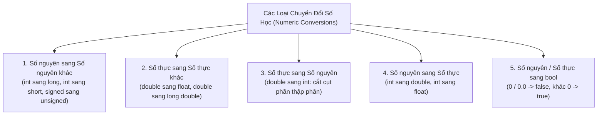

# 10.3 — Chuyển Đổi Số Học (Numeric Conversions)

---

## 🎯 Mục Tiêu Bài Học
- Hiểu toàn diện 5 nhóm chuyển đổi số học (Numeric Conversions) trong tiêu chuẩn ISO C++.
- Nhận diện các rủi ro: Mất mát độ chính xác (Precision loss), Cắt ngắn bit (Truncation), Tràn số (Overflow).
- Nắm vững quy tắc an toàn khi chuyển đổi giữa số nguyên có dấu (signed) và không dấu (unsigned).

---

## 1. Numeric Conversion Là Gì?

Khác với Promotion (luôn an toàn tuyệt đối), **Chuyển đổi số học (Numeric Conversion)** bao gồm bất kỳ chuyển đổi kiểu dữ liệu cơ bản nào nằm ngoài phạm vi thăng cấp.

Nó có thể xảy ra giữa các kiểu có kích thước bằng nhau, hoặc từ kiểu lớn hơn sang kiểu nhỏ hơn, hoặc giữa các hệ thống biểu diễn khác nhau (số nguyên <-> số thực).



---

## 2. Năm Nhóm Chuyển Đổi Số Học Chi Tiết

### Nhóm 1: Chuyển đổi giữa các số nguyên
- **Mở rộng (Widening)**: `short` sang `long` -> Luôn an toàn vì kiểu đích có dải giá trị rộng hơn.
- **Thu hẹp (Narrowing)**: `int` (4 bytes) sang `short` (2 bytes) -> Nếu giá trị vượt quá phạm vi [-32768, 32767], kết quả phụ thuộc vào phần cứng hoặc bị tràn số.

### Nhóm 2: Chuyển đổi giữa các số thực
- `double` sang `float`: `double` có 53 bit định trị (~15-17 chữ số thập phân), trong khi `float` chỉ có 24 bit định trị (~6-9 chữ số thập phân). Phần dư sẽ bị làm tròn.

```cpp
#include <iostream>
#include <iomanip>

int main()
{
    double d{ 0.123456789012345 };
    float f = d; // Chuyển đổi số thực sang float

    std::cout << std::setprecision(15);
    std::cout << "double: " << d << '
';
    std::cout << "float : " << f << '
'; // Bị mất độ chính xác ở các số cuối!
    return 0;
}
```

### Nhóm 3: Số thực sang số nguyên
Phần thập phân bị loại bỏ hoàn toàn (Truncation):
```cpp
int n = 5.89; // n = 5
```

### Nhóm 4: Số nguyên sang số thực
- `int` sang `double`: Thông thường an toàn vì `double` có 53 bit lưu giá trị, đủ sức chứa trọn vẹn số nguyên 32-bit (`int`).
- `int` sang `float`: Nguy hiểm! `int` 32-bit có thể có giá trị tới 2 tỷ, trong khi `float` chỉ có 24 bit biểu diễn chính xác số nguyên (tối đa ~16,777,216). Các số nguyên lớn hơn giá trị này sẽ bị làm tròn sai số khi chuyển sang `float`!

### Nhóm 5: Chuyển sang `bool`
- Giá trị `0` (hoặc `0.0`) được chuyển thành `false`.
- Mọi giá trị khác `0` đều được chuyển thành `true`.

---

## ⚠️ Cạm Bẫy Tử Thần: Signed sang Unsigned

::: danger Hiểm họa an ninh mạng: Tràn số khi gán số âm cho unsigned
Trong C++, việc gán một số nguyên có dấu âm cho một biến không dấu `unsigned` sẽ kích hoạt phép toán modulo $2^N$ (chuẩn ISO):
```cpp
unsigned short u = -5; // u sẽ nhận giá trị 65531!
```
Đây là nguồn gốc của hàng ngàn lỗ hổng bảo mật tràn bộ đệm (Buffer Overflow) trong các hệ điều hành và phần mềm mạng!
:::

---

## 📝 Bài Tập Tự Luyện & Quiz Củng Cố

### Câu hỏi 1:
Kết quả xuất ra màn hình của đoạn code sau là gì?
```cpp
int main()
{
    int i{ 7 };
    bool b = i;
    std::cout << b << '
';
    return 0;
}
```
A) `7`  
B) `true`  
C) `1`  
D) Báo lỗi biên dịch

::: details [Xem lời giải]
**Đáp án đúng: C**  
Giải thích: Chuyển đổi số học sang `bool` biến bất kỳ số khác 0 thành `true`. Khi in `bool` ra `std::cout` mà không dùng cờ `std::boolalpha`, `true` sẽ được in thành số `1`.
:::
