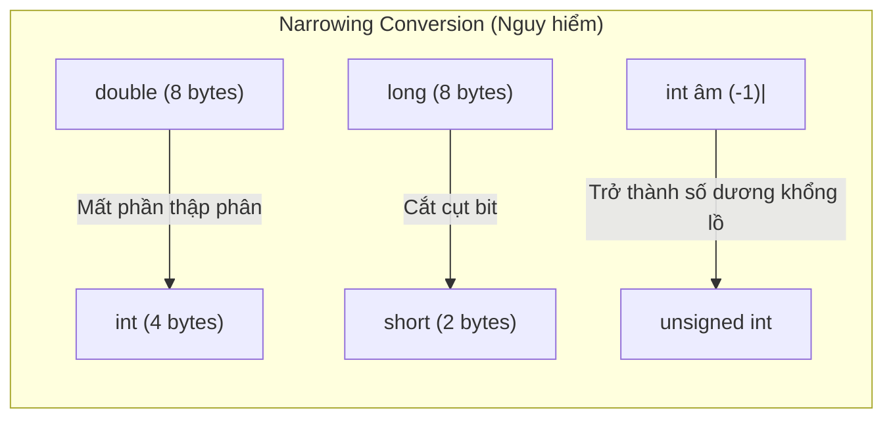

# 10.4 — Chuyển Đổi Thu Hẹp (Narrowing) & List Initialization

---

## 🎯 Mục Tiêu Bài Học
- Định nghĩa chính xác Chuyển đổi thu hẹp (Narrowing Conversion) theo chuẩn C++.
- Hiểu tại sao khởi tạo danh sách `{}` (List / Brace Initialization) lại là vũ khí bảo vệ số 1 của lập trình viên hiện đại.
- Ứng dụng hằng biểu thức `constexpr` để cho phép chuyển đổi an toàn khi giá trị nằm trong phạm vi.

---

## 1. Chuyển Đổi Thu Hẹp (Narrowing Conversion) Là Gì?

Một phép chuyển đổi được gọi là **Chuyển đổi thu hẹp (Narrowing Conversion)** nếu nó có nguy cơ làm mất dữ liệu hoặc thay đổi giá trị trong thời gian chạy (runtime). Cụ thể gồm:

1. Từ số thực chuyển sang số nguyên (ví dụ `double` sang `int`).
2. Từ số thực lớn sang số thực nhỏ hơn (`double` sang `float`), trừ khi giá trị là hằng số và nằm trọn trong dải biểu diễn.
3. Từ số nguyên lớn sang số nguyên nhỏ hơn (`long` sang `short`, `int` sang `char`).
4. Từ số nguyên có dấu sang không dấu hoặc ngược lại.



---

## 2. Khởi Tạo Danh Sách `{}` (Uniform Initialization) Chặn Đứng Narrowing

Trong C++98/03, lập trình viên thường dùng dấu `=` hoặc dấu ngoặc tròn `()`:
```cpp
int a = 5.5;   // C++ cũ: Biên dịch êm ru, nhưng a = 5 (mất dữ liệu!)
int b(5.5);    // C++ cũ: Tương tự, không có cảnh báo
```

Từ C++11 trở đi, **Khởi tạo danh sách `{}`** ra đời với nguyên tắc nghiêm ngặt: **CẤM TUYỆT ĐỐI CHUYỂN ĐỔI THU HẸP!**

```cpp
// int c { 5.5 }; // LỖI BIÊN DỊCH: error: narrowing conversion of '5.5' from 'double' to 'int'
```

Trình biên dịch sẽ lập tức từ chối dịch chương trình nếu phát hiện bạn đang cố nhồi nhét một giá trị lớn vào một vùng nhớ nhỏ hơn mà có thể gây mất mát.

---

## 3. Ngoại Lệ Thông Minh Với Hằng Biểu Thức `constexpr`

Compiler C++ cực kỳ thông minh: Nếu đối số là một hằng biểu thức `constexpr` (giá trị đã biết tại compile-time) và compiler **chứng minh được giá trị đó nằm vừa vặn trong kiểu đích**, thì phép gán `{}` vẫn được chấp nhận!

```cpp
int main()
{
    constexpr int n1{ 100 };
    char c1{ n1 }; // HỢP LỆ! Vì 100 nằm trọn trong dải [-128, 127] của char

    constexpr int n2{ 500 };
    // char c2{ n2 }; // LỖI BIÊN DỊCH! 500 vượt quá giới hạn của char

    return 0;
}
```

---

## 💡 Thực Hành Tốt Nhất (Best Practice)

::: tip Quy Tắc Vàng
Luôn luôn ưu tiên sử dụng **Khởi tạo ngoặc nhọn `{}`** khi khai báo mọi biến trong C++. Nó không chỉ thống nhất cú pháp mà còn loại bỏ hoàn toàn 100% các lỗi logic tiềm ẩn do chuyển đổi thu hẹp vô tình gây ra.
:::

---

## 📝 Bài Tập Tự Luyện & Quiz Củng Cố

### Câu hỏi 1:
Dòng lệnh nào sau đây sẽ gây ra lỗi biên dịch (Compile Error)?
```cpp
int x{ 10 };
char a{ 65 };       // Dòng 1
char b = 300;       // Dòng 2
char c{ 300 };      // Dòng 3
char d{ x };        // Dòng 4
```
A) Chỉ dòng 2  
B) Chỉ dòng 3  
C) Cả dòng 3 và dòng 4  
D) Cả dòng 2, 3 và 4

::: details [Xem lời giải]
**Đáp án đúng: C**  
Giải thích:  
- Dòng 3 lỗi vì `300` vượt quá giới hạn của `char`, khởi tạo `{}` phát hiện ra và chặn đứng.  
- Dòng 4 lỗi vì `x` là biến thông thường (không phải `constexpr`), compiler không thể bảo đảm tại runtime `x` sẽ không chứa giá trị vượt quá giới hạn của `char`, nên khởi tạo `{}` coi đây là narrowing conversion và báo lỗi!  
- Dòng 2 chỉ bị cảnh báo (warning) trong một số compiler chứ không báo lỗi chặn dịch.
:::
