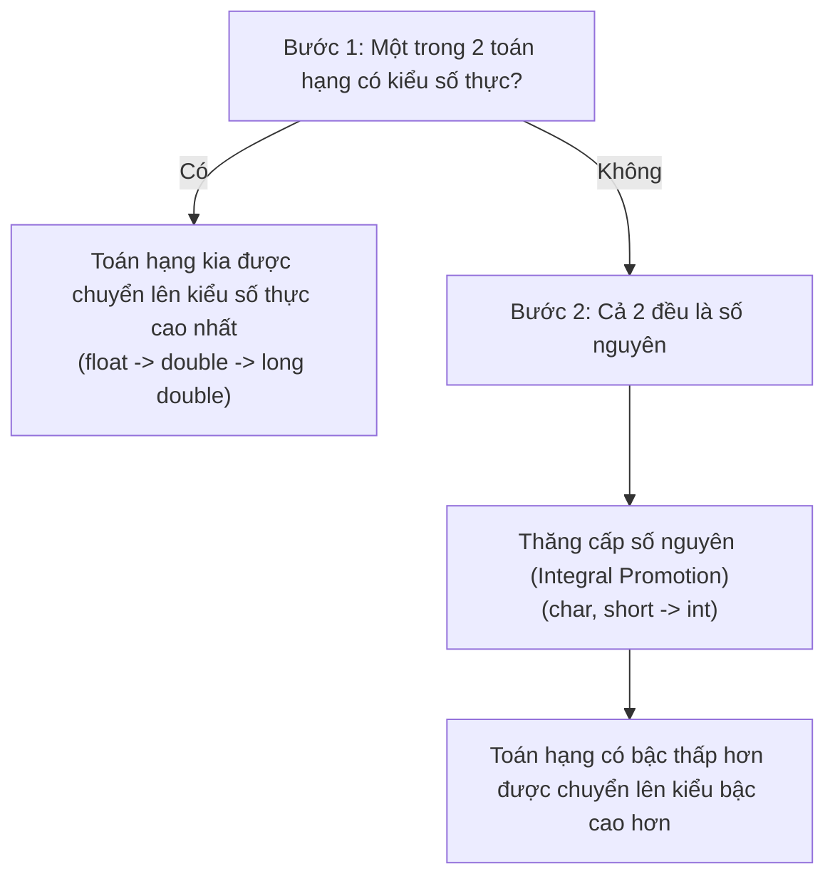

# 10.5 — Chuyển Đổi Số Học Thông Thường (Usual Arithmetic Conversions)

---

## 🎯 Mục Tiêu Bài Học
- Nắm vững quy tắc Chuyển đổi số học thông thường (Usual Arithmetic Conversions) khi thực hiện các phép toán hai ngôi (+, -, *, /).
- Hiểu thứ tự ưu tiên các kiểu dữ liệu từ cao xuống thấp trong biểu thức.
- Nhận diện và phòng tránh thảm họa số học khi kết hợp số có dấu và không dấu.

---

## 1. Tại Sao Phải Cần Quy Tắc Chuyển Đổi Trong Biểu Thức?

Trong C++, một toán tử hai ngôi (như `+`, `-`, `*`, `/`) yêu cầu **cả hai toán hạng phải có cùng kiểu dữ liệu**.

Khi bạn viết:
```cpp
int a{ 5 };
double b{ 2.5 };
auto result = a + b;
```
CPU không thể cộng trực tiếp thanh ghi số nguyên với thanh ghi số thực. Trình biên dịch phải tự động tìm một "mẫu số chung" — một kiểu dữ liệu bao trùm để chuyển đổi một trong hai toán hạng trước khi phát lệnh tính toán.

---

## 2. Bảng Xếp Hạng Độ Ưu Tiên Kiểu Dữ Liệu

Quy tắc chuẩn ISO C++ áp dụng bảng xếp hạng sau (từ cao xuống thấp):

```
1. long double        (Cao nhất)
2. double
3. float
4. unsigned long long
5. long long
6. unsigned long
7. long
8. unsigned int
9. int                (Thấp nhất trong nhóm chuẩn)
```



---

## ⚠️ Cạm Bẫy Kinh Điển: Kết Hợp `signed` Và `unsigned`

Khi biểu thức có sự tham gia của một số `signed int` và một số `unsigned int` có cùng kích thước, **`signed int` sẽ bị ép kiểu ngầm định thành `unsigned int`**!

```cpp
#include <iostream>

int main()
{
    int s{ -5 };
    unsigned int u{ 1 };

    if (s < u)
        std::cout << "-5 nho hon 1 (Dung ly thuyet toan hoc)
";
    else
        std::cout << "-5 LON HON 1 (Thuc te trong C++!)
";

    return 0;
}
```

Khi chạy chương trình, kết quả in ra là:  
`-5 LON HON 1 (Thuc te trong C++!)`

**Tại sao lại vô lý như vậy?**  
Vì `s` (`int -5`) bị chuyển thành `unsigned int`. Biểu diễn nhị phân bù 2 của `-5` khi nhìn dưới lăng kính không dấu trở thành con số khổng lồ `4,294,967,291`! Và `4,294,967,291 > 1`!

---

## 💡 Thực Hành Tốt Nhất (Best Practice)

::: tip Quy Tắc Vàng
1. Tuyệt đối tránh trộn lẫn biến `signed` và `unsigned` trong cùng một phép so sánh hoặc biểu thức số học.
2. Từ C++20, hãy sử dụng hàm `<utility>`: `std::cmp_less(s, u)`, `std::cmp_greater(s, u)` để so sánh số có dấu và không dấu một cách an toàn tuyệt đối.
:::

---

## 📝 Bài Tập Tự Luyện & Quiz Củng Cố

### Câu hỏi 1:
Biểu thức sau có kiểu dữ liệu là gì?
```cpp
short s{ 1 };
float f{ 2.0f };
auto res = s * f;
```
A) `short`  
B) `int`  
C) `float`  
D) `double`

::: details [Xem lời giải]
**Đáp án đúng: C**  
Giải thích:  
1. `s` kiểu `short` đầu tiên được thăng cấp lên `int`.  
2. Trong phép nhân giữa `int` và `float`, kiểu `float` có bậc ưu tiên cao hơn kiểu số nguyên. Do đó `int` được chuyển đổi thành `float`.  
3. Phép nhân được thực hiện giữa hai số `float`, kết quả `res` có kiểu `float`.
:::
