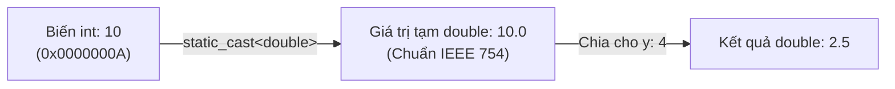

# 10.6 — Ép Kiểu Tường Minh & `static_cast`

---

## 🎯 Mục Tiêu Bài Học
- Phân biệt giữa ép kiểu ngầm định và ép kiểu tường minh (Explicit Type Conversion / Casting).
- Hiểu rõ rủi ro của kiểu ép C-style cũ `(type)value`.
- Sử dụng thành thạo `static_cast` trong C++ hiện đại để chuyển đổi kiểu an toàn tại compile-time.

---

## 1. Tại Sao Phải Cần Ép Kiểu Tường Minh?

Trong nhiều trường hợp, việc chuyển đổi ngầm định của compiler không đem lại kết quả như mong muốn:

```cpp
int x{ 10 };
int y{ 4 };
double d = x / y; // Kết quả là 2.0, không phải 2.5!
```
Vì cả `x` và `y` đều là số nguyên `int`, phép chia số nguyên `10 / 4` cho ra kết quả nguyên `2`. Sau đó số `2` mới được gán cho `double d` thành `2.0`.

Để giải quyết, ta cần **Ép kiểu tường minh (Explicit Casting)**: Yêu cầu compiler chuyển đổi một trong hai toán hạng sang `double` trước khi chia.

---

## 2. Thảm Họa Của C-Style Cast

Trong ngôn ngữ C cổ điển, người ta ép kiểu bằng cú pháp:
```cpp
double d = (double)x / y; // C-style cast
```

::: danger Vì sao C-style cast bị coi là nguy hiểm trong C++?
C-style cast là một "cây búa tạ mù quáng". Nó sẽ cố gắng thực hiện phép ép kiểu bằng bất kỳ giá trị nào:
1. Thử dùng `const_cast` (vứt bỏ tính bất biến của dữ liệu).
2. Thử dùng `static_cast`.
3. Thử dùng `reinterpret_cast` (ép con trỏ bất kỳ thành kiểu khác, bỏ qua ranh giới kiểu).

Compiler sẽ không kiểm tra an toàn, dễ dẫn đến lỗi phá hỏng bộ nhớ RAM (Memory Corruption) cực kỳ khó debug!
:::

---

## 3. `static_cast` — Chuẩn Mực Của C++ Hiện Đại

C++ giới thiệu 4 toán tử ép kiểu chuyên biệt: `static_cast`, `const_cast`, `dynamic_cast`, `reinterpret_cast`.

Trong đó, **`static_cast`** là toán tử phổ biến và quan trọng nhất:
- Kiểm tra tính hợp lệ của phép chuyển đổi ngay tại thời điểm biên dịch (**Compile-time type checking**).
- Nếu phép chuyển đổi là vô lý (ví dụ ép con trỏ chuỗi sang số nguyên), compiler sẽ **từ chối biên dịch ngay lập tức**.

```cpp
#include <iostream>

int main()
{
    int x{ 10 };
    int y{ 4 };

    // Ép kiểu x thành double trước khi thực hiện phép chia
    double result{ static_cast<double>(x) / y };

    std::cout << "Ket qua chinh xac: " << result << '
'; // 2.5

    // In mã ASCII của ký tự
    char ch{ 'a' };
    std::cout << "Ky tu: " << ch << " co ma ASCII la: " << static_cast<int>(ch) << '
';

    return 0;
}
```



---

## 4. Tắt Cảnh Báo Narrowing Bằng `static_cast`

Khi bạn cố tình muốn cắt ngắn dữ liệu (ví dụ làm tròn số thực thành số nguyên) và muốn nói với compiler rằng: *"Tôi biết rõ việc này và hoàn toàn chịu trách nhiệm, đừng cảnh báo nữa"*, hãy dùng `static_cast`:

```cpp
double pi{ 3.14159 };
int intPi = static_cast<int>(pi); // Tắt sạch mọi warning của compiler
```

---

## 📝 Bài Tập Tự Luyện & Quiz Củng Cố

### Bài tập code:
Viết chương trình nhập vào một ký tự bất kỳ từ bàn phím bằng `char`, sau đó sử dụng `static_cast` để in ra mã ASCII của ký tự đó dưới dạng số nguyên `int`.

::: details [Xem lời giải mẫu]
```cpp
#include <iostream>

int main()
{
    std::cout << "Nhap mot ky tu bat ky: ";
    char c{};
    std::cin >> c;

    std::cout << "Ky tu '" << c << "' co ma ASCII la: " << static_cast<int>(c) << '
';

    return 0;
}
```
:::
