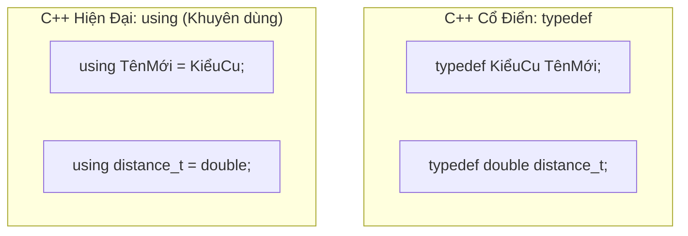

# 10.7 — Bí Danh Kiểu: `typedef` và `using`

---

## 🎯 Mục Tiêu Bài Học
- Hiểu khái niệm Bí danh kiểu (Type Alias): Đặt một tên mới dễ hiểu cho một kiểu dữ liệu có sẵn.
- Phân biệt cú pháp cổ điển `typedef` và cú pháp hiện đại `using` (Type Alias C++11).
- Ứng dụng bí danh kiểu để tăng tính bảo trì, tính độc lập nền tảng phần cứng và rút ngắn tên kiểu phức tạp.

---

## 1. Bí Danh Kiểu (Type Alias) Là Gì?

Trong các dự án phần mềm lớn, một số kiểu dữ liệu có tên rất dài và phức tạp (ví dụ con trỏ hàm, iterator của STL, kiểu mẫu nhiều tầng).

**Bí danh kiểu (Type Alias)** cho phép lập trình viên tạo ra một định danh mới thay thế cho kiểu dữ liệu đã tồn tại.

::: warning Quan trọng: Bí danh KHÔNG tạo ra kiểu dữ liệu mới!
Bí danh kiểu hoàn toàn tương đương với kiểu gốc. Compiler chỉ đơn giản xem nó như một cái tên gọi khác (synonym). Nó không cung cấp cơ chế an toàn kiểu (type safety) bổ sung.
:::

---

## 2. Cú Pháp: `using` (Hiện Đại) vs `typedef` (Cổ Điển)



### Tại sao `using` vượt trội hơn `typedef`?
1. **Cú pháp gán tự nhiên**: `using TênMới = KiểuGốc;` tuân theo tư duy gán biến thông thường (`Tên = Giá trị`), cực kỳ dễ đọc khi làm việc với con trỏ hàm hoặc template.
2. **Hỗ trợ Template**: `using` có thể kết hợp với template để tạo ra **Alias Templates** (sẽ học ở Chương 13), điều mà `typedef` hoàn toàn bất lực!

```cpp
#include <iostream>
#include <cstdint>

// Định nghĩa bí danh kiểu cho khoảng cách và thời gian
using distance_t = double;
using seconds_t  = double;

distance_t calculateDistance(distance_t speed, seconds_t time)
{
    return speed * time;
}

int main()
{
    distance_t mySpeed{ 60.5 };
    seconds_t myTime{ 2.0 };

    distance_t total = calculateDistance(mySpeed, myTime);
    std::cout << "Quang duong: " << total << " km
";

    return 0;
}
```

---

## 3. Các Ứng Dụng Thực Chiến Của Type Alias

1. **Trừu tượng hóa nền tảng (Platform Independence)**: Giúp mã nguồn chạy được trên nhiều hệ điều hành. Ví dụ thư viện `<cstdint>` định nghĩa `int32_t` là bí danh của `int` trên máy 32/64-bit, nhưng là `long` trên các hệ vi điều khiển đặc thù.
2. **Dễ dàng tái cấu trúc (Refactoring)**: Nếu bạn quyết định đổi kiểu dữ liệu điểm số học sinh từ `int` sang `double`, bạn chỉ cần sửa 1 dòng duy nhất tại `using score_t = double;`.
3. **Rút ngắn tên kiểu "siêu dài"**:
   ```cpp
   using StringVector = std::vector<std::string>;
   ```

---

## 💡 Thực Hành Tốt Nhất (Best Practice)

::: tip Quy Tắc Đặt Tên Bí Danh Kiểu
Nên quy ước hậu tố `_t` (như `distance_t`, `status_t`) hoặc viết hoa chữ cái đầu theo phong cách PascalCase (như `Distance`, `PixelCoordinate`) để người đọc dễ dàng phân biệt bí danh kiểu với tên biến thông thường.
:::

---

## 📝 Bài Tập Tự Luyện & Quiz Củng Cố

### Câu hỏi 1:
Cho đoạn mã sau:
```cpp
using Miles = double;
using Kilometers = double;

Miles m{ 10.0 };
Kilometers k{ m }; // Hợp lệ hay lỗi biên dịch?
```
A) Lỗi biên dịch vì không thể gán hai kiểu khác nhau `Miles` và `Kilometers`.  
B) Hợp lệ, vì cả `Miles` và `Kilometers` thực chất chỉ là hai cái tên khác nhau của cùng kiểu `double`.

::: details [Xem lời giải]
**Đáp án đúng: B**  
Giải thích: Type alias không tạo ra kiểu dữ liệu độc lập mới. Compiler đối xử với `Miles` và `Kilometers` hệt như `double`. Do đó phép gán hoàn toàn hợp lệ.
:::
