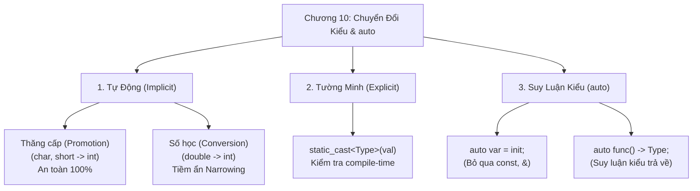

# 10.x — Tổng Kết Chương 10 & Bài Kiểm Tra Toàn Diện

---

## 📚 Tóm Tắt Kiến Thức Cốt Lõi Chương 10

Chương 10 trang bị cho bạn nền tảng sống còn về cách C++ quản lý và chuyển dịch kiểu dữ liệu trong bộ nhớ:

1. **Chuyển đổi kiểu (Type Conversion)**: Quá trình tạo ra một giá trị tạm thời mang kiểu đích từ giá trị nguồn. Không bao giờ thay đổi biến gốc.
2. **Thăng cấp số học (Promotion)**: Chuyển đổi an toàn tuyệt đối từ kiểu nhỏ lên kiểu lớn hơn (`char`/`short` -> `int`, `float` -> `double`).
3. **Chuyển đổi số học (Numeric Conversion)**: Chuyển đổi giữa các kiểu có thể gây mất mát dữ liệu hoặc cắt cụt (Narrowing).
4. **Khởi tạo danh sách `{}`**: Vũ khí bảo vệ chống lại lỗi narrowing conversion ngay tại compile-time.
5. **Chuyển đổi trong biểu thức (Usual Arithmetic Conversions)**: Tự động thăng cấp toán hạng nhỏ lên bậc cao hơn của toán hạng kia. Cảnh giác cao độ khi trộn lẫn `signed` và `unsigned`.
6. **Ép kiểu tường minh (`static_cast`)**: Công cụ ép kiểu chuẩn mực của C++ hiện đại, thay thế hoàn toàn C-style cast nguy hiểm.
7. **Bí danh kiểu (`using`)**: Đặt tên đại diện cho kiểu dữ liệu, giúp code dễ đọc, dễ bảo trì và mở rộng.
8. **Suy luận kiểu (`auto`)**: Compiler tự tìm ra kiểu dữ liệu dựa vào giá trị khởi tạo tại compile-time, 0% chi phí runtime. Lưu ý `auto` loại bỏ `const` và tham chiếu `&`.

---

## 🧠 Sơ Đồ Tư Duy Tổng Thể Chương 10



---

## 📝 Bài Kiểm Tra Đánh Giá Toàn Diện (Quiz)

### Câu hỏi 1:
Trong các phép gán sau, phép gán nào được coi là **Thăng cấp số học (Numeric Promotion)**?
```cpp
int a = 'c';       // (1)
float b = 3.5;     // (2)
double c = 2.0f;   // (3)
short d = 10;      // (4)
```
A) (1) và (2)  
B) (1) và (3)  
C) (2) và (4)  
D) Chỉ (3)

::: details [Xem lời giải]
**Đáp án đúng: B**  
Giải thích:  
- (1) `char` lên `int` là Integral Promotion.  
- (3) `float` lên `double` là Floating-point Promotion.  
- (2) `double 3.5` sang `float` là chuyển đổi thu hẹp (Numeric Conversion).  
- (4) `int 10` sang `short` là Numeric Conversion.
:::

---

### Câu hỏi 2 (Phân tích lỗi thực chiến):
Đoạn code sau có lỗi logic gì nghiêm trọng?
```cpp
#include <iostream>

int main()
{
    unsigned int count{ 10 };
    for (auto i = count; i >= 0; --i)
    {
        std::cout << i << " ";
    }
    return 0;
}
```
A) Lỗi biên dịch vì `auto` không dùng được trong vòng lặp `for`.  
B) Chương trình in từ 10 về 0 rồi dừng bình thường.  
C) **Vòng lặp vô tận (Infinite Loop)**: `i` có kiểu `unsigned int` nên không bao giờ âm được. Khi `i = 0` và trừ tiếp `--i`, nó sẽ tràn số thành `4,294,967,295`, điều kiện `i >= 0` luôn luôn đúng!  
D) Bị crash do segmentation fault.

::: details [Xem lời giải]
**Đáp án đúng: C**  
Giải thích: `auto i = count` suy luận ra `i` là `unsigned int`. Một biến không dấu thì giá trị của nó LUÔN LUÔN $\ge 0$. Do đó điều kiện `i >= 0` trở thành chân lý vĩnh cửu, vòng lặp chạy mãi mãi và làm treo chương trình!
:::

---

### Bài tập thực hành:
Viết một hàm `printBinaryRepresentation` nhận vào một số nguyên `int`, sử dụng `static_cast` và các kiến thức chuyển đổi kiểu để in ra mã ký tự tương ứng nếu số đó nằm trong khoảng mã in được của bảng mã ASCII (từ 32 đến 126). Nếu ngoài khoảng, in thông báo "Khong the in".

::: details [Xem lời giải mẫu]
```cpp
#include <iostream>

void printAsciiChar(int code)
{
    if (code >= 32 && code <= 126)
    {
        char ch = static_cast<char>(code);
        std::cout << "Ma " << code << " tuong ung voi ky tu: '" << ch << "'
";
    }
    else
    {
        std::cout << "Ma " << code << " khong nam trong dải ky tu ASCII in duoc!
";
    }
}

int main()
{
    printAsciiChar(65);  // 'A'
    printAsciiChar(33);  // '!'
    printAsciiChar(200); // Ngoai dai
    return 0;
}
```
:::
