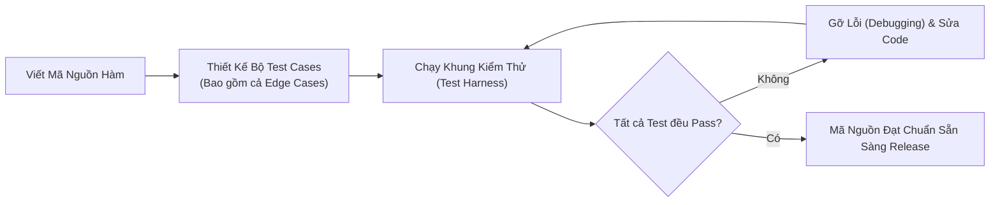

# 9.1 — Nhập Môn Kiểm Thử Mã Nguồn (Introduction to Testing Your Code)

---

## 🎯 Mục Tiêu Bài Học
- Hiểu tầm quan trọng của việc kiểm thử phần mềm (**Software Testing**).
- Phân biệt giữa Kiểm thử thủ công (Manual Testing) và Kiểm thử tự động (Automated Unit Testing).
- Xây dựng một khung kiểm thử đơn vị cơ bản (**Test Harness**) không cần thư viện ngoài.
- Nắm vững khái niệm Ca kiểm thử (Test Cases) và Điều kiện biên (Edge Cases).

---

## 1. Tại Sao Kiểm Thử Là Kỹ Năng Sống Còn?

Một lập trình viên nghiệp dư thường viết code xong, chạy thử 1 trường hợp thuận lợi duy nhất (Happy Path), thấy kết quả đúng và kết luận: "Chương trình đã hoàn thành!".

Tuy nhiên, trong thực tế, phần mềm sẽ đối mặt với:
- Dữ liệu người dùng nhập sai, số âm, số quá lớn gây tràn bộ nhớ.
- Người dùng nhấn hủy bỏ ở giữa chừng.
- Tệp tin không tồn tại, kết nối mạng bị ngắt.

**Kiểm thử phần mềm** là quá trình thực thi chương trình với mục đích chủ động tìm ra lỗi (bugs) trước khi sản phẩm đến tay người dùng cuối.



---

## 2. Tự Xây Dựng Khung Kiểm Thử Đơn Vị (Test Harness)

Giả sử bạn cần viết hàm kiểm tra một số nguyên có phải là số nguyên tố hay không:

```cpp
#include <iostream>

// Hàm cần kiểm thử
bool isPrime(int x)
{
    if (x <= 1)
        return false;

    for (int i = 2; i * i <= x; ++i)
    {
        if (x % i == 0)
            return false;
    }
    return true;
}

// Hàm Test Harness tự động
bool testIsPrime()
{
    bool allPass { true };

    // Kiểm tra các trường hợp biên và số đặc biệt
    if (isPrime(-5) != false) { std::cout << "Test -5 FAILED!\n"; allPass = false; }
    if (isPrime(0)  != false) { std::cout << "Test 0 FAILED!\n";  allPass = false; }
    if (isPrime(1)  != false) { std::cout << "Test 1 FAILED!\n";  allPass = false; }
    if (isPrime(2)  != true)  { std::cout << "Test 2 FAILED!\n";  allPass = false; }
    if (isPrime(3)  != true)  { std::cout << "Test 3 FAILED!\n";  allPass = false; }
    if (isPrime(4)  != false) { std::cout << "Test 4 FAILED!\n";  allPass = false; }
    if (isPrime(97) != true)  { std::cout << "Test 97 FAILED!\n"; allPass = false; }

    return allPass;
}

int main()
{
    if (testIsPrime())
    {
        std::cout << "🎉 Tất cả các bài kiểm tra đều ĐẠT (PASSED)!\n";
    }
    return 0;
}
```
