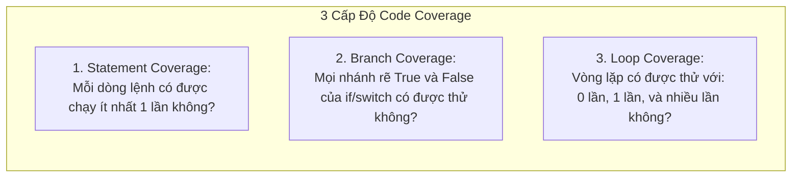

# 9.2 — Độ Bao Phủ Mã Nguồn (Code Coverage)

---

## 🎯 Mục Tiêu Bài Học
- Hiểu khái niệm **Độ bao phủ mã nguồn (Code Coverage)**: Thước đo tỷ lệ phần trăm mã nguồn được thực thi trong quá trình kiểm thử.
- Phân biệt 3 cấp độ bao phủ:
  1. Bao phủ câu lệnh (Statement Coverage)
  2. Bao phủ nhánh (Branch Coverage)
  3. Bao phủ vòng lặp (Loop Coverage - Nguyên tắc 0, 1, 2)
- Nhận thức giới hạn: Độ bao phủ 100% không đồng nghĩa với mã nguồn 100% không có lỗi!

---

## 1. Ba Cấp Độ Bao Phủ Mã Nguồn



### 1.1. Statement Coverage vs Branch Coverage
Xem xét đoạn mã sau:
```cpp
void checkValue(int x)
{
    if (x > 0)
        std::cout << "Duong\n"; // Dòng 1
    std::cout << "Xong\n";      // Dòng 2
}
```
- Nếu chỉ test với `x = 5`: Dòng 1 và Dòng 2 đều chạy -> **Statement Coverage đạt 100%**!
- Tuy nhiên, nhánh ngầm định `x <= 0` (khi điều kiện if sai) chưa hề được kiểm tra -> **Branch Coverage chỉ đạt 50%**!

### 1.2. Loop Coverage: Nguyên Tắc 0, 1, 2
Mọi vòng lặp phải được kiểm tra ở 3 trạng thái biên:
1. **0 lần lặp**: Điều kiện sai ngay từ đầu (ví dụ: mảng rỗng).
2. **1 lần lặp**: Vòng lặp chạy đúng 1 phần tử.
3. **2 hoặc nhiều lần lặp**: Vòng lặp chạy bình thường.
