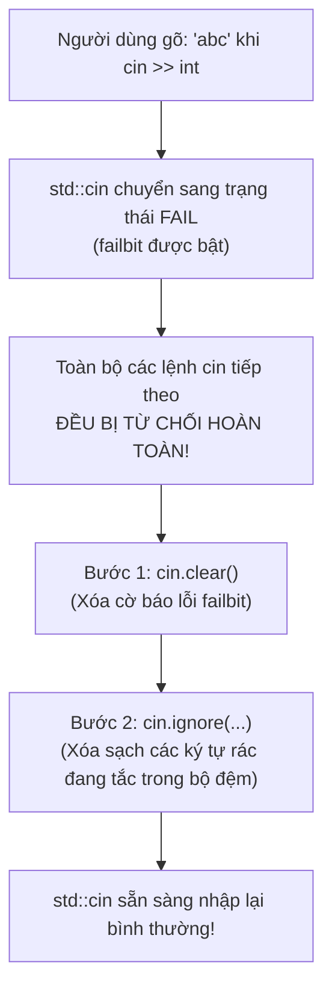

# 9.5 — std::cin và Xử Lý Dữ Liệu Nhập Không Hợp Lệ (Handling Invalid Input)

---

## 🎯 Mục Tiêu Bài Học
- Hiểu cơ chế hoạt động của bộ đệm dòng nhập (**Input Stream Buffer**) của `std::cin`.
- Nhận diện 4 loại lỗi khi nhập liệu:
  1. Trích xuất thất bại (Extraction failure - nhập chữ khi đòi hỏi số).
  2. Ký tự thừa trong bộ đệm (Extraneous input - nhập `5a`).
  3. Tràn số khi nhập (Numeric overflow).
  4. Trôi lệnh nhập chuỗi sau khi nhập số.
- Viết hàm nhập liệu an toàn tuyệt đối với `cin.clear()` và `cin.ignore()`.

---

## 1. Cơ Chế Xử Lý Lỗi Của `std::cin`



---

## 2. Hàm Nhập Số Nguyên An Toàn Tuyệt Đối (Robust Input)

Dưới đây là khuôn mẫu hàm nhập số chuẩn mực được sử dụng trong các hệ thống phần mềm C++ thực tế:

```cpp
#include <iostream>
#include <limits>

int getInt()
{
    while (true)
    {
        std::cout << "Nhap mot so nguyen: ";
        int x {};
        std::cin >> x;

        // 1. Kiểm tra trích xuất thất bại (nhập chữ hoặc số quá lớn gây tràn)
        if (std::cin.fail())
        {
            std::cin.clear(); // Xóa trạng thái lỗi
            // Xóa toàn bộ ký tự rác trong buffer cho đến khi gặp dấu xuống dòng '\n'
            std::cin.ignore(std::numeric_limits<std::streamsize>::max(), '\n');
            std::cout << "Du lieu khong hop le! Vui long nhap lai.\n";
            continue;
        }

        // 2. Xóa các ký tự thừa phía sau nếu có (ví dụ nhập '5abcd')
        std::cin.ignore(std::numeric_limits<std::streamsize>::max(), '\n');
        return x;
    }
}

int main()
{
    int age = getInt();
    std::cout << "Tuoi cua ban la: " << age << '\n';
    return 0;
}
```
