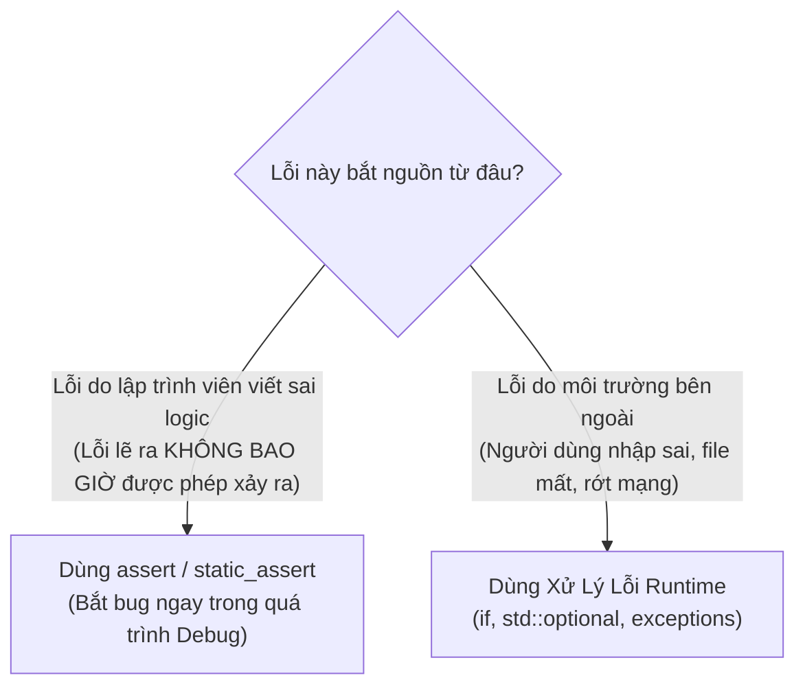

# 9.6 — Khẳng Định Tính Đúng Đắn: assert và static_assert

---

## 🎯 Mục Tiêu Bài Học
- Hiểu khái niệm **Tiền điều kiện (Preconditions)** và **Bất biến (Invariants)** trong phần mềm.
- Sử dụng macro `assert()` trong `<cassert>` cho việc kiểm tra tại Runtime.
- Cơ chế vô hiệu hóa `assert` trong bản Release bằng `#define NDEBUG`.
- 🚀 Khẳng định tại Compile-time với **`static_assert`**.
- Phân biệt rõ ràng: Khi nào dùng `assert` và khi nào dùng Xử lý lỗi thông thường.

---

## 1. Runtime Assertion: Macro `assert()`

Macro `assert(condition)` kiểm tra một điều kiện tại runtime. Nếu `condition` là `false`, chương trình sẽ lập tức in thông báo lỗi kèm tên file, số dòng và **dừng chương trình ngay lập tức qua `std::abort()`**:

```cpp
#include <iostream>
#include <cassert> // Cần include header này

double calculateSpeed(double distance, double time)
{
    // Tiền điều kiện: Thời gian phải lớn hơn 0
    assert(time > 0.0 && "Thoi gian phai lon hon 0!");
    return distance / time;
}

int main()
{
    std::cout << calculateSpeed(100.0, 10.0) << '\n'; // OK
    std::cout << calculateSpeed(100.0, 0.0) << '\n';  // 💥 Dừng chương trình ngay!
    return 0;
}
```

::: warning ⚠️ Cạm Bẫy Chết Người Với Side Effects Trong Assert
Trong bản phát hành thương mại (Release), chúng ta tắt assert để tối ưu hiệu năng bằng cách định nghĩa cờ `NDEBUG`. Khi có `NDEBUG`, toàn bộ mã bên trong `assert` **BỊ XÓA BỎ HOÀN TOÀN**!
```cpp
assert(++x > 5); // 💥 LỖI THẢM HỌA: Trong bản Release, ++x SẼ KHÔNG ĐƯỢC CHẠY!
```
:::

---

## 2. Compile-Time Assertion: `static_assert`

`static_assert` là từ khóa tích hợp của C++, kiểm tra điều kiện ngay tại thời điểm biên dịch. Nếu điều kiện sai, **chương trình không thể biên dịch thành công**:

```cpp
#include <cstdint>

// Kiểm tra kiến trúc hệ thống bắt buộc phải là 64-bit pointer
static_assert(sizeof(void*) == 8, "Chuong trinh nay chi ho tro kien truc 64-bit!");

// C++17: Không bắt buộc phải có chuỗi thông báo
static_assert(sizeof(int) >= 4);
```

---

## 3. Khi Nào Dùng Assert vs Khi Nào Dùng Xử Lý Lỗi?


