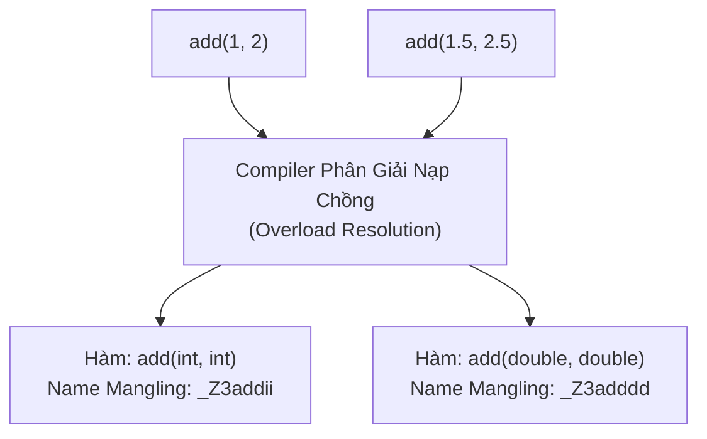

# 11.1 — Nhập Môn Nạp Chồng Hàm (Function Overloading)

---

## 🎯 Mục Tiêu Bài Học
- Hiểu rõ khái niệm Nạp chồng hàm (Function Overloading): Khả năng định nghĩa nhiều hàm cùng tên nhưng khác tham số.
- Phân biệt giữa Tên hàm (Function Name) và Chữ ký hàm (Function Signature).
- Khám phá cơ chế "Name Mangling" của Compiler để phân giải lời gọi hàm trong mã nhị phân.

---

## 1. Nạp Chồng Hàm Là Gì? Vì Sao Cần Phải Có?

Trong các ngôn ngữ lập trình cũ như C, tên của mỗi hàm trong toàn bộ chương trình bắt buộc phải là duy nhất. Nếu bạn muốn viết một hàm cộng hai số nguyên và một hàm cộng hai số thực, bạn buộc phải đặt tên khác nhau:
```c
int add_int(int a, int b);
double add_double(double a, double b);
```
Điều này khiến mã nguồn trở nên cồng kềnh, khó nhớ và phi tự nhiên.

**Nạp chồng hàm (Function Overloading)** là tính năng của C++ cho phép bạn tạo ra **nhiều hàm có cùng một tên gọi**, miễn là mỗi hàm có **danh sách tham số khác nhau**.

```cpp
#include <iostream>

int add(int x, int y)
{
    return x + y;
}

double add(double x, double y)
{
    return x + y;
}

int main()
{
    std::cout << add(1, 2) << '
';     // Gọi add(int, int) -> in ra 3
    std::cout << add(1.5, 2.5) << '
'; // Gọi add(double, double) -> in ra 4.0
    return 0;
}
```



---

## 2. Bí Mật Đằng Sau: Name Mangling (Biến Đổi Tên) Của Compiler

Ở cấp độ mã máy (Assembly / Binary), CPU không hề biết đến khái niệm "overloading". Mỗi hàm trong bảng ký hiệu (Symbol Table) bắt buộc phải có một địa chỉ độc nhất.

Để làm được điều này, trình biên dịch C++ áp dụng kỹ thuật **Name Mangling**: Nó tự động ghép tên hàm với kiểu của các tham số để tạo ra một tên duy nhất trong tệp `.obj`:
- `add(int, int)` được mã hóa thành: `_Z3addii`
- `add(double, double)` được mã hóa thành: `_Z3adddd`

Nhờ đó, Linker có thể liên kết chính xác lời gọi hàm tới đúng đoạn mã máy tương ứng.

---

## 💡 Thực Hành Tốt Nhất (Best Practice)

::: tip Khi nào nên nạp chồng hàm?
Chỉ nên nạp chồng hàm khi các hàm thực hiện **cùng một hành động logic** trên các kiểu dữ liệu khác nhau. Tuyệt đối không nạp chồng các hàm có cùng tên nhưng thực hiện hai hành vi hoàn toàn khác biệt (ví dụ `openFile` và `openWindow`).
:::

---

## 📝 Bài Tập Tự Luyện & Quiz Củng Cố

### Câu hỏi 1:
Điều kiện nào sau đây là BẮT BUỘC để hai hàm cùng tên có thể nạp chồng thành công?
A) Hai hàm phải có kiểu trả về khác nhau.  
B) Hai hàm phải có danh sách tham số khác nhau (về số lượng hoặc kiểu dữ liệu).  
C) Hai hàm phải nằm ở hai tệp `.cpp` khác nhau.  
D) Hai hàm phải có từ khóa `inline`.

::: details [Xem lời giải]
**Đáp án đúng: B**  
Giải thích: Tiêu chuẩn C++ quy định nạp chồng hàm được phân biệt duy nhất dựa trên danh sách tham số (số lượng, kiểu dữ liệu, thứ tự kiểu). Kiểu trả về không được dùng để phân biệt overload.
:::
