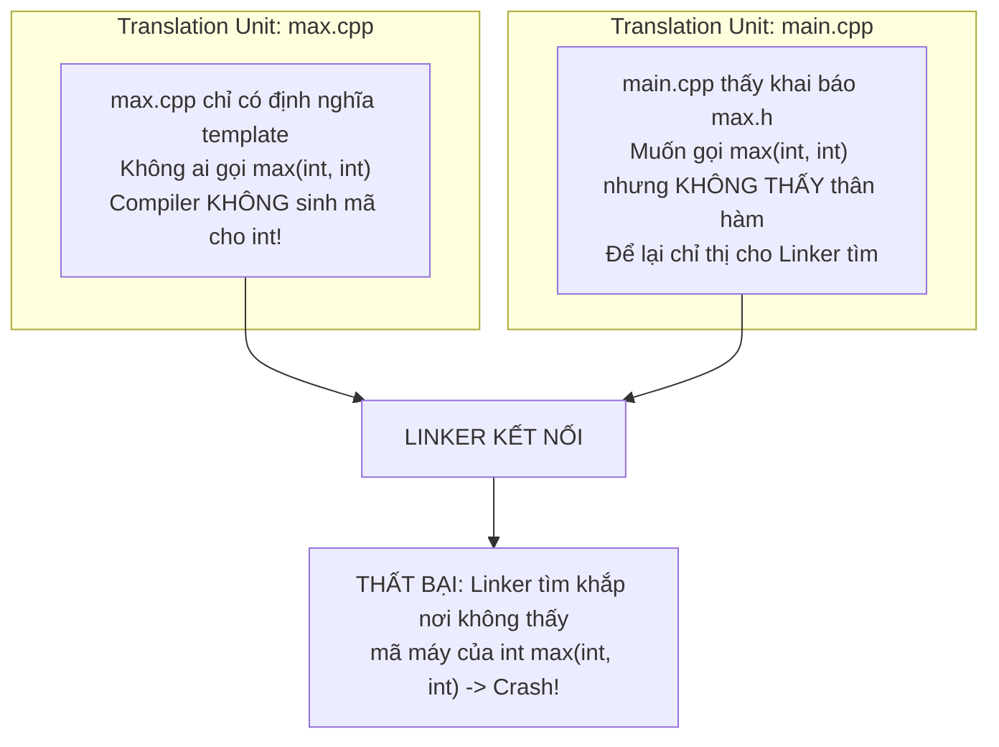

# 11.10 — Tổ Chức Mẫu Hàm Trong Dự Án Nhiều Tệp

---

## 🎯 Mục Tiêu Bài Học
- Hiểu tại sao việc tách khai báo template ra `.h` và định nghĩa vào `.cpp` thông thường sẽ gây ra **Lỗi Liên Kết (Linker Error)**.
- Nắm vững Nguyên lý Một Định Nghĩa (One-Definition Rule - ODR) dành cho Template.
- Áp dụng phương pháp chuẩn mực: **Định nghĩa trọn vẹn Template bên trong tệp tiêu đề (Header file)**.

---

## 1. Cạm Bẫy Kinh Điển Khi Tách Template Thành File `.cpp`

Với các hàm thông thường, quy tắc vàng là:
- Khai báo nguyên mẫu trong file `.h`.
- Định nghĩa chi tiết phần thân hàm trong file `.cpp`.

Hãy thử làm điều tương tự với Template và xem thảm họa xảy ra:

::: code-group
```cpp [max.h]
#ifndef MAX_H
#define MAX_H

template <typename T>
T max(T x, T y); // Chỉ khai báo

#endif
```

```cpp [max.cpp]
#include "max.h"

template <typename T>
T max(T x, U y) // Định nghĩa thân hàm
{
    return (x > y) ? x : y;
}
```

```cpp [main.cpp]
#include "max.h"
#include <iostream>

int main()
{
    std::cout << max(3, 7) << '
';
    return 0;
}
```
:::

Khi bạn biên dịch dự án này:
```text
Linker Error: undefined reference to `int max<int>(int, int)'
```

---

## 2. Vì Sao Linker Bị Lỗi? Mổ Xẻ Quá Trình Biên Dịch



Trình biên dịch xử lý từng file `.cpp` (Translation Unit) một cách hoàn toàn độc lập:
1. Khi dịch `main.cpp`, compiler thấy lời gọi `max(3, 7)` cần sinh mã cho `int`. Nhưng trong `max.h` chỉ có khai báo, compiler không có thân hàm nên đành nhờ Linker tìm sau.
2. Khi dịch `max.cpp`, compiler thấy định nghĩa template nhưng trong file đó không có ai gọi `max`, nên compiler **không hề sinh ra bất kỳ dòng mã máy nào**!
3. Đến giai đoạn Linker ráp nối: Linker tìm mã máy của `max<int>` nhưng không tìm thấy ở đâu -&gt; Báo lỗi `undefined reference`!

---

## 3. Giải Pháp Chuẩn Mực: Định Nghĩa Template Trong File Header

Để template hoạt động trơn tru trong toàn dự án:
&gt; **Bắt buộc phải đặt TOÀN BỘ định nghĩa của template vào bên trong file Header (`.h` hoặc `.hpp`)!**

```cpp
// max.h
#ifndef MAX_H
#define MAX_H

template <typename T>
T max(T x, T y)
{
    return (x > y) ? x : y;
}

#endif
```

Bất kỳ file `.cpp` nào `#include "max.h"` đều sẽ có trong tay cả bản thiết kế và phần thân hàm, cho phép compiler tự do hiện thực hóa (instantiate) bất cứ kiểu dữ liệu nào ngay tại file đó mà không phụ thuộc vào Linker!

---

## 💡 Không Sợ Vi Phạm One-Definition Rule (ODR)
Hàm template được định nghĩa trong header được tiêu chuẩn C++ coi là ngầm định `inline`. Khi nhiều file `.cpp` cùng sinh ra mã cho `max<int>`, Linker sẽ tự động loại bỏ các bản sao trùng lặp và chỉ giữ lại 1 bản duy nhất.

---

## 📝 Bài Tập Tự Luyện & Quiz Củng Cố

### Câu hỏi 1:
Cách tổ chức mã nguồn chuẩn nhất cho một mẫu hàm được sử dụng ở nhiều tệp `.cpp` là gì?
A) Khai báo trong `.h`, định nghĩa trong `.cpp`.  
B) Định nghĩa trọn vẹn cả khai báo và phần thân hàm trong file `.h`.  
C) Viết hàm trong `main.cpp` rồi dùng `extern` ở các file khác.  
D) Chỉ dùng template trong 1 file duy nhất.

::: details [Xem lời giải]
**Đáp án đúng: B**  
Giải thích: Vì compiler cần nhìn thấy toàn bộ phần thân của template để sinh mã tại thời điểm biên dịch của từng đơn vị dịch (Translation Unit), nên toàn bộ định nghĩa template phải nằm trong file header.
:::
