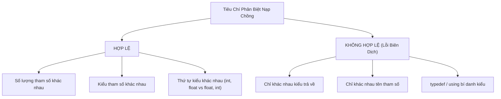

# 11.2 — Tiêu Chí Phân Biệt Các Hàm Nạp Chồng

---

## 🎯 Mục Tiêu Bài Học
- Nắm vững các tiêu chí phân biệt nạp chồng hợp lệ: Số lượng tham số, Kiểu dữ liệu tham số.
- Hiểu tại sao **Kiểu trả về (Return Type) KHÔNG ĐƯỢC dùng để phân biệt overload**.
- Phân biệt giữa tham số giá trị và tham số tham chiếu, tham số `const`.

---

## 1. Các Yếu Tố Hợp Lệ Để Phân Biệt Overload

Trình biên dịch căn cứ vào **Chữ ký hàm (Function Signature)** để phân biệt các hàm nạp chồng:

| Yếu tố | Có phân biệt được Overload không? | Ví dụ minh họa |
| :--- | :---: | :--- |
| **Số lượng tham số** | **CÓ** | `void print(int);`<br>`void print(int, int);` |
| **Kiểu dữ liệu tham số** | **CÓ** | `void print(int);`<br>`void print(double);` |
| **Thứ tự các kiểu tham số** | **CÓ** | `void print(int, double);`<br>`void print(double, int);` |
| **Tham chiếu vs Giá trị** | **LƯU Ý** | Xem phân tích chi tiết bên dưới |
| **Kiểu trả về (Return Type)** | ❌ **KHÔNG** | `int getValue();`<br>`double getValue();` -> **LỖI!** |



---

## 2. Vì Sao Kiểu Trả Về Không Thể Phân Biệt Nạp Chồng?

Hãy xem xét ví dụ sau:
```cpp
int getRandom();
double getRandom();
```
Khi người dùng gọi:
```cpp
getRandom(); // Gọi hàm nhưng vứt bỏ giá trị trả về!
```
Tại dòng lệnh này, compiler hoàn toàn không có bất kỳ manh mối nào để biết bạn muốn gọi phiên bản `int` hay `double`! Do đó, C++ cấm phân biệt nạp chồng chỉ dựa trên kiểu trả về.

---

## 3. Cạm Bẫy: Bí Danh Kiểu `typedef` / `using` Không Tạo Ra Overload!

```cpp
using Miles = double;
using Speed = double;

void setSpeed(Miles m);
void setSpeed(Speed s); // LỖI BIÊN DỊCH: Trùng định nghĩa hàm!
```
Vì `Miles` và `Speed` chỉ là bí danh của `double`, hai hàm trên đối với compiler hoàn toàn giống hệt nhau là `setSpeed(double)`.

---

## 4. Cạm Bẫy: Phân Biệt Giữa Giá Trị (Value) Và Tham Chiếu (Reference)

```cpp
void foo(int x);
void foo(int& x);

int main()
{
    int a{ 5 };
    // foo(a); // LỖI BIÊN DỊCH: Ambiguous call!
    return 0;
}
```
Mặc dù hai hàm có chữ ký khác nhau, nhưng khi gọi `foo(a)`, compiler không biết bạn muốn truyền `a` theo giá trị hay theo tham chiếu -> Gây ra lỗi gọi hàm mơ hồ!

---

## 📝 Bài Tập Tự Luyện & Quiz Củng Cố

### Câu hỏi 1:
Cặp khai báo hàm nào sau đây sẽ gây ra LỖI BIÊN DỊCH do không thể phân biệt nạp chồng?
A) `void print(int x);` và `void print(double x);`  
B) `int calculate(int x);` và `double calculate(int x);`  
C) `void draw(int x, int y);` và `void draw(int x);`  
D) `void log(int x, double y);` và `void log(double x, int y);`

::: details [Xem lời giải]
**Đáp án đúng: B**  
Giải thích: Hai hàm trong phương án B có danh sách tham số giống hệt nhau `(int x)` và chỉ khác nhau kiểu trả về (`int` vs `double`). Đây là điều cấm trong C++.
:::
