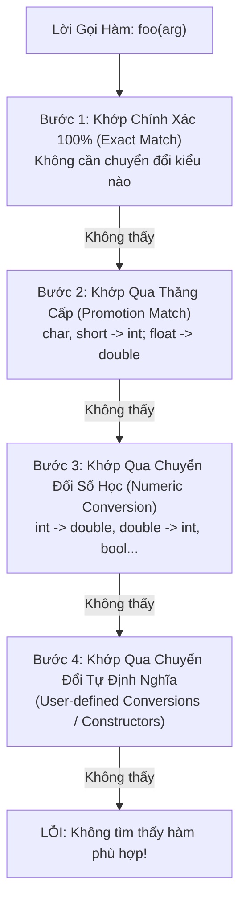

# 11.3 — Phân Giải Nạp Chồng & Khớp Mơ Hồ (Ambiguous Matches)

---

## 🎯 Mục Tiêu Bài Học
- Hiểu tường tận quy trình 4 bước Phân giải nạp chồng (Overload Resolution) của Compiler.
- Nhận diện lỗi Khớp mơ hồ (Ambiguous Match) — một trong những lỗi đau đầu nhất của C++.
- Biết cách sử dụng `static_cast` hoặc hậu tố literal (`1.0f`, `1ULL`) để giải quyết mơ hồ.

---

## 1. Quy Trình 4 Bước Phân Giải Nạp Chồng Của Compiler

Khi gặp một lời gọi hàm nạp chồng, compiler sẽ duyệt qua danh sách các ứng viên theo 4 cấp bậc ưu tiên từ cao xuống thấp:



### Kết quả có thể xảy ra:
1. **Tìm thấy đúng 1 hàm duy nhất**: Thành công! Hàm đó được chọn để gọi.
2. **Không tìm thấy hàm nào**: Lỗi biên dịch `no matching function for call`.
3. **Tìm thấy từ 2 hàm trở lên ở CÙNG MỘT CẤP ĐỘ ƯU TIÊN**: **Lỗi Khớp Mơ Hồ (Ambiguous Match)**!

---

## 2. Hiện Tượng Khớp Mơ Hồ (Ambiguous Match)

Khớp mơ hồ xảy ra khi compiler tìm thấy nhiều hơn một hàm có thể chấp nhận đối số truyền vào, nhưng không có hàm nào vượt trội hơn hẳn theo thứ bậc ưu tiên.

```cpp
#include <iostream>

void print(int x)
{
    std::cout << "int: " << x << '
';
}

void print(double x)
{
    std::cout << "double: " << x << '
';
}

int main()
{
    // print(5L); // Lỗi biên dịch: error: call of overloaded 'print(long int)' is ambiguous
    return 0;
}
```

**Tại sao lại mơ hồ?**  
`5L` có kiểu `long`. Cả chuyển đổi từ `long` sang `int` và từ `long` sang `double` đều thuộc **Bước 3 (Numeric Conversion)**. Cả hai đều có mức độ ưu tiên ngang nhau, compiler không dám tự ý đoán ý muốn của bạn, nên dừng lại và báo lỗi!

---

## 3. Cách Khắc Phục Lỗi Mơ Hồ

Có 3 giải pháp kinh điển:

```cpp
int main()
{
    // Cách 1: Sử dụng static_cast tường minh
    print(static_cast<int>(5L)); // Gọi chính xác print(int)

    // Cách 2: Dùng hậu tố Literal chính xác
    print(5);    // int literal -> gọi print(int)
    print(5.0);  // double literal -> gọi print(double)

    // Cách 3: Định nghĩa thêm một hàm overload cho chính kiểu đó
    // void print(long x);
    return 0;
}
```

---

## 📝 Bài Tập Tự Luyện & Quiz Củng Cố

### Câu hỏi 1:
Cho các hàm sau:
```cpp
void foo(short x);
void foo(double x);
```
Lời gọi `foo(5);` (với số 5 là int) sẽ kích hoạt hàm nào?
A) `foo(short)`  
B) `foo(double)`  
C) Báo lỗi biên dịch vì Ambiguous Match.  
D) Không hàm nào được gọi.

::: details [Xem lời giải]
**Đáp án đúng: C**  
Giải thích: `5` có kiểu `int`. Chuyển `int` sang `short` và `int` sang `double` đều là chuyển đổi số học (Bước 3). Vì hai hàm này ở cùng một cấp độ ưu tiên, compiler không thể thiên vị bên nào nên báo lỗi Khớp mơ hồ!
:::
