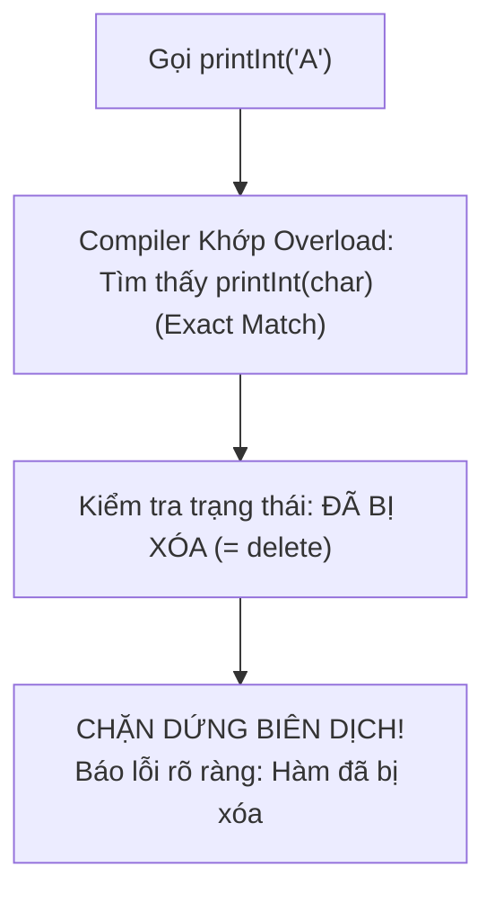

# 11.4 — Xóa Hàm Bằng `= delete`

---

## 🎯 Mục Tiêu Bài Học
- Hiểu cơ chế xóa hàm bằng cú pháp `= delete` (C++11).
- Ứng dụng `= delete` để ngăn chặn compiler tự động chuyển đổi ngầm định không mong muốn.
- So sánh `= delete` với giải pháp khai báo `private` thời C++03.

---

## 1. Vấn Đề Chuyển Đổi Kiểu Không Mong Muốn

Giả sử bạn viết một hàm in số nguyên:
```cpp
void printInt(int x)
{
    std::cout << x << '
';
}
```
Nếu ai đó gọi `printInt('A')` hoặc `printInt(true)`, compiler sẽ thăng cấp `char` và `bool` thành `int` và in ra `65` và `1`. Nhưng nếu bạn **tuyệt đối chỉ muốn hàm này nhận số nguyên**, cấm mọi kiểu khác thì làm thế nào?

---

## 2. Cú Pháp `= delete` (C++11)

C++11 cung cấp từ khóa **`= delete`** đặt ở cuối phần khai báo hàm:

```cpp
#include <iostream>

void printInt(int x)
{
    std::cout << x << '
';
}

// Xóa bỏ các phiên bản nhận bool và char
void printInt(char) = delete;
void printInt(bool) = delete;

int main()
{
    printInt(99);   // HỢP LỆ: Gọi printInt(int)
    
    // printInt('A');  // LỖI BIÊN DỊCH: error: use of deleted function 'void printInt(char)'
    // printInt(true); // LỖI BIÊN DỊCH: error: use of deleted function 'void printInt(bool)'

    return 0;
}
```



---

## 💡 Điểm Tinh Tế Cực Hay Của C++:
Hàm `= delete` **vẫn tham gia vào quá trình phân giải nạp chồng (Overload Resolution)**!
1. Khi bạn gọi `printInt('A')`, compiler tìm thấy `printInt(char)` là khớp chính xác 100% (tốt hơn `printInt(int)` cần thăng cấp).
2. Sau khi đã chọn `printInt(char)`, compiler mới phát hiện nó bị `= delete` và phát thông báo lỗi ngay lập tức!
3. Nhờ đó, nó ngăn chặn compiler "lùi bước" sang gọi `printInt(int)`.

---

## 📝 Bài Tập Tự Luyện & Quiz Củng Cố

### Câu hỏi 1:
Làm thế nào để cấm người dùng gọi hàm `square(double)` và chỉ cho phép `square(int)`?
A) `void square(double) = 0;`  
B) `void square(double) = delete;`  
C) `void square(double) = private;`  
D) `delete void square(double);`

::: details [Xem lời giải]
**Đáp án đúng: B**  
Giải thích: Cú pháp chuẩn C++11 để xóa một hàm là đặt `= delete;` ở cuối khai báo hàm.
:::
