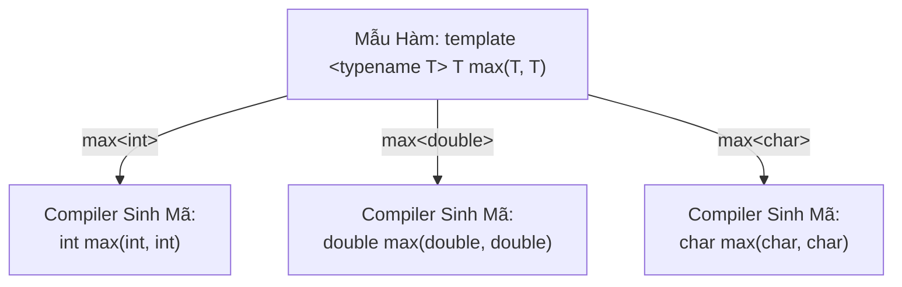

# 11.6 — Mẫu Hàm (Function Templates)

---

## 🎯 Mục Tiêu Bài Học
- Hiểu tư duy Lập trình tổng quát (Generic Programming) trong C++.
- Nắm vững cú pháp tạo Mẫu hàm (Function Template) với `template <typename T>`.
- Hiểu vai trò của Tham số kiểu (Type Template Parameter).

---

## 1. Giới Hạn Của Nạp Chồng Hàm

Ở bài 11.1, chúng ta đã viết nạp chồng hàm `max`:
```cpp
int max(int x, int y) { return (x > y) ? x : y; }
double max(double x, double y) { return (x > y) ? x : y; }
long max(long x, long y) { return (x > y) ? x : y; }
```
Hãy nhìn vào các hàm trên: Thuật toán so sánh `(x > y) ? x : y` **hoàn toàn giống hệt nhau 100%**, chỉ khác mỗi kiểu dữ liệu! Nếu có 20 kiểu dữ liệu khác nhau, bạn phải viết và bảo trì 20 hàm lặp đi lặp lại.

---

## 2. Giải Pháp Tối Thượng: Mẫu Hàm (Function Template)

Trong C++, **Mẫu hàm (Function Template)** là một bản thiết kế (blueprint) mẫu cho phép bạn viết một hàm độc lập với kiểu dữ liệu:

```cpp
#include <iostream>

// Định nghĩa mẫu hàm max cho bất kỳ kiểu T nào
template <typename T>
T max(T x, T y)
{
    return (x < y) ? y : x;
}

int main()
{
    std::cout << max<int>(3, 7) << '
';       // Gọi hàm max cho kiểu int
    std::cout << max<double>(3.5, 2.1) << '
'; // Gọi hàm max cho kiểu double
    std::cout << max<char>('a', 'z') << '
';   // Gọi hàm max cho kiểu char

    return 0;
}
```



---

## 3. Cú Pháp Chi Tiết: `template <typename T>`

- Từ khóa `template`: Báo cho trình biên dịch biết đây là một định nghĩa mẫu.
- `<typename T>`: Khai báo một **Tham số kiểu (Type parameter)** có tên là `T` (viết tắt của Type).
- Bạn cũng có thể dùng cú pháp cũ `template <class T>`, nhưng `typename` được khuyến nghị dùng trong C++ hiện đại vì tính rõ nghĩa.

---

## 💡 Thực Hành Tốt Nhất (Best Practice)

::: tip Đặt Tên Tham Số Template
Theo quy ước chuẩn, nếu mẫu chỉ có một kiểu duy nhất, hãy đặt tên là `T`. Nếu có nhiều kiểu, bạn có thể đặt tên là `T, U` hoặc các tên có ý nghĩa như `typename KeyType, typename ValueType`.
:::

---

## 📝 Bài Tập Tự Luyện & Quiz Củng Cố

### Bài tập code:
Hãy viết một mẫu hàm `add` nhận vào hai tham số cùng kiểu `T` và trả về tổng của chúng. Kiểm thử hàm này trong `main()` với số nguyên và số thực.

::: details [Xem lời giải mẫu]
```cpp
#include <iostream>

template <typename T>
T add(T a, T b)
{
    return a + b;
}

int main()
{
    std::cout << add<int>(5, 10) << '
';
    std::cout << add<double>(1.2, 3.4) << '
';
    return 0;
}
```
:::
