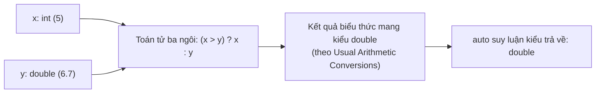

# 11.8 — Mẫu Hàm Với Nhiều Kiểu Mẫu Khác Nhau

---

## 🎯 Mục Tiêu Bài Học
- Thiết kế mẫu hàm với nhiều tham số kiểu: `template <typename T, typename U>`.
- Giải quyết bài toán: Kiểu trả về của hàm nên là gì khi kết hợp hai kiểu khác nhau?
- Ứng dụng `auto` và `std::common_type_t` trong C++14/C++20 để tự động suy luận kiểu trả về chuẩn xác nhất.

---

## 1. Mẫu Hàm Với 2 Kiểu Tham Số

Để giải quyết vấn đề ở bài trước (cho phép truyền cả `int` và `double` vào hàm `max`), ta khai báo hai tham số kiểu độc lập:

```cpp
#include <iostream>

template <typename T, typename U>
T max(T x, U y)
{
    return (x > y) ? x : y; // Cạm bẫy: Trả về kiểu T!
}

int main()
{
    std::cout << max(5, 6.7) << '
'; // in ra 6, mất phần .7!
    return 0;
}
```

::: danger Cạm bẫy kiểu trả về
Trong đoạn code trên, kiểu trả về bị ghim cứng là `T`. Khi gọi `max(5, 6.7)`, `T` là `int`, do đó kết quả `6.7` bị ép kiểu thu hẹp về `int` và trở thành `6`!
:::

---

## 2. Giải Pháp Hiện Đại: Để `auto` Tự Suy Luận Kiểu Trả Về (C++14)

Từ C++14, bạn có thể để `auto` tự tính toán kiểu kết quả dựa trên toán tử số học thông thường (Usual Arithmetic Conversions):

```cpp
#include <iostream>

template <typename T, typename U>
auto max(T x, U y)
{
    return (x > y) ? x : y; // Compiler tự chọn kiểu lớn hơn giữa T và U!
}

int main()
{
    std::cout << max(5, 6.7) << '
'; // In ra chính xác 6.7!
    std::cout << max(9.8, 4) << '
'; // In ra chính xác 9.8!
    return 0;
}
```



---

## 🚀 Cập Nhật C++20: Abbreviated Function Templates Với `auto`

Trong C++20, bạn có thể viết mẫu hàm siêu ngắn gọn mà không cần dòng `template <typename T>` dài dòng:

```cpp
// C++20 Abbreviated Function Template
auto max(auto x, auto y)
{
    return (x > y) ? x : y;
}
```
Mỗi tham số `auto` ở danh sách tham số hàm sẽ được compiler tự động biến thành một tham số template độc lập!

---

## 📝 Bài Tập Tự Luyện & Quiz Củng Cố

### Bài tập code:
Viết một hàm template C++20 nhận vào 2 tham số `a` và `b` thuộc hai kiểu bất kỳ, in ra giá trị của cả hai và trả về tích của chúng.

::: details [Xem lời giải mẫu]
```cpp
#include <iostream>

// C++20 syntax
auto printAndMultiply(auto a, auto b)
{
    std::cout << "a = " << a << ", b = " << b << '
';
    return a * b;
}

int main()
{
    auto result = printAndMultiply(4, 2.5);
    std::cout << "Tich: " << result << '
'; // 10
    return 0;
}
```
:::
