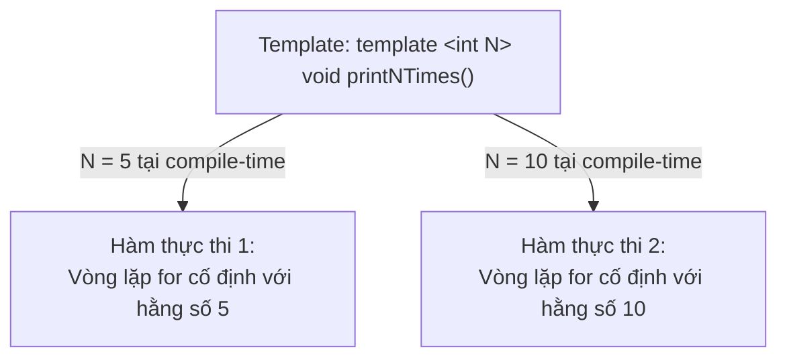

# 11.9 — Tham Số Mẫu Không Phải Kiểu (NTTP)

---

## 🎯 Mục Tiêu Bài Học
- Phân biệt giữa Tham số kiểu (Type Template Parameter) và Tham số không phải kiểu (Non-Type Template Parameter - NTTP).
- Ứng dụng NTTP để truyền hằng số compile-time vào hàm hoặc lớp mà không tốn chi phí bộ nhớ runtime.
- Cập nhật C++20 mở rộng cho NTTP: Cho phép số thực `double` và lớp ký tự.

---

## 1. NTTP Là Gì?

Thay vì truyền một *Kiểu dữ liệu* (`typename T`), **Tham số mẫu không phải kiểu (NTTP)** cho phép bạn truyền một **Giá trị hằng số cố định (constexpr value)** vào template ngay tại thời điểm biên dịch!

```cpp
#include <iostream>

// N là một Non-type template parameter kiểu int
template <int N>
void printNTimes()
{
    for (int i{ 0 }; i < N; ++i)
        std::cout << "*";
    std::cout << '
';
}

int main()
{
    printNTimes<5>();  // Compiler sinh ra hàm in 5 dấu sao
    printNTimes<10>(); // Compiler sinh ra hàm in 10 dấu sao

    return 0;
}
```



---

## 2. Các Kiểu Được Phép Dùng Làm NTTP

Trong C++11/C++17:
- Các kiểu số nguyên (`int`, `char`, `long`, `size_t`, `bool`, `enum`).
- Con trỏ và tham chiếu tới đối tượng có thời gian sống tĩnh (static linkage).

Từ C++20:
- Cho phép số thực (`float`, `double`).
- Cho phép các lớp đối tượng Literal Class (như chuỗi compile-time).

---

## 3. Lợi Ích Vượt Trội Về Hiệu Năng

1. **Tối ưu hóa vòng lặp (Loop Unrolling)**: Vì compiler biết trước chính xác số lần lặp `N` tại compile-time, nó có thể trải phẳng vòng lặp thành các lệnh CPU liên tiếp, loại bỏ hoàn toàn chi phí rẽ nhánh và kiểm tra điều kiện lặp.
2. **Kích thước mảng tĩnh cố định**: Là nền tảng để xây dựng `std::array<T, N>` siêu tốc độ trên Stack thay thế mảng C-style.

---

## 📝 Bài Tập Tự Luyện & Quiz Củng Cố

### Câu hỏi 1:
Đoạn code sau có biên dịch được không?
```cpp
template <int N>
void foo() {}

int main()
{
    int x = 5;
    foo<x>();
    return 0;
}
```
A) Biên dịch bình thường.  
B) Lỗi biên dịch vì `x` không phải là hằng số `constexpr`.

::: details [Xem lời giải]
**Đáp án đúng: B**  
Giải thích: Đối số truyền vào cho NTTP bắt buộc phải là một hằng biểu thức tính toán được tại compile-time (`constexpr`). Biến `x` là biến cục bộ runtime nên không thể dùng làm đối số NTTP. Muốn hợp lệ, bạn phải sửa thành: `constexpr int x = 5;`.
:::
