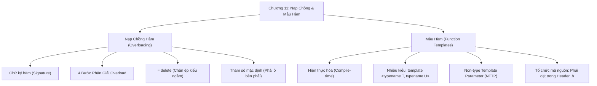

# 11.x — Tổng Kết Chương 11 & Bài Kiểm Tra Toàn Diện

---

## 📚 Tóm Tắt Kiến Thức Cốt Lõi Chương 11

Chương 11 mở ra cánh cửa của sự linh hoạt và khả năng tái sử dụng mã tối thượng trong C++:

1. **Nạp chồng hàm (Function Overloading)**: Khả năng định nghĩa nhiều hàm cùng tên với các danh sách tham số khác nhau. Cơ chế Name Mangling mã hóa tên duy nhất trong bảng ký hiệu.
2. **Tiêu chí phân biệt overload**: Số lượng, kiểu dữ liệu và thứ tự tham số. Kiểu trả về **không** được dùng để phân biệt.
3. **Phân giải nạp chồng (Overload Resolution)**: Quy trình 4 bước tìm hàm khớp tốt nhất. Tránh lỗi Khớp mơ hồ (Ambiguous Matches).
4. **Xóa hàm (`= delete`)**: Chặn đứng các chuyển đổi ngầm định không mong muốn.
5. **Tham số mặc định**: Phải đặt từ phải sang trái, khai báo tại header file.
6. **Mẫu hàm (Function Templates)**: Lập trình tổng quát (Generic Programming), viết 1 lần dùng cho mọi kiểu dữ liệu.
7. **Hiện thực hóa mẫu (Instantiation)**: Compiler tự động sinh mã máy tại compile-time cho từng kiểu dữ liệu cụ thể.
8. **Mẫu hàm nhiều kiểu (`template <typename T, typename U>`)**: Kết hợp `auto` return type để kết quả luôn chính xác.
9. **Tham số mẫu không phải kiểu (NTTP)**: Truyền hằng số `constexpr` vào template để tối ưu hóa hiệu năng phần cứng.
10. **Tổ chức tệp**: Toàn bộ định nghĩa template phải nằm trong file Header `.h`.

---

## 🧠 Sơ Đồ Cấu Trúc Chương 11



---

## 📝 Bài Kiểm Tra Đánh Giá Toàn Diện (Quiz)

### Câu hỏi 1:
Đoạn code sau có lỗi gì khi biên dịch?
```cpp
template <typename T>
T add(T a, T b)
{
    return a + b;
}

int main()
{
    auto res = add(10, 20.5);
    return 0;
}
```
A) Không có lỗi, kết quả ra `30.5`.  
B) Không có lỗi, kết quả ra `30`.  
C) **Lỗi biên dịch**: Compiler không thể suy luận được `T` là `int` hay `double` vì hai đối số có kiểu khác nhau trong khi template yêu cầu cùng kiểu `T`.  
D) Lỗi thời gian chạy (runtime crash).

::: details [Xem lời giải]
**Đáp án đúng: C**  
Giải thích: Template tham số `T` xuất hiện ở cả hai đối số, đòi hỏi cả hai phải có cùng kiểu. Truyền một `int` và một `double` gây ra mâu thuẫn suy luận kiểu. Để sửa, ta có thể gọi tường minh `add<double>(10, 20.5)` hoặc dùng hai tham số kiểu `template <typename T, typename U>`.
:::

---

### Bài tập thực hành tổng hợp:
Hãy viết một mẫu hàm `printArray` sử dụng NTTP để nhận vào một mảng kiểu C với số phần tử `N` bất kỳ, và in toàn bộ các phần tử của mảng đó ra màn hình phân tách bởi dấu phẩy.

::: details [Xem lời giải mẫu]
```cpp
#include <iostream>

template <typename T, int N>
void printArray(const T (&arr)[N])
{
    for (int i{ 0 }; i < N; ++i)
    {
        std::cout << arr[i];
        if (i < N - 1)
            std::cout << ", ";
    }
    std::cout << '
';
}

int main()
{
    int intArray[]{ 1, 2, 3, 4, 5 };
    printArray(intArray); // Compiler tự suy luận T = int, N = 5

    double dblArray[]{ 1.1, 2.2, 3.3 };
    printArray(dblArray); // Compiler tự suy luận T = double, N = 3

    return 0;
}
```
:::
