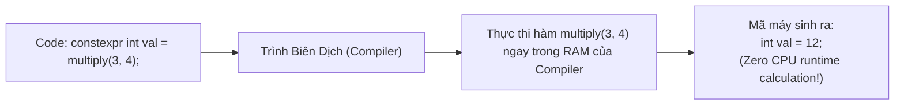

# F.1 — Hàm `constexpr` (Constexpr Functions)

---

## 🎯 Mục Tiêu Bài Học
- Hiểu khái niệm Tính toán tại thời điểm biên dịch (Compile-time Evaluation).
- Định nghĩa hàm `constexpr` và hiểu cơ chế hoạt động kép: Vừa có thể tính tại compile-time, vừa có thể chạy tại runtime.
- Nắm bắt điều kiện để một hàm `constexpr` được thực thi ngay trong lúc biên dịch.

---

## 1. Khái Niệm Tính Toán Tại Compile-Time

Trong lập trình truyền thống, mọi phép tính đều diễn ra khi người dùng chạy chương trình (Runtime). CPU phải tiêu tốn chu kỳ xung nhịp và pin để tính toán.

Nếu một phép tính chỉ bao gồm các hằng số đã biết trước (ví dụ tính diện tích vòng tròn cố định), tại sao ta phải bắt CPU chạy lại phép tính đó hàng triệu lần?

**Hàm `constexpr`** trong C++ cho phép compiler tính toán kết quả của hàm ngay trong quá trình biên dịch mã nguồn, và thay thế toàn bộ lời gọi hàm bằng **giá trị kết quả cuối cùng** trong tệp nhị phân!

```cpp
#include <iostream>

constexpr int multiply(int x, int y)
{
    return x * y;
}

int main()
{
    // Lời gọi này ĐƯỢC TÍNH TOÁN NGAY LÚC BIÊN DỊCH!
    constexpr int val = multiply(3, 4); // Mã máy chỉ lưu trực tiếp số 12

    std::cout << val << '
';
    return 0;
}
```



---

## 2. Bản Chất Hai Mặt Của Hàm `constexpr`

Một hàm `constexpr` **KHÔNG BẮT BUỘC** phải luôn chạy tại compile-time! Nó có tính linh hoạt kép:
1. **Chạy tại compile-time**: Nếu tất cả các đối số truyền vào đều là hằng số compile-time (`constexpr`) VÀ giá trị trả về được gán cho một biến `constexpr`.
2. **Chạy tại runtime bình thường**: Nếu bất kỳ đối số nào là biến runtime (giá trị chỉ biết khi chương trình đang chạy).

```cpp
int main()
{
    int a{ 5 }; // Biến runtime (người dùng nhập hoặc tính toán lúc chạy)
    int b{ 6 };

    // multiply tự động chuyển sang chạy tại RUNTIME như một hàm thông thường!
    int result = multiply(a, b); 
    std::cout << result << '
';

    return 0;
}
```

---

## 💡 Thực Hành Tốt Nhất (Best Practice)

::: tip Khi nào nên dùng constexpr cho hàm?
Bất kỳ hàm nào có logic tính toán thuần túy (Pure Function - không phụ thuộc I/O, không gọi hàm hệ điều hành) và có thể đánh giá được với các hằng số, hãy cân nhắc thêm từ khóa `constexpr`. Nó hoàn toàn miễn phí và mang lại tiềm năng tối ưu hóa cực lớn.
:::

---

## 📝 Bài Tập Tự Luyện & Quiz Củng Cố

### Câu hỏi 1:
Điều gì xảy ra nếu bạn gọi một hàm `constexpr` với các tham số là biến số runtime thông thường?
A) Bị lỗi biên dịch vì hàm `constexpr` chỉ được nhận hằng số.  
B) Chương trình bị crash khi chạy.  
C) Hàm tự động suy biến và thực thi tại thời gian chạy (Runtime) hệt như một hàm bình thường.  
D) Compiler tự động biến các biến runtime thành hằng số.

::: details [Xem lời giải]
**Đáp án đúng: C**  
Giải thích: Hàm `constexpr` được thiết kế linh hoạt. Khi gặp đối số runtime, nó tự động hoạt động như một hàm runtime thông thường.
:::
