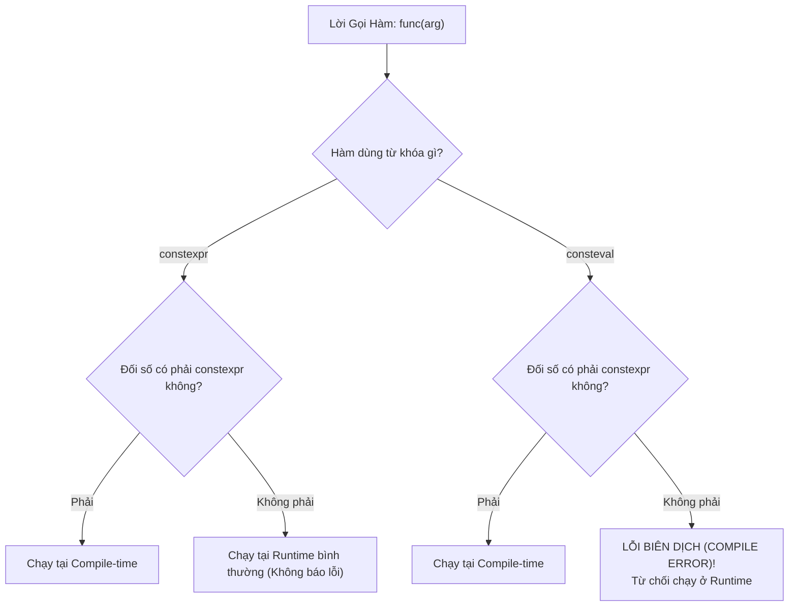

# F.3 — Hàm Bắt Buộc Compile-Time: `consteval` (C++20)

---

## 🎯 Mục Tiêu Bài Học
- Hiểu sự ra đời và ý nghĩa cách mạng của từ khóa **`consteval`** trong C++20.
- Khái niệm **Hàm tức thì (Immediate Functions)**.
- Phân biệt bản chất: `constexpr` (Có thể chạy compile-time) vs `consteval` (BẮT BUỘC 100% compile-time).

---

## 1. Vấn Đề Của `constexpr`: Thiếu Sự Ép Buộc

Như chúng ta đã biết, hàm `constexpr` có tính chất "dễ dãi": Nếu bạn vô tình truyền một đối số runtime vào hàm `constexpr`, compiler sẽ im lặng chuyển hàm đó sang chạy tại runtime mà không có bất kỳ cảnh báo nào.

Nhiều lập trình viên muốn viết các hàm kiểm tra bảo mật, định dạng chuỗi, hoặc tiền tính toán ma trận mà **bắt buộc phải thực hiện trong lúc biên dịch**. Nếu vì lý do nào đó mà nó bị lọt sang chạy ở runtime, họ muốn compiler **phải báo lỗi ngay lập tức**!

---

## 2. `consteval` — Hàm Tức Thì (Immediate Functions - C++20)

C++20 giới thiệu từ khóa **`consteval`**:
&gt; Một hàm được đánh dấu `consteval` được gọi là **Hàm tức thì (Immediate Function)**. Mỗi lời gọi tới hàm này **BẮT BUỘC PHẢI SINH RA MỘT HẰNG BIỂU THỨC COMPILE-TIME**, nếu không chương trình sẽ bị từ chối biên dịch!

```cpp
#include <iostream>

// Hàm consteval: Bắt buộc 100% compile-time
consteval int square(int n)
{
    return n * n;
}

int main()
{
    constexpr int a = square(5); // HỢP LỆ: 5 là hằng số -> tính ra 25 lúc dịch
    int b = square(5);           // HỢP LỆ: Đối số là 5 (hằng số) -> kết quả 25 gán vào biến b runtime

    int x{ 5 }; // Biến runtime
    // int c = square(x); 
    // LỖI BIÊN DỊCH NGAY LẬP TỨC!
    // error: the value of 'x' is not usable in a constant expression

    return 0;
}
```



---

## 3. So Sánh Bảng Vàng: `constexpr` vs `consteval`

| Đặc điểm | `constexpr` | `consteval` (C++20) |
| :--- | :--- | :--- |
| **Tên gọi chuẩn** | Constexpr Function | Immediate Function |
| **Có thể chạy tại compile-time?** | Có | Có |
| **Có thể chạy tại runtime?** | **CÓ** (nếu đối số là runtime) | ❌ **KHÔNG BAO GIỜ!** |
| **Khi đối số không phải hằng?** | Âm thầm chạy tại runtime | **Báo lỗi biên dịch ngay** |
| **Mục đích sử dụng** | Hàm linh hoạt, tối ưu khi có thể | Hàm bắt buộc phải tiền xử lý lúc dịch |

---

## 📝 Bài Tập Tự Luyện & Quiz Củng Cố

### Câu hỏi 1:
Khi nào bạn nên dùng `consteval` thay vì `constexpr`?
A) Khi bạn muốn hàm chạy nhanh hơn ở runtime.  
B) Khi bạn muốn bảo đảm tuyệt đối rằng hàm không bao giờ được phép thực thi tại runtime (ví dụ hàm kiểm tra cú pháp chuỗi format lúc biên dịch).  
C) Khi hàm cần in dữ liệu ra `std::cout`.  
D) Khi hàm có tham số là con trỏ.

::: details [Xem lời giải]
**Đáp án đúng: B**  
Giải thích: `consteval` sinh ra để biến hàm thành "immediate function", bắt buộc mọi lời gọi phải được giải quyết xong xuôi tại compile-time, ngăn chặn 100% rủi ro chạy ngầm tại runtime.
:::
