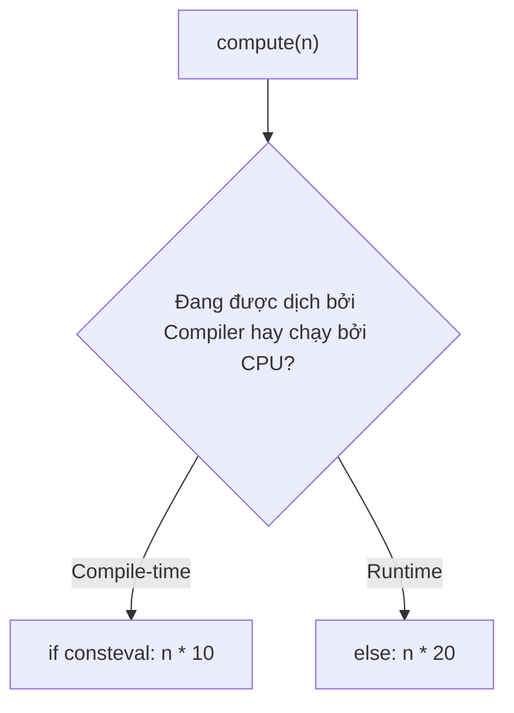

# F.4 — `is_constant_evaluated` & `if consteval` (C++20 / C++23)

---

## 🎯 Mục Tiêu Bài Học
- Hiểu cách viết hàm tối ưu hóa kép: Đường dẫn compile-time dùng thuật toán đơn giản, đường dẫn runtime dùng lệnh phần cứng tăng tốc.
- Nắm vững `std::is_constant_evaluated()` trong thư viện `<type_traits>` (C++20).
- Làm chủ cú pháp mới `if consteval` trong C++23.

---

## 1. Bài Toán Tối Ưu Hóa Kép (Dual-path Optimization)

Hãy tưởng tượng bạn muốn viết một hàm tính căn bậc hai hoặc hàm toán học phức tạp:
- **Tại Compile-time**: Các tập lệnh mở rộng của CPU (như Intel AVX-512 hoặc ARM Neon) không thể chạy được trong trình biên dịch. Bạn phải dùng một vòng lặp xấp xỉ đơn giản (như giải thuật Newton).
- **Tại Runtime**: Bạn muốn tận dụng các chỉ thị phần cứng siêu tốc của vi xử lý để chạy trong 1 nano giây!

Làm thế nào để một hàm biết nó đang được chạy bởi Trình biên dịch hay đang được chạy bởi CPU thực tế?

---

## 2. Giải Pháp C++20: `std::is_constant_evaluated()`

C++20 bổ sung hàm `std::is_constant_evaluated()` trong `<type_traits>`:
Nó trả về `true` nếu biểu thức hiện tại đang được compiler tính toán tại compile-time, và `false` nếu đang chạy runtime.

```cpp
#include <iostream>
#include <type_traits>

constexpr double smartCalculation(double x)
{
    if (std::is_constant_evaluated())
    {
        // Nhánh Compile-time: Dùng thuật toán phần mềm thuần túy
        return x * x * 2.0; 
    }
    else
    {
        // Nhánh Runtime: Có thể gọi hàm phần cứng hoặc thư viện tối ưu
        return x * x * 2.0;
    }
}
```

---

## 3. Cập Nhật C++23: Cú Pháp Thanh Lịch `if consteval`

Trong C++20, `std::is_constant_evaluated()` có một số góc khuất ngữ pháp dễ gây nhầm lẫn nếu viết trong `if constexpr`.  
Để giải quyết dứt điểm, C++23 giới thiệu câu lệnh chuyên biệt **`if consteval`**:

```cpp
#include <iostream>

constexpr int compute(int n)
{
    if consteval // C++23: Cực kỳ trực quan và sạch đẹp!
    {
        // Mã này CHỈ thực thi khi đang ở compile-time
        return n * 10;
    }
    else
    {
        // Mã này CHỈ thực thi khi đang chạy ở runtime
        return n * 20;
    }
}

int main()
{
    constexpr int ct = compute(5); // Chạy nhánh if consteval -> 50
    int x{ 5 };
    int rt = compute(x);           // Chạy nhánh else -> 100

    std::cout << "Compile-time: " << ct << '
';
    std::cout << "Runtime     : " << rt << '
';

    return 0;
}
```



---

## 📝 Bài Tập Tự Luyện & Quiz Củng Cố

### Câu hỏi 1:
Tính năng `if consteval` được chính thức đưa vào tiêu chuẩn C++ nào?
A) C++11  
B) C++14  
C) C++20  
D) C++23

::: details [Xem lời giải]
**Đáp án đúng: D**  
Giải thích: `std::is_constant_evaluated()` được giới thiệu trong C++20, và cú pháp câu lệnh `if consteval` được chuẩn hóa hoàn thiện trong C++23.
:::
