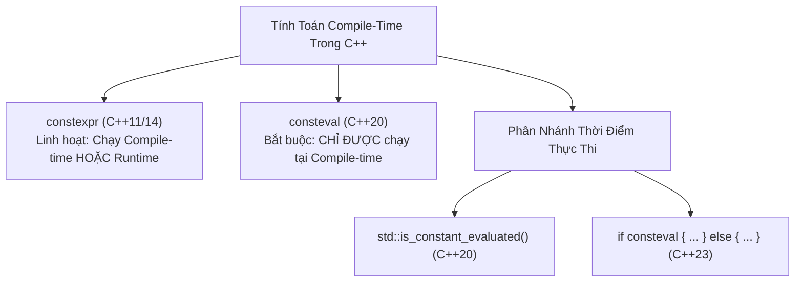

# F.X — Tổng Kết Chương F & Bài Kiểm Tra Siêu Tính Toán

---

## 📚 Tóm Tắt Kiến Thức Cốt Lõi Chương F

Chương F đưa bạn lên tầm cao của lập trình viên C++ hiện đại: **Làm chủ siêu tính toán Compile-time**:

1. **Hàm `constexpr`**: Cho phép compiler tính toán kết quả trước khi chương trình ra đời. Giảm thời gian khởi động, tiết kiệm pin CPU, 0% chi phí runtime.
2. **Khả năng linh hoạt kép**: Hàm `constexpr` có thể chạy ở cả compile-time (khi nhận hằng số) lẫn runtime (khi nhận biến thường).
3. **Tiến trình chuẩn hóa**: C++14/20 cho phép vòng lặp, biến cục bộ và thuật toán phức tạp bên trong hàm `constexpr`.
4. **Hàm tức thì `consteval` (C++20)**: Bắt buộc 100% phải giải quyết tại compile-time. Ngăn chặn triệt để nguy cơ hàm bị lọt xuống runtime.
5. **Phân nhánh thông minh**: `std::is_constant_evaluated()` (C++20) và `if consteval` (C++23) cho phép viết 2 đường dẫn thực thi tối ưu riêng biệt cho compile-time và runtime.

---

## 🧠 Sơ Đồ Toàn Cảnh Tính Toán Compile-Time



---

## 📝 Bài Kiểm Tra Đánh Giá Toàn Diện (Quiz)

### Câu hỏi 1:
Đoạn mã sau có lỗi gì không?
```cpp
consteval int getVal(int x)
{
    return x * 2;
}

int main()
{
    int n{ 4 };
    int res = getVal(n);
    return 0;
}
```
A) Chạy bình thường, `res = 8`.  
B) Lỗi biên dịch vì `getVal` là hàm `consteval`, không được phép nhận đối số runtime `n`.  
C) Bị crash lúc runtime.

::: details [Xem lời giải]
**Đáp án đúng: B**  
Giải thích: Hàm `consteval` bắt buộc đối số truyền vào phải là hằng biểu thức đã biết giá trị tại thời điểm biên dịch. Biến `n` là biến runtime thông thường nên vi phạm quy tắc `consteval`.
:::

---

### Bài tập thực hành đỉnh cao:
Hãy viết một hàm `consteval` kiểm tra xem một số nguyên dương $N$ có phải là số nguyên tố (Prime Number) hay không. Sử dụng hàm này để khởi tạo mảng tĩnh hoặc kiểm tra tính nguyên tố của số `10007` ngay trong lúc biên dịch!

::: details [Xem lời giải mẫu]
```cpp
#include <iostream>

consteval bool isPrime(int n)
{
    if (n <= 1) return false;
    if (n <= 3) return true;
    if (n % 2 == 0 || n % 3 == 0) return false;

    for (int i = 5; i * i <= n; i += 6)
    {
        if (n % i == 0 || n % (i + 2) == 0)
            return false;
    }
    return true;
}

int main()
{
    // Compiler tự tay chạy thuật toán sàng nguyên tố trong lúc dịch mã!
    constexpr bool check = isPrime(10007);

    if constexpr (check)
    {
        std::cout << "10007 la so nguyen to (Xac nhan boi Compiler)!
";
    }

    return 0;
}
```
:::
