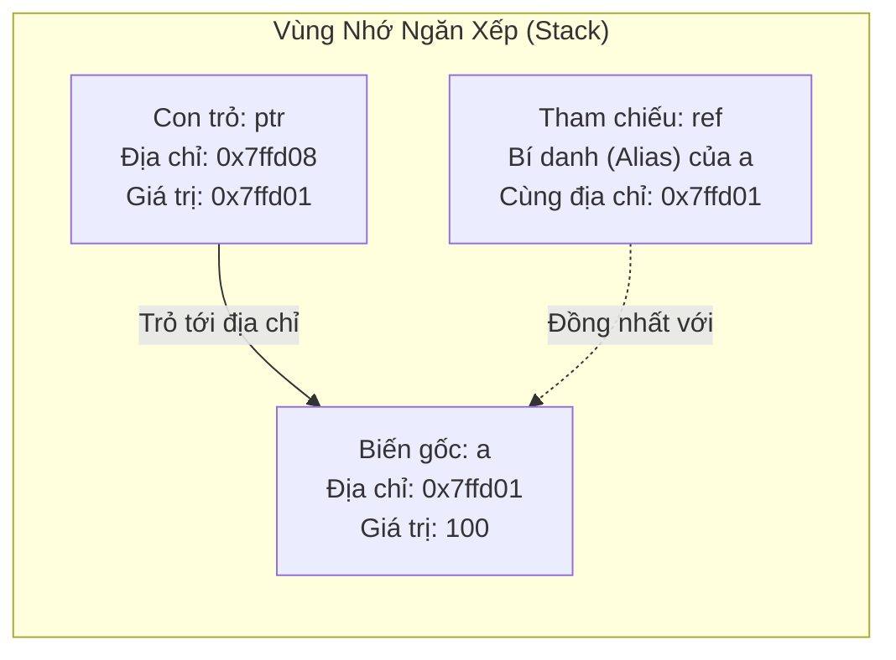

# 12.12 — Return by reference and return by address

---

## 🎯 Mục Tiêu Bài Học
- Nắm vững bản chất lý thuyết và cơ chế hoạt động của **Return by reference and return by address** trong tiêu chuẩn ISO C++.
- Hiểu rõ cách máy tính tổ chức bộ nhớ (RAM, CPU registers) khi thực thi mã nguồn liên quan.
- Nhận biết các cạm bẫy lỗi kinh điển (**Undefined Behavior**, Memory Leak, Bug logic) và cách phòng tránh.
- Áp dụng các quy tắc thực hành tốt nhất (**Best Practices**) chuẩn công nghiệp và cập nhật C++20/C++23 hiện đại.

---

# 12.12 &#8212; Return by tham chiếu and return by address

In previous lessons, we discussed that when passing an đối số by value, a copy of the đối số is made into the hàm tham số.  For các kiểu dữ liệu cơ bản (which are cheap to copy), this is fine.  But copying is typically expensive for class types (such as `std::string`).  We can avoid making an expensive copy by utilizing passing by (const) tham chiếu (or pass by address) instead.

We encounter a similar situation when returning by value: a copy of the giá trị trả về is passed back to the caller.  If the return type of the hàm is a class type, this can be expensive.

```cpp
std::string returnByValue(); // returns a copy of a std::string (expensive)
```

Return by tham chiếu

In cases where we’re passing a class type back to the caller, we may (or may not) want to return by tham chiếu instead.  **Return by tham chiếu** returns a tham chiếu that is bound to the object being returned, which avoids making a copy of the giá trị trả về.  To return by tham chiếu, we simply define the giá trị trả về of the hàm to be a tham chiếu type:

```cpp
std::string&       returnByReference(); // returns a reference to an existing std::string (cheap)
const std::string& returnByReferenceToConst(); // returns a const reference to an existing std::string (cheap)
```

Here is an academic program to demonstrate the mechanics of return by tham chiếu:

```cpp
#include <iostream>
#include <string>

const std::string& getProgramName() // returns a const reference
{
    static const std::string s_programName { "Calculator" }; // has static duration, destroyed at end of program

    return s_programName;
}

int main()
{
    std::cout << "This program is named " << getProgramName();

    return 0;
}
```

This program prints:

```cpp
This program is named Calculator
```

Because `getProgramName()` returns a const tham chiếu, when the line `return s_programName` is executed, `getProgramName()` will return a const tham chiếu to `s_programName` (thus avoiding making a copy).  That const tham chiếu can then be used by the caller to access the value of `s_programName`, which is printed.

The object being returned by tham chiếu must exist after the hàm returns

Using return by tham chiếu has one major caveat: the programmer *must* be sure that the object being referenced outlives the hàm returning the tham chiếu.  Otherwise, the tham chiếu being returned will be left dangling (referencing an object that has been destroyed), and use of that tham chiếu will result in hành vi không xác định (Hành vi không xác định (Undefined Behavior - UB) - UB).

In the program above, because `s_programName` has static duration, `s_programName` will exist until the end of the program.  When `main()` accesses the returned tham chiếu, it is actually accessing `s_programName`, which is fine, because `s_programName` won’t be destroyed until later.

Now let’s modify the above program to show what happens in the case where our hàm returns a dangling tham chiếu:

```cpp
#include <iostream>
#include <string>

const std::string& getProgramName()
{
    const std::string programName { "Calculator" }; // now a non-static local variable, destroyed when function ends

    return programName;
}

int main()
{
    std::cout << "This program is named " << getProgramName(); // undefined behavior

    return 0;
}
```

The result of this program is undefined.  When `getProgramName()` returns, a tham chiếu bound to local biến `programName` is returned.  Then, because `programName` is a local biến with automatic duration, `programName` is destroyed at the end of the hàm.  That means the returned tham chiếu is now dangling, and use of `programName` in the `main()` hàm results in hành vi không xác định (Hành vi không xác định (Undefined Behavior - UB) - UB).

Modern các trình biên dịch will produce a cảnh báo or error if you try to return a local biến by tham chiếu (so the above program may not even compile), but các trình biên dịch sometimes have trouble detecting more complicated cases.

::: danger Cảnh báo nguy hiểm

Objects returned by tham chiếu must live beyond the phạm vi truy cập (scope) of the hàm returning the tham chiếu, or a dangling tham chiếu will result.  Never return a (non-static) local biến or temporary by tham chiếu.

:::

Lifetime extension doesn’t work across hàm boundaries

Let’s take a look at an example where we return a temporary by tham chiếu:

```cpp
#include <iostream>

const int& returnByConstReference()
{
    return 5; // returns const reference to temporary object
}

int main()
{
    const int& ref { returnByConstReference() };

    std::cout << ref; // undefined behavior

    return 0;
}
```

In the above program, `returnByConstReference()` is returning an integer hằng giá trị (literal), but the return type of the hàm is `const int&`.  This results in the creation and return of a temporary tham chiếu bound to a temporary object holding value 5.  This returned tham chiếu is copied into a temporary tham chiếu in the phạm vi truy cập (scope) of the caller.  The temporary object then goes out of phạm vi truy cập (scope), leaving the temporary tham chiếu in the phạm vi truy cập (scope) of the caller dangling.

By the time the temporary tham chiếu in the phạm vi truy cập (scope) of the caller is bound to const tham chiếu biến `ref` (in `main()`), it is too late to extend the lifetime of the temporary object -- as it has already been destroyed.  Thus `ref` is a dangling tham chiếu, and use of the value of `ref` will result in hành vi không xác định (Hành vi không xác định (Undefined Behavior - UB) - UB).

Here’s a less obvious example that similarly doesn’t work:

```cpp
#include <iostream>

const int& returnByConstReference(const int& ref)
{
    return ref;
}

int main()
{
    // case 1: direct binding
    const int& ref1 { 5 }; // extends lifetime
    std::cout << ref1 << '\n'; // okay

    // case 2: indirect binding
    const int& ref2 { returnByConstReference(5) }; // binds to dangling reference
    std::cout << ref2 << '\n'; // undefined behavior

    return 0;
}
```

In case 2, a temporary object is created to hold value `5`, which hàm tham số `ref` binds to.  The hàm just returns this tham chiếu back to the caller, which then uses the tham chiếu to khởi tạo `ref2`.  Because this is not a direct binding to the temporary object (as the refrence was bounced through a hàm), lifetime extension doesn’t apply.  This leaves `ref2` dangling, and its subsequent use is hành vi không xác định (Hành vi không xác định (Undefined Behavior - UB) - UB).

::: danger Cảnh báo nguy hiểm

Reference lifetime extension does not work across hàm boundaries.

:::

Don’t return non-const static local các biến by tham chiếu

In the original example above, we returned a const static local biến by tham chiếu to illustrate the mechanics of return by tham chiếu in a simple way.  However, returning non-const static local các biến by tham chiếu is fairly non-idiomatic, and should generally be avoided.  Here’s a simplified example that illustrates one such problem that can occur:

```cpp
#include <iostream>
#include <string>

const int& getNextId()
{
    static int s_x{ 0 }; // note: variable is non-const
    ++s_x; // generate the next id
    return s_x; // and return a reference to it
}

int main()
{
    const int& id1 { getNextId() }; // id1 is a reference
    const int& id2 { getNextId() }; // id2 is a reference

    std::cout << id1 << id2 << '\n';

    return 0;
}
```

This program prints:

```cpp
22
```

This happens because `id1` and `id2` are referencing the same object (the static biến `s_x`), so when anything (e.g. `getNextId()`) modifies that value, all các tham chiếu are now accessing the modified value.

This above example can be fixed by making `id1` and `id2` normal các biến (rather than các tham chiếu) so they save a copy of the giá trị trả về rather than a tham chiếu to `s_x`.

::: info For advanced readers

Here’s another example with a less obvious version of the same problem:

```cpp
#include <iostream>
#include <string>
#include <string_view>

std::string& getName()
{
    static std::string s_name{};
    std::cout << "Enter a name: ";
    std::cin >> s_name;
    return s_name;
}

void printFirstAlphabetical(const std::string& s1, const std::string& s2)
{
    if (s1 < s2)
        std::cout << s1 << " comes before " << s2 << '\n';
    else
        std::cout << s2 << " comes before " << s1 << '\n';
}

int main()
{
    printFirstAlphabetical(getName(), getName());
    
    return 0;
}
```

Here’s the result from one run of this program:

```cpp
Enter a name: Dave
Enter a name: Stan
Stan comes before Stan
```

In this example, `getName()` returns a tham chiếu to static local `s_name`.  Initializing a `const std::string&` with a tham chiếu to `s_name` causes that `std::string&` to bind to `s_name` (not make a copy of it).  

Thus, both `s1` and `s2` end up viewing `s_name` (which was assigned the last name we entered).

Note that if we use `std::string_view` tham số instead, the first `std::string_view` tham số will be invalidated when the underlying `std::string` is changed.
:::

<p>Another issue that commonly occurs with programs that return a non-const static local by tham chiếu is that there is no standardized way to reset `s_x` back to the default state.  Such programs must either use a non-conventional solution (e.g. a reset hàm tham số), or can only be reset by quitting and restarting the program.

::: tip Thực hành tốt nhất (Best Practice)

Avoid returning các tham chiếu to non-const local static các biến.

:::

Returning a const tham chiếu to a *const* local static biến is sometimes done if the local biến being returned by tham chiếu is expensive to create and/or khởi tạo (so we don’t have to recreate the biến every hàm call).  But this is rare.

Returning a const tham chiếu to a *const* global biến is also sometimes done as a way to encapsulate access to a global biến.  We discuss this in lesson [7.8 -- Why (non-const) global các biến are evil](https://www.learncpp.com/cpp-tutorial/why-non-const-global-các biến-are-evil/).  When used intentionally and carefully, this is also okay.

Assigning/initializing a normal biến with a returned tham chiếu makes a copy

If a hàm returns a tham chiếu, and that tham chiếu is used to khởi tạo or assign to a non-tham chiếu biến, the giá trị trả về will be copied (as if it had been returned by value).

```cpp
#include <iostream>
#include <string>

const int& getNextId()
{
    static int s_x{ 0 };
    ++s_x;
    return s_x;
}

int main()
{
    const int id1 { getNextId() }; // id1 is a normal variable now and receives a copy of the value returned by reference from getNextId()
    const int id2 { getNextId() }; // id2 is a normal variable now and receives a copy of the value returned by reference from getNextId()

    std::cout << id1 << id2 << '\n';

    return 0;
}
```

In the above example, `getNextId()` is returning a tham chiếu, but `id1` and `id2` are non-tham chiếu các biến.  In such a case, the value of the returned tham chiếu is copied into the normal biến.  Thus, this program prints:

```cpp
12
```

Also note that if a program returns a dangling tham chiếu, the tham chiếu is left dangling before the copy is made, which will lead to hành vi không xác định (Hành vi không xác định (Undefined Behavior - UB) - UB):

```cpp
#include <iostream>
#include <string>

const std::string& getProgramName() // will return a const reference
{
    const std::string programName{ "Calculator" };

    return programName;
}

int main()
{
    std::string name { getProgramName() }; // makes a copy of a dangling reference
    std::cout << "This program is named " << name << '\n'; // undefined behavior

    return 0;
}
```

It’s okay to return tham chiếu tham số by tham chiếu

There are quite a few cases where returning đối tượng by tham chiếu makes sense, and we’ll encounter many of those in future lessons.  However, there is one useful example that we can show now.

If a tham số is passed into a hàm by tham chiếu, it’s safe to return that tham số by tham chiếu.  This makes sense: in order to pass an đối số to a hàm, the đối số must exist in the phạm vi truy cập (scope) of the caller.  When the called hàm returns, that object must still exist in the phạm vi truy cập (scope) of the caller.

Here is a simple example of such a hàm:

```cpp
#include <iostream>
#include <string>

// Takes two std::string objects, returns the one that comes first alphabetically
const std::string& firstAlphabetical(const std::string& a, const std::string& b)
{
	return (a < b) ? a : b; // We can use operator< on std::string to determine which comes first alphabetically
}

int main()
{
	std::string hello { "Hello" };
	std::string world { "World" };

	std::cout << firstAlphabetical(hello, world) << '\n';

	return 0;
}
```

This prints:

```cpp
Hello
```

In the above hàm, the caller passes in two std::string đối tượng by const tham chiếu, and whichever of these strings comes first alphabetically is passed back by const tham chiếu.  If we had used truyền theo giá trị and return by value, we would have made up to 3 copies of std::string (one for each tham số, one for the giá trị trả về).  By using pass by tham chiếu/return by tham chiếu, we can avoid those copies.

It’s okay for an rvalue passed by const tham chiếu to be returned by const tham chiếu

When an đối số for a const tham chiếu tham số is an rvalue, it’s still okay to return that tham số by const tham chiếu.

This is because rvalues are not destroyed until the end of the full biểu thức in which they are created.

First, let’s look at this example:

```cpp
#include <iostream>
#include <string>

std::string getHello()
{
    return "Hello"; // implicit conversion to std::string
}

int main()
{
    const std::string s{ getHello() };

    std::cout << s;
    
    return 0;
}
```

In this case, `getHello()` returns a `std::string` by value, which is an rvalue.  This rvalue is then used to khởi tạo `s`.  After the sự khởi tạo of `s`, the biểu thức in which the rvalue was created has finished evaluating, and the rvalue is destroyed.

Now let’s take a look at this similar example:

```cpp
#include <iostream>
#include <string>

const std::string& foo(const std::string& s)
{
    return s;
}

std::string getHello()
{
    return "Hello"; // implicit conversion to std::string
}

int main()
{
    const std::string s{ foo(getHello()) };

    std::cout << s;
    
    return 0;
}
```

The only difference in this case is that the rvalue is passed by const tham chiếu to `foo()` and then returned by const tham chiếu back to the caller before it is used to khởi tạo `s`.  Everything else works identically.

We discuss a similar case in lesson [14.6 -- Access các hàm](https://www.learncpp.com/cpp-tutorial/access-các hàm/).

The caller can modify values through the tham chiếu

When an đối số is passed to a hàm by non-const tham chiếu, the hàm can use the tham chiếu to modify the value of the đối số.

Similarly, when a non-const tham chiếu is returned from a hàm, the caller can use the tham chiếu to modify the value being returned.

Here’s an illustrative example:

```cpp
#include <iostream>

// takes two integers by non-const reference, and returns the greater by reference
int& max(int& x, int& y)
{
    return (x > y) ? x : y;
}

int main()
{
    int a{ 5 };
    int b{ 6 };

    max(a, b) = 7; // sets the greater of a or b to 7

    std::cout << a << b << '\n';
        
    return 0;
}
```

In the above program, `max(a, b)` calls the `max()` hàm with `a` and `b` as đối số.  Reference tham số `x` binds to đối số `a`, and tham chiếu tham số `y` binds to đối số `b`.  The hàm then determines which of `x` (`5`) and `y` (`6`) is greater.  In this case, that’s `y`, so the hàm returns `y` (which is still bound to `b`) back to the caller.  The caller then assigns the value `7` to this returned tham chiếu.

Therefore, the biểu thức `max(a, b) = 7` effectively resolves to `b = 7`.  

This prints:

```cpp
57
```

Return by address

**Return by address** works almost identically to return by tham chiếu, except a con trỏ to an object is returned instead of a tham chiếu to an object.  Return by address has the same primary caveat as return by tham chiếu -- the object being returned by address must outlive the phạm vi truy cập (scope) of the hàm returning the address, otherwise the caller will receive a dangling con trỏ.

The major advantage of return by address over return by tham chiếu is that we can have the hàm return `nullptr` if there is no valid object to return.  For example, let’s say we have a list of students that we want to search.  If we find the student we are looking for in the list, we can return a con trỏ to the object representing the matching student.  If we don’t find any students matching, we can return `nullptr` to indicate a matching student object was not found.

The major disadvantage of return by address is that the caller has to remember to do a `nullptr` check before dereferencing the giá trị trả về, otherwise a null con trỏ dereference may occur and hành vi không xác định (Hành vi không xác định (Undefined Behavior - UB) - UB) will result.  Because of this danger, return by tham chiếu should be preferred over return by address unless the ability to return “no object” is needed.

::: tip Thực hành tốt nhất (Best Practice)

Prefer return by tham chiếu over return by address unless the ability to return “no object” (using `nullptr`) is important.
:::

::: info Related content
<p>If you need the ability to return “no object” or a value (rather than an object) [12.15 -- std::optional](https://www.learncpp.com/cpp-tutorial/stdoptional/) describes a good alternative.

:::

::: info Related content
<p>See [5.9 -- std::string_view (part 2)](https://www.learncpp.com/cpp-tutorial/stdstring_view-part-2/#stringvsstringview) for a quick guide on when to return `std::string_view` vs `const std::string&` .
:::

</a>
  	<a class="nav-link" href="/">
  
    <i class="fa fa-home" aria-hidden="true"></i>
    
      Back to table of contents
    
</a>
  	<a class="nav-link" href="https://www.learncpp.com/cpp-tutorial/pass-by-address-part-2/">
  
    <i class="fa fa-chevron-circle-left" aria-hidden="true"></i>
    
      Previous lesson
      
        12.11Pass by address (part 2)
      
    
  </a>


---





::: danger Cạm Bẫy Thực Chiến: Con Trỏ Lơ Lửng (Dangling Pointer) & UB
Tuyệt đối không giải phóng vùng nhớ mà con trỏ đang trỏ tới rồi tiếp tục truy cập nó, hoặc trả về tham chiếu/con trỏ tới một biến cục bộ trên Stack. Khi hàm kết thúc, biến cục bộ bị hủy và con trỏ sẽ trỏ vào vùng nhớ rác, dẫn đến **Hành vi không xác định (Undefined Behavior)** cực kỳ nguy hiểm!
:::


::: tip Nâng Cấp C++ Hiện Đại: Thay Thế Con Trỏ Thô Bằng Smart Pointers
Trong C++ hiện đại (C++11 đến C++23), hãy hạn chế tối đa việc sử dụng con trỏ thô (`T*`) cùng các toán tử `new`/`delete`. Thay vào đó, hãy luôn ưu tiên:
- `std::unique_ptr<T>`: Sở hữu độc quyền tài nguyên (Zero-overhead, tự động giải phóng RAII).
- `std::shared_ptr<T>`: Sở hữu chia sẻ tài nguyên có cơ chế đếm tham chiếu (Reference counting).
- `std::span<T>` (C++20) hoặc `std::string_view` (C++17): Xem qua vùng nhớ mà không sở hữu, an toàn và tốc độ cực cao.
:::


::: tip 💡 Tóm Tắt Quy Tắc Vàng (Core Guidelines)
1. Luôn hiểu rõ vòng đời và quyền sở hữu (Ownership) của dữ liệu trước khi viết code.
2. Ưu tiên khởi tạo đồng nhất với dấu ngoặc nhọn `{}` để ngăn chặn lỗi thu hẹp kiểu dữ liệu (Narrowing conversions).
3. Bật toàn bộ cờ cảnh báo `-Wall -Wextra -Wpedantic` để compiler giúp bạn phát hiện bug từ sớm!
:::
