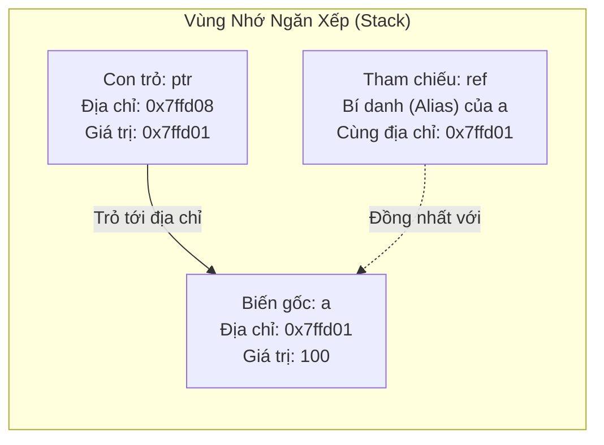

# 12.14 — Type deduction with pointers, references, and const

---

## 🎯 Mục Tiêu Bài Học
- Nắm vững bản chất lý thuyết và cơ chế hoạt động của **Type deduction with pointers, references, and const** trong tiêu chuẩn ISO C++.
- Hiểu rõ cách máy tính tổ chức bộ nhớ (RAM, CPU registers) khi thực thi mã nguồn liên quan.
- Nhận biết các cạm bẫy lỗi kinh điển (**Undefined Behavior**, Memory Leak, Bug logic) và cách phòng tránh.
- Áp dụng các quy tắc thực hành tốt nhất (**Best Practices**) chuẩn công nghiệp và cập nhật C++20/C++23 hiện đại.

---

# 12.14 &#8212; Type deduction with các con trỏ, các tham chiếu, and const

Trong bài học [10.8 -- Type deduction for đối tượng using the auto keyword](https://www.learncpp.com/cpp-tutorial/type-deduction-for-đối tượng-using-the-auto-keyword/), we discussed how the `auto` keyword can be used to have the trình biên dịch deduce the type of a biến from the initializer:

```cpp
int main()
{
    int a { 5 };
    auto b { a }; // b deduced as an int

    return 0;
}
```

We also noted that by default, type deduction will drop `const` from types:

```cpp
int main()
{
    const double a { 7.8 }; // a has type const double
    auto b { a };           // b has type double (const dropped)

    constexpr double c { 7.8 }; // c has type const double (constexpr implicitly applies const)
    auto d { c };               // d has type double (const dropped)

    return 0;
}
```

Const (or constexpr) can be reapplied by adding the `const` (or `constexpr`) qualifier to the definition of the deduced type:

```cpp
int main()
{
    double a { 7.8 };    // a has type double
    const auto b { a };  // b has type const double (const applied)

    constexpr double c { 7.8 }; // c has type const double (constexpr implicitly applies const)
    const auto d { c };         // d is const double (const dropped, const reapplied)
    constexpr auto e { c };     // e is constexpr double (const dropped, constexpr reapplied)

    return 0;
}
```

Type deduction drops các tham chiếu

In addition to dropping const, type deduction will also drop các tham chiếu:

```cpp
#include <string>

std::string& getRef(); // some function that returns a reference

int main()
{
    auto ref { getRef() }; // type deduced as std::string (not std::string&)

    return 0;
}
```

In the above example, biến `ref` is using type deduction.  Although hàm `getRef()` returns a `std::string&`, the tham chiếu qualifier is dropped, so the type of `ref` is deduced as `std::string`.

Just like with dropped `const`, if you want the deduced type to be a tham chiếu, you can reapply the tham chiếu at the point of definition:

```cpp
#include <string>

std::string& getRef(); // some function that returns a reference

int main()
{
    auto ref1 { getRef() };  // std::string (reference dropped)
    auto& ref2 { getRef() }; // std::string& (reference dropped, reference reapplied)

    return 0;
}
```

Top-level const and low-level const

A **top-level const** is a const qualifier that applies to an object itself.  For example:

```cpp
const int x;    // this const applies to x, so it is top-level
int* const ptr; // this const applies to ptr, so it is top-level
// references don't have a top-level const syntax, as they are implicitly top-level const
```

In contrast, a **low-level const** is a const qualifier that applies to the object being referenced or pointed to:

```cpp
const int& ref; // this const applies to the object being referenced, so it is low-level
const int* ptr; // this const applies to the object being pointed to, so it is low-level
```

A tham chiếu to a const value is always a low-level const.  A con trỏ can have a top-level, low-level, or both kinds of const:

```cpp
const int* const ptr; // the left const is low-level, the right const is top-level
```

When we say that type deduction drops const qualifiers, it only drops top-level consts.  Low-level consts are not dropped.  We’ll see examples of this in just a moment.

Type deduction and const các tham chiếu

If the initializer is a tham chiếu to const, the tham chiếu is dropped first (and then reapplied if applicable), and then any top-level const is dropped from the result.

```cpp
#include <string>

const std::string& getConstRef(); // some function that returns a reference to const

int main()
{
    auto ref1{ getConstRef() }; // std::string (reference dropped, then top-level const dropped from result)

    return 0;
}
```

In the above example, since `getConstRef()` returns a `const std::string&`, the tham chiếu is dropped first, leaving us with a `const std::string`.  This const is now a top-level const, so it is also dropped, leaving the deduced type as `std::string`.

::: info Hiểu biết cốt lõi

Dropping a tham chiếu may change a low-level const to a top-level const: `const std::string&` is a low-level const, but dropping the tham chiếu yields `const std::string`, which is a top-level const.
:::

<p>We can reapply a tham chiếu and/or const:

```cpp
#include <string>

const std::string& getConstRef(); // some function that returns a const reference

int main()
{
    auto ref1{ getConstRef() };        // std::string (reference and top-level const dropped)
    const auto ref2{ getConstRef() };  // const std::string (reference dropped, const dropped, const reapplied)

    auto& ref3{ getConstRef() };       // const std::string& (reference dropped and reapplied, low-level const not dropped)
    const auto& ref4{ getConstRef() }; // const std::string& (reference dropped and reapplied, low-level const not dropped)

    return 0;
}
```

We covered the case for `ref1` in the prior example.  For `ref2`, this is similar to the `ref1` case, except we’re reapplying the `const` qualifier, so the deduced type is `const std::string`.

Things get more interesting with `ref3`.  Normally the tham chiếu would be dropped first, but since we’ve reapplied the tham chiếu, it is not dropped.  That means the type is still `const std::string&`.  And since this const is a low-level const, it is not dropped.  Thus the deduced type is `const std::string&`.

The `ref4` case works similarly to `ref3`, except we’ve reapplied the `const` qualifier as well.  Since the type is already deduced as a tham chiếu to const, us reapplying `const` here is redundant.  That said, using `const` here makes it explicitly clear that our result will be const (whereas in the `ref3` case, the constness of the result is implicit and not obvious).

::: tip Thực hành tốt nhất (Best Practice)

If you want a const tham chiếu, reapply the `const` qualifier even when it’s not strictly necessary, as it makes your intent clear and helps prevent mistakes.
:::

<p class="cpp-section cpp-topline" style="clear: both">What about constexpr các tham chiếu?

Constexpr is not part of an biểu thức’s type, so it is not deduced by `auto`.

::: info A reminder

When defining a const tham chiếu (e.g. `const int&`), the const applies to the object being referenced, not the tham chiếu itself.

When defining a constexpr tham chiếu to a const biến (e.g. `constexpr const int&`), we need to apply both `constexpr` (which applies to the tham chiếu) and `const` (which applies to the type being referenced).

This is covered in lesson [12.4 -- Lvalue các tham chiếu to const](https://www.learncpp.com/cpp-tutorial/lvalue-các tham chiếu-to-const/).

:::

```cpp
#include <string_view>
#include <iostream>

constexpr std::string_view hello { "Hello" };   // implicitly const

constexpr const std::string_view& getConstRef() // function is constexpr, returns a const std::string_view&
{
    return hello;
}

int main()
{
    auto ref1{ getConstRef() };                  // std::string_view (reference dropped and top-level const dropped)
    constexpr auto ref2{ getConstRef() };        // constexpr const std::string_view (reference dropped and top-level const dropped, constexpr applied, implicitly const)

    auto& ref3{ getConstRef() };                 // const std::string_view& (reference reapplied, low-level const not dropped)
    constexpr const auto& ref4{ getConstRef() }; // constexpr const std::string_view& (reference reapplied, low-level const not dropped, constexpr applied)
    
    return 0;
}
```

Type deduction and các con trỏ

Unlike các tham chiếu, type deduction does not drop các con trỏ:

```cpp
#include <string>

std::string* getPtr(); // some function that returns a pointer

int main()
{
    auto ptr1{ getPtr() }; // std::string*

    return 0;
}
```

We can also use an asterisk in conjunction with con trỏ type deduction (`auto*`) to make it clearer that the deduced type is a con trỏ:

```cpp
#include <string>

std::string* getPtr(); // some function that returns a pointer

int main()
{
    auto ptr1{ getPtr() };  // std::string*
    auto* ptr2{ getPtr() }; // std::string*

    return 0;
}
```

::: info Hiểu biết cốt lõi

The reason that các tham chiếu are dropped during type deduction but các con trỏ are not dropped is because các tham chiếu and các con trỏ have different semantics.

When we evaluate a tham chiếu, we’re really evaluating the object being referenced.  Therefore, when deducing a type, it makes sense that we should deduce the type of the thing being referenced, not the tham chiếu itself.  Also, since we deduce a non-tham chiếu, it’s really easy to make it a tham chiếu by using `auto&`.  If type deduction were to deduce a tham chiếu instead, the syntax for removing a tham chiếu if we didn’t want it is much more complicated.

On the other hand, các con trỏ hold the address of an object.  When we evaluate a con trỏ, we are evaluating the con trỏ, not the object being pointed to (if we want that, we can dereference the con trỏ).  Therefore, it makes sense that we should deduce the type of the con trỏ, not the thing being pointed to.

:::

The difference between auto and auto* Optional

When we use `auto` with a con trỏ type initializer, the type deduced for `auto` includes the con trỏ.  So for `ptr1` above, the type substituted for `auto` is `std::string*`.

When we use `auto*` with a con trỏ type initializer, the type deduced for auto does *not* include the con trỏ -- the con trỏ is reapplied afterward after the type is deduced.  So for `ptr2` above, the type substituted for `auto` is `std::string`, and then the con trỏ is reapplied.

In most cases, the practical effect is the same (`ptr1` and `ptr2` both deduce to `std::string*` in the above example).

However, there are a couple of difference between `auto` and `auto*` in practice.  First, `auto*` must resolve to a con trỏ initializer, otherwise a compile error will result:

```cpp
#include <string>

std::string* getPtr(); // some function that returns a pointer

int main()
{
    auto ptr3{ *getPtr() };      // std::string (because we dereferenced getPtr())
    auto* ptr4{ *getPtr() };     // does not compile (initializer not a pointer)

    return 0;
}
```

This makes sense: in the `ptr4` case, `auto` deduces to `std::string`, then the con trỏ is reapplied.  Thus `ptr4` has type `std::string*`, and we can’t khởi tạo a `std::string*` with an initializer that is not a con trỏ.

Second, there are differences in how `auto` and `auto*` behave when we introduce `const` into the equation.  We’ll cover this below.

Type deduction and const các con trỏ Optional

Since các con trỏ aren’t dropped, we don’t have to worry about that.  But with các con trỏ, we have both the const con trỏ and the con trỏ to const cases to think about, and we also have `auto` vs `auto*`.  Just like with các tham chiếu, only top-level const is dropped during con trỏ type deduction.

Let’s start with a simple case:

```cpp
#include <string>

std::string* getPtr(); // some function that returns a pointer

int main()
{
    const auto ptr1{ getPtr() };  // std::string* const
    auto const ptr2 { getPtr() }; // std::string* const

    const auto* ptr3{ getPtr() }; // const std::string*
    auto* const ptr4{ getPtr() }; // std::string* const

    return 0;
}
```

When we use either `auto const` or `const auto`, we’re saying, “make the deduced con trỏ a const con trỏ”.  So in the case of `ptr1` and `ptr2`, the deduced type is `std::string*`, and then const is applied, making the final type `std::string* const`.  This is similar to how `const int` and `int const` mean the same thing.

However, when we use `auto*`, the order of the const qualifier matters.  A `const` on the left means “make the deduced con trỏ a con trỏ to const”, whereas a `const` on the right means “make the deduced con trỏ type a const con trỏ”.  Thus `ptr3` ends up as a con trỏ to const, and `ptr4` ends up as a const con trỏ.

Now let’s look at an example where the initializer is a const con trỏ to const.

```cpp
#include <string>

int main()
{
    std::string s{};
    const std::string* const ptr { &s };

    auto ptr1{ ptr };  // const std::string*
    auto* ptr2{ ptr }; // const std::string*

    auto const ptr3{ ptr };  // const std::string* const
    const auto ptr4{ ptr };  // const std::string* const

    auto* const ptr5{ ptr }; // const std::string* const
    const auto* ptr6{ ptr }; // const std::string*

    const auto const ptr7{ ptr };  // error: const qualifer can not be applied twice
    const auto* const ptr8{ ptr }; // const std::string* const

    return 0;
}
```

The `ptr1` and `ptr2` cases are straightforward.  The top-level const (the const on the con trỏ itself) is dropped.  The low-level const on the object being pointed to is not dropped.  So in both cases, the final type is `const std::string*`.

The `ptr3` and `ptr4` cases are also straightforward.  The top-level const is dropped, but we’re reapplying it.  The low-level const on the object being pointed to is not dropped.  So in both cases, the final type is `const std::string* const`.

The `ptr5` and `ptr6` cases are analogous to the cases we showed in the prior example.  In both cases, the top-level const is dropped.  For `ptr5`, the `auto* const` reapplies the top-level const, so the final type is `const std::string* const`.  For `ptr6`, the `const auto*` applies const to the type being pointed to (which in this case was already const), so the final type is `const std::string*`.

In the `ptr7` case, we’re applying the const qualifier twice, which is disallowed, and will cause a compile error.

And finally, in the `ptr8` case, we’re applying const on both sides of the con trỏ (which is allowed since `auto*` must be a con trỏ type), so the resulting types is `const std::string* const`.

::: tip Thực hành tốt nhất (Best Practice)

If you want a const con trỏ, con trỏ to const, or const con trỏ to const, reapply the `const` qualifier(s) even when it’s not strictly necessary, as it makes your intent clear and helps prevent mistakes.
:::

::: info Tip
<p>Consider using `auto*` when deducing a con trỏ type.  Using `auto*` in this case makes it clearer that we are deducing a con trỏ type, enlists the trình biên dịch’s help to ensure we don’t deduce a non-con trỏ type, and gives you more control over const.
:::

<p class="cpp-section cpp-topline" style="clear: both">Tổng kết bài học

Sorry to hear about your headache.  Let’s recap the most important points quickly.

Top-level vs low-level const:

- A top-level const applies to the object itself (e.g. `const int x` or `int* const ptr`).

- A low-level const applies to the object accessed through a tham chiếu or con trỏ (e.g. `const int& ref`, `const int* ptr`).

What type deduction deduces:

- Type deduction first drops any các tham chiếu (unless the deduced type is defined as a tham chiếu).  For a const tham chiếu, dropping the tham chiếu will cause the (low-level) const to become a top-level const.

- Type deduction then drops any top-level const (unless the deduced type is defined as `const` or `constexpr`).

- Constexpr is not part of the type system, so is never deduced.  It must always be explicitly applied to the deduced type.

- Type deduction does not drop các con trỏ.

- Always explicitly define the deduced type as a tham chiếu, `const`, or `constexpr` (as applicable), and even if these qualifiers are redundant because they would be deduced.  This helps prevent errors and makes it clear what your intent is.

Type deduction and các con trỏ:

- When using `auto`, the deduced type will be a con trỏ only if the initializer is a con trỏ.  When using `auto*`, the deduced type is always a con trỏ, even if the initializer is not a con trỏ.

- `auto const` and `const auto` both make the deduced con trỏ a const con trỏ.  There is no way to explicitly specify a low-level const (con trỏ-to-const) using `auto`.

- `auto* const` also makes the deduced con trỏ a const con trỏ.  `const auto*` makes the deduced con trỏ a con trỏ-to-const.  If these are hard to remember, `int* const` is a const con trỏ (to int), so `auto* const` must be a const con trỏ.  `const int*` is a con trỏ-to-const (int), so `const auto*` must be a con trỏ-to-const)

- Consider using `auto*` over `auto` when deducing a con trỏ type, as it allows you to explicitly reapply both the top-level and low-level const, and will error if a con trỏ type is not deduced.

</a>
  	<a class="nav-link" href="/">
  
    <i class="fa fa-home" aria-hidden="true"></i>
    
      Back to table of contents
    
</a>
  	<a class="nav-link" href="https://www.learncpp.com/cpp-tutorial/in-and-out-tham số/">
  
    <i class="fa fa-chevron-circle-left" aria-hidden="true"></i>
    
      Previous lesson
      
        12.13In and out tham số
      
    
  </a>


---





::: danger Cạm Bẫy Thực Chiến: Con Trỏ Lơ Lửng (Dangling Pointer) & UB
Tuyệt đối không giải phóng vùng nhớ mà con trỏ đang trỏ tới rồi tiếp tục truy cập nó, hoặc trả về tham chiếu/con trỏ tới một biến cục bộ trên Stack. Khi hàm kết thúc, biến cục bộ bị hủy và con trỏ sẽ trỏ vào vùng nhớ rác, dẫn đến **Hành vi không xác định (Undefined Behavior)** cực kỳ nguy hiểm!
:::


::: tip Nâng Cấp C++ Hiện Đại: Thay Thế Con Trỏ Thô Bằng Smart Pointers
Trong C++ hiện đại (C++11 đến C++23), hãy hạn chế tối đa việc sử dụng con trỏ thô (`T*`) cùng các toán tử `new`/`delete`. Thay vào đó, hãy luôn ưu tiên:
- `std::unique_ptr<T>`: Sở hữu độc quyền tài nguyên (Zero-overhead, tự động giải phóng RAII).
- `std::shared_ptr<T>`: Sở hữu chia sẻ tài nguyên có cơ chế đếm tham chiếu (Reference counting).
- `std::span<T>` (C++20) hoặc `std::string_view` (C++17): Xem qua vùng nhớ mà không sở hữu, an toàn và tốc độ cực cao.
:::


::: tip 💡 Tóm Tắt Quy Tắc Vàng (Core Guidelines)
1. Luôn hiểu rõ vòng đời và quyền sở hữu (Ownership) của dữ liệu trước khi viết code.
2. Ưu tiên khởi tạo đồng nhất với dấu ngoặc nhọn `{}` để ngăn chặn lỗi thu hẹp kiểu dữ liệu (Narrowing conversions).
3. Bật toàn bộ cờ cảnh báo `-Wall -Wextra -Wpedantic` để compiler giúp bạn phát hiện bug từ sớm!
:::
