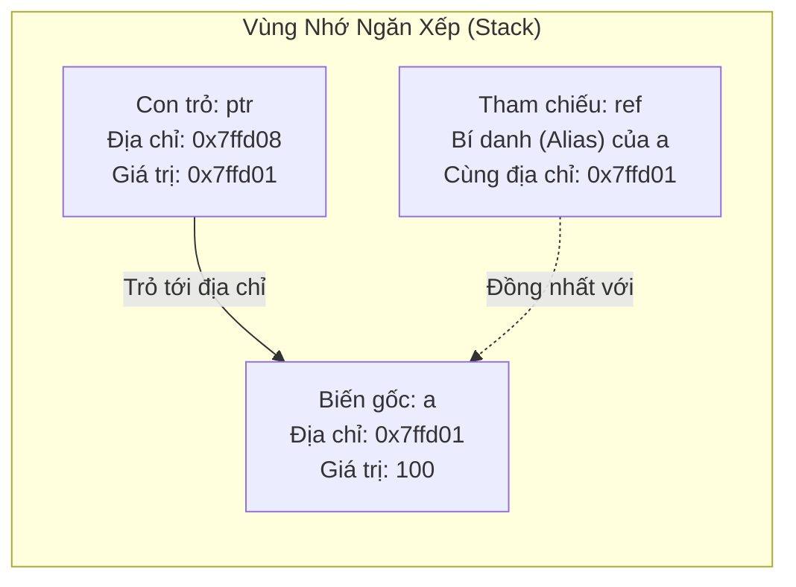

# 12.3 — Lvalue references

---

## 🎯 Mục Tiêu Bài Học
- Nắm vững bản chất lý thuyết và cơ chế hoạt động của **Lvalue references** trong tiêu chuẩn ISO C++.
- Hiểu rõ cách máy tính tổ chức bộ nhớ (RAM, CPU registers) khi thực thi mã nguồn liên quan.
- Nhận biết các cạm bẫy lỗi kinh điển (**Undefined Behavior**, Memory Leak, Bug logic) và cách phòng tránh.
- Áp dụng các quy tắc thực hành tốt nhất (**Best Practices**) chuẩn công nghiệp và cập nhật C++20/C++23 hiện đại.

---

# 12.3 &#8212;  Lvalue các tham chiếu

In C++, a **tham chiếu** is an alias for an existing object.  Once a tham chiếu has been defined, any operation on the tham chiếu is applied to the object being referenced.  This means we can use a tham chiếu to read or modify the object being referenced.

Although các tham chiếu might seem silly, useless, or redundant at first, các tham chiếu are used everywhere in C++ (we’ll see examples of this in a few lessons).

::: info Hiểu biết cốt lõi

A tham chiếu is essentially identical to the object being referenced.

:::

You can also create các tham chiếu to các hàm, though this is done less often.

Modern C++ contains two types of các tham chiếu: lvalue các tham chiếu, and rvalue các tham chiếu.  In this chapter, we’ll discuss lvalue các tham chiếu.

::: info Related content

Because we’ll be talking about lvalues and rvalues in this lesson, please review [12.2 -- Value categories (lvalues and rvalues)](https://www.learncpp.com/cpp-tutorial/value-categories-lvalues-and-rvalues/) if you need a refresher on these terms before proceeding.  Rvalue các tham chiếu are covered in the chapter on move semantics ([chapter 22](https://www.learncpp.com#Chapter22)).

:::

Lvalue các tham chiếu types

An **lvalue tham chiếu** (commonly just called a “tham chiếu” since prior to C++11 there was only one type of tham chiếu) acts as an alias for an existing lvalue (such as a biến).

Just like the type of an object determines what kind of value it can hold, the type of a tham chiếu determines what type of object it can tham chiếu.  Lvalue tham chiếu types can be identified by use of a single ampersand (&) in the type specifier:

```cpp
// regular types
int        // a normal int type (not an reference)
int&       // an lvalue reference to an int object
double&    // an lvalue reference to a double object
const int& // an lvalue reference to a const int object
```

For example, `int&` is the type of an lvalue tham chiếu to an `int` object, and `const int&` is the type of an lvalue tham chiếu to a `const int` object.

A type that specifies a tham chiếu (e.g. `int&`) is called a **tham chiếu type**.  The type that can be referenced (e.g. `int`) is called the **referenced type**.

::: info Nomenclature

There are two kinds of lvalue các tham chiếu:

- An lvalue tham chiếu to a non-const is commonly just called an “lvalue tham chiếu”, but may also be referred to as an **lvalue tham chiếu to non-const** or a **non-const lvalue tham chiếu** (since it isn’t defined using the `const` keyword).

- An lvalue tham chiếu to a const  is commonly called either an **lvalue tham chiếu to const** or a **const lvalue tham chiếu**.

:::

We’ll focus on non-const lvalue các tham chiếu in this lesson, and on const lvalue các tham chiếu in the next lesson ([12.4 -- Lvalue các tham chiếu to const](https://www.learncpp.com/cpp-tutorial/lvalue-các tham chiếu-to-const/)).

Lvalue tham chiếu các biến

One of the things we can do with an lvalue tham chiếu type is create an lvalue tham chiếu biến.  An **lvalue tham chiếu biến** is a biến that acts as a tham chiếu to an lvalue (usually another biến).

To create an lvalue tham chiếu biến, we simply define a biến with an lvalue tham chiếu type:

```cpp
#include <iostream>

int main()
{
    int x { 5 };    // x is a normal integer variable
    int& ref { x }; // ref is an lvalue reference variable that can now be used as an alias for variable x

    std::cout << x << '\n';  // print the value of x (5)
    std::cout << ref << '\n'; // print the value of x via ref (5)

    return 0;
}
```

In the above example, the type `int&` defines `ref` as an lvalue tham chiếu to an int, which we then khởi tạo with lvalue biểu thức `x`.  Thereafter, `ref` and `x` can be used synonymously.  This program thus prints:

```cpp
5
5
```

From the trình biên dịch’s perspective, it doesn’t matter whether the ampersand is “attached” to the type name (`int& ref`) or the biến’s name (`int &ref`), and which you choose is a matter of style.  Modern C++ programmers tend to prefer attaching the ampersand to the type, as it makes clearer that the tham chiếu is part of the type information, not the identifier.

::: tip Thực hành tốt nhất (Best Practice)

When defining a tham chiếu, place the ampersand next to the type (not the tham chiếu biến’s name).

:::

::: info For advanced readers

For those of you already familiar with các con trỏ, the ampersand in this context does not mean “address of”, it means “lvalue tham chiếu to”.

:::

Modifying values through a non-const lvalue tham chiếu

In the above example, we showed that we can use a tham chiếu to read the value of the object being referenced.  We can also use a non-const tham chiếu to modify the value of the object being referenced:

```cpp
#include <iostream>

int main()
{
    int x { 5 }; // normal integer variable
    int& ref { x }; // ref is now an alias for variable x

    std::cout << x << ref << '\n'; // print 55

    x = 6; // x now has value 6

    std::cout << x << ref << '\n'; // prints 66

    ref = 7; // the object being referenced (x) now has value 7

    std::cout << x << ref << '\n'; // prints 77

    return 0;
}
```

This code prints:

```cpp
55
66
77
```

In the above example, `ref` is an alias for `x`, so we are able to change the value of `x` through either `x` or `ref`.

Reference sự khởi tạo

Much like các hằng số, all các tham chiếu must be được khởi tạo.  References are được khởi tạo using a form of sự khởi tạo called **tham chiếu sự khởi tạo**.

```cpp
int main()
{
    int& invalidRef;   // error: references must be initialized

    int x { 5 };
    int& ref { x }; // okay: reference to int is bound to int variable

    return 0;
}
```

When a tham chiếu is được khởi tạo with an object (or hàm), we say it is **bound** to that object (or hàm).  The process by which such a tham chiếu is bound is called **tham chiếu binding**.  The object (or hàm) being referenced is sometimes called the **referent**.

Non-const lvalue các tham chiếu can only be bound to a *modifiable* lvalue.

```cpp
int main()
{
    int x { 5 };
    int& ref { x };         // okay: non-const lvalue reference bound to a modifiable lvalue

    const int y { 5 };
    int& invalidRef { y };  // invalid: non-const lvalue reference can't bind to a non-modifiable lvalue 
    int& invalidRef2 { 0 }; // invalid: non-const lvalue reference can't bind to an rvalue

    return 0;
}
```

::: info Hiểu biết cốt lõi

If non-const lvalue các tham chiếu could be bound to non-modifiable (const) lvalues or rvalues, then you would be able to change those values through the tham chiếu, which would be a violation of their const-ness.

:::

Lvalue các tham chiếu to `void` are disallowed (what would be the point?).

Even though the type of the tham chiếu (e.g. `int&`) doesn’t exactly match the type of the object being bound (e.g. `int`), no conversion is applied here (not even a trivial conversion) -- the difference in types is handled as part of the tham chiếu sự khởi tạo process.

A tham chiếu will (usually) only bind to an object matching its referenced type

In most cases, a tham chiếu will only bind to an object whose type matches the referenced type, (there are some exceptions to this rule that we’ll discuss when we get into tính kế thừa).

If you try to bind a tham chiếu to an object that does not match its referenced type, the trình biên dịch will try to implicitly convert the object to the referenced type and then bind the tham chiếu to that.

::: info Hiểu biết cốt lõi

Since the result of a conversion is an rvalue, and a non-const lvalue tham chiếu can’t bind to an rvalue, trying to bind a non-const lvalue tham chiếu to an object that does not match its referenced type will result in a quá trình biên dịch error.

:::

```cpp
int main()
{
    int x { 5 };
    int& ref { x };            // okay: referenced type (int) matches type of initializer

    double d { 6.0 };
    int& invalidRef { d };     // invalid: conversion of double to int is narrowing conversion, disallowed by list initialization
    double& invalidRef2 { x }; // invalid: non-const lvalue reference can't bind to rvalue (result of converting x to double)

    return 0;
}
```

References can’t be reseated (changed to refer to another object)

Once được khởi tạo, a tham chiếu in C++ cannot be **reseated**, meaning it cannot be changed to tham chiếu another object.

New C++ programmers often try to reseat a tham chiếu by using phép gán to provide the tham chiếu with another biến to tham chiếu.  This will compile and run -- but not hàm as expected.  Consider the following program:

```cpp
#include <iostream>

int main()
{
    int x { 5 };
    int y { 6 };

    int& ref { x }; // ref is now an alias for x
    
    ref = y; // assigns 6 (the value of y) to x (the object being referenced by ref)
    // The above line does NOT change ref into a reference to variable y!

    std::cout << x << '\n'; // user is expecting this to print 5

    return 0;
}
```

Perhaps surprisingly, this prints:

```cpp
6
```

When a tham chiếu is evaluated in an biểu thức, it resolves to the object it’s referencing.  So `ref = y` doesn’t change `ref` to now tham chiếu `y`.  Rather, because `ref` is an alias for `x`, the biểu thức evaluates as if it was written `x = y` -- and since `y` evaluates to value `6`, `x` is assigned the value `6`.

Reference phạm vi truy cập (scope) and duration

Reference các biến follow the same scoping and duration rules that normal các biến do:

```cpp
#include <iostream>

int main()
{
    int x { 5 }; // normal integer
    int& ref { x }; // reference to variable value

     return 0;
} // x and ref die here
```

References and referents have independent lifetimes

With one exception (that we’ll cover next lesson), the lifetime of a tham chiếu and the lifetime of its referent are independent.  In other words, both of the following are true:

- A tham chiếu can be destroyed before the object it is referencing.

- The object being referenced can be destroyed before the tham chiếu.

When a tham chiếu is destroyed before the referent, the referent is not impacted.  The following program demonstrates this:

```cpp
#include <iostream>

int main()
{
    int x { 5 };

    {
        int& ref { x };   // ref is a reference to x
        std::cout << ref << '\n'; // prints value of ref (5)
    } // ref is destroyed here -- x is unaware of this

    std::cout << x << '\n'; // prints value of x (5)

    return 0;
} // x destroyed here
```

The above prints:

```cpp
5
5
```

When `ref` dies, biến `x` carries on as normal, blissfully unaware that a tham chiếu to it has been destroyed.

Dangling các tham chiếu

When an object being referenced is destroyed before a tham chiếu to it, the tham chiếu is left referencing an object that no longer exists.  Such a tham chiếu is called a **dangling tham chiếu**.  Accessing a dangling tham chiếu leads to hành vi không xác định (Hành vi không xác định (Undefined Behavior - UB) - UB).

Dangling các tham chiếu are fairly easy to avoid, but we’ll show a case where this can happen in practice in lesson [12.12 -- Return by tham chiếu and return by address](https://www.learncpp.com/cpp-tutorial/return-by-tham chiếu-and-return-by-address/).

References aren’t đối tượng

Perhaps surprisingly, các tham chiếu are not đối tượng in C++.  A tham chiếu is not required to exist or occupy storage.  If possible, the trình biên dịch will optimize các tham chiếu away by replacing all occurrences of a tham chiếu with the referent.  However, this isn’t always possible, and in such cases, các tham chiếu may require storage.

This also means that the term “tham chiếu biến” is a bit of a misnomer, as các biến are đối tượng with a name, and các tham chiếu aren’t đối tượng.

Because các tham chiếu aren’t đối tượng, they can’t be used anywhere an object is required (e.g. you can’t have a tham chiếu to a tham chiếu, since an lvalue tham chiếu must tham chiếu an identifiable object).  In cases where you need a tham chiếu that is an object or a tham chiếu that can be reseated, `std::reference_wrapper` (which we cover in lesson [23.3 -- Aggregation](https://www.learncpp.com/cpp-tutorial/aggregation/)) provides a solution.

::: info As an aside…

Consider the following các biến:

```cpp
int var{};
int& ref1{ var };  // an lvalue reference bound to var
int& ref2{ ref1 }; // an lvalue reference bound to var
```

Because `ref2` (a tham chiếu) is được khởi tạo with `ref1` (a tham chiếu), you might be tempted to conclude that `ref2` is a tham chiếu to a tham chiếu.  It is not.  Because `ref1` is a tham chiếu to `var`, when used in an biểu thức (such as an initializer), `ref1` evaluates to `var`.  So `ref2` is just a normal lvalue tham chiếu (as indicated by its type `int&`), bound to `var`.

A tham chiếu to a tham chiếu (to an `int`) would have syntax `int&&` -- but since C++ doesn’t support các tham chiếu to các tham chiếu, this syntax was repurposed in C++11 to indicate an rvalue tham chiếu (which we cover in lesson [22.2 -- R-value các tham chiếu](https://www.learncpp.com/cpp-tutorial/rvalue-các tham chiếu/)).
:::

::: info Author’s note

If các tham chiếu seem a bit useless at this point, don’t worry.  References are used a lot, and we’ll cover one of the primary reasons why shortly, in lessons [12.5 -- Pass by lvalue tham chiếu](https://www.learncpp.com/cpp-tutorial/pass-by-lvalue-tham chiếu/) and [12.6 -- Pass by const lvalue tham chiếu](https://www.learncpp.com/cpp-tutorial/pass-by-const-lvalue-tham chiếu/).

:::

Hệ thống Câu hỏi & Quiz Tự Luyện

Câu hỏi #1

Determine what values the following program prints by yourself (do not compile the program).

```cpp
#include <iostream>

int main()
{
    int x{ 1 };
    int& ref{ x };

    std::cout << x << ref << '\n';

    int y{ 2 };
    ref = y;
    y = 3;

    std::cout << x << ref << '\n';

    x = 4;

    std::cout << x << ref << '\n';

    return 0;
}
```

::: details Xem lời giải (Solution)

11

22

44

Because `ref` is bound to `x`, `x` and `ref` are synonymous, so they will always print the same value.  The line `ref = y` assigns the value of `y` (2) to `ref` -- it does not change `ref` to tham chiếu `y`.  The subsequent line `y = 3` only changes `y`.
:::

  	
  	

---



::: danger Cạm Bẫy Thực Chiến: Con Trỏ Lơ Lửng (Dangling Pointer) & UB
Tuyệt đối không giải phóng vùng nhớ mà con trỏ đang trỏ tới rồi tiếp tục truy cập nó, hoặc trả về tham chiếu/con trỏ tới một biến cục bộ trên Stack. Khi hàm kết thúc, biến cục bộ bị hủy và con trỏ sẽ trỏ vào vùng nhớ rác, dẫn đến **Hành vi không xác định (Undefined Behavior)** cực kỳ nguy hiểm!
:::

::: tip Nâng Cấp C++ Hiện Đại: Thay Thế Con Trỏ Thô Bằng Smart Pointers
Trong C++ hiện đại (C++11 đến C++23), hãy hạn chế tối đa việc sử dụng con trỏ thô (`T*`) cùng các toán tử `new`/`delete`. Thay vào đó, hãy luôn ưu tiên:
- `std::unique_ptr<T>`: Sở hữu độc quyền tài nguyên (Zero-overhead, tự động giải phóng RAII).
- `std::shared_ptr<T>`: Sở hữu chia sẻ tài nguyên có cơ chế đếm tham chiếu (Reference counting).
- `std::span<T>` (C++20) hoặc `std::string_view` (C++17): Xem qua vùng nhớ mà không sở hữu, an toàn và tốc độ cực cao.
:::

::: tip 💡 Tóm Tắt Quy Tắc Vàng (Core Guidelines)
1. Luôn hiểu rõ vòng đời và quyền sở hữu (Ownership) của dữ liệu trước khi viết code.
2. Ưu tiên khởi tạo đồng nhất với dấu ngoặc nhọn `{}` để ngăn chặn lỗi thu hẹp kiểu dữ liệu (Narrowing conversions).
3. Bật toàn bộ cờ cảnh báo `-Wall -Wextra -Wpedantic` để compiler giúp bạn phát hiện bug từ sớm!
:::
