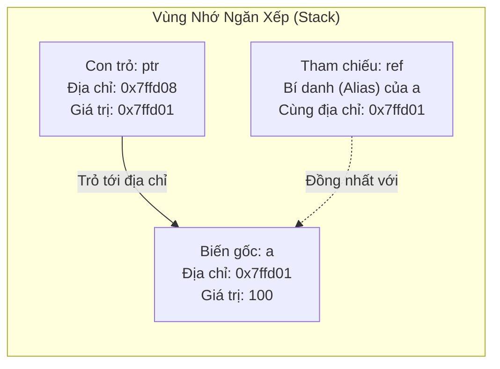

# 12.5 — Pass by lvalue reference

---

## 🎯 Mục Tiêu Bài Học
- Nắm vững bản chất lý thuyết và cơ chế hoạt động của **Pass by lvalue reference** trong tiêu chuẩn ISO C++.
- Hiểu rõ cách máy tính tổ chức bộ nhớ (RAM, CPU registers) khi thực thi mã nguồn liên quan.
- Nhận biết các cạm bẫy lỗi kinh điển (**Undefined Behavior**, Memory Leak, Bug logic) và cách phòng tránh.
- Áp dụng các quy tắc thực hành tốt nhất (**Best Practices**) chuẩn công nghiệp và cập nhật C++20/C++23 hiện đại.

---

# 12.5 &#8212; Pass by lvalue tham chiếu

In the previous lessons, we introduced lvalue các tham chiếu ([12.3 --  Lvalue các tham chiếu](https://www.learncpp.com/cpp-tutorial/lvalue-các tham chiếu/)) and lvalue các tham chiếu to const ([12.4 -- Lvalue các tham chiếu to const](https://www.learncpp.com/cpp-tutorial/lvalue-các tham chiếu-to-const/)).  In isolation, these may not have seemed very useful -- why create an alias to a biến when you can just use the biến itself?

In this lesson, we’ll finally provide some insight into what makes các tham chiếu useful.  And then starting later in this chapter, you’ll see các tham chiếu used regularly.

First, some context.  Back in lesson [2.4 -- Introduction to hàm tham số and đối số](https://www.learncpp.com/cpp-tutorial/introduction-to-hàm-tham số-and-đối số/) we discussed `truyền theo giá trị`, where an đối số passed to a hàm is copied into the hàm’s tham số:

```cpp
#include <iostream>

void printValue(int y)
{
    std::cout << y << '\n';
} // y is destroyed here

int main()
{
    int x { 2 };

    printValue(x); // x is passed by value (copied) into parameter y (inexpensive)

    return 0;
}
```

In the above program, when `printValue(x)` is called, the value of `x` (`2`) is *copied* into tham số `y`.  Then, at the end of the hàm, object `y` is destroyed.

This means that when we called the hàm, we made a copy of our đối số’s value, only to use it briefly and then destroy it!  Fortunately, because các kiểu dữ liệu cơ bản are cheap to copy, this isn’t a problem.

Some đối tượng are expensive to copy

Most of the types provided by the standard library (such as `std::string`) are class types.  Class types are usually expensive to copy.  Whenever possible, we want to avoid making unnecessary copies of đối tượng that are expensive to copy, especially when we will destroy those copies almost immediately.

Consider the following program illustrating this point:

```cpp
#include <iostream>
#include <string>

void printValue(std::string y)
{
    std::cout << y << '\n';
} // y is destroyed here

int main()
{
    std::string x { "Hello, world!" }; // x is a std::string

    printValue(x); // x is passed by value (copied) into parameter y (expensive)

    return 0;
}
```

This prints

```cpp
Hello, world!
```

While this program behaves like we expect, it’s also inefficient.  Identically to the prior example, when `printValue()` is called, đối số `x` is copied into `printValue()` tham số `y`.  However, in this example, the đối số is a `std::string` instead of an `int`, and `std::string` is a class type that is expensive to copy.  And this expensive copy is made every time `printValue()` is called!

We can do better.

Pass by tham chiếu

One way to avoid making an expensive copy of an đối số when calling a hàm is to use `pass by tham chiếu` instead of `truyền theo giá trị`.  When using **pass by tham chiếu**, we declare a hàm tham số as a tham chiếu type (or const tham chiếu type) rather than as a normal type.  When the hàm is called, each tham chiếu tham số is bound to the appropriate đối số.  Because the tham chiếu acts as an alias for the đối số, no copy of the đối số is made.

Here’s the same example as above, using pass by tham chiếu instead of truyền theo giá trị:

```cpp
#include <iostream>
#include <string>

void printValue(std::string& y) // type changed to std::string&
{
    std::cout << y << '\n';
} // y is destroyed here

int main()
{
    std::string x { "Hello, world!" };

    printValue(x); // x is now passed by reference into reference parameter y (inexpensive)

    return 0;
}
```

This program is identical to the prior one, except the type of tham số `y` has been changed from `std::string` to `std::string&` (an lvalue tham chiếu).  Now, when `printValue(x)` is called, lvalue tham chiếu tham số `y` is bound to đối số `x`.  Binding a tham chiếu is always inexpensive, and no copy of `x` needs to be made.  Because a tham chiếu acts as an alias for the object being referenced, when `printValue()` uses tham chiếu `y`, it’s accessing the actual đối số `x` (rather than a copy of `x`).

::: info Hiểu biết cốt lõi

Pass by tham chiếu allows us to pass đối số to a hàm without making copies of those đối số each time the hàm is called.

:::

The following program demonstrates that a value tham số is a separate object from the đối số, while a tham chiếu tham số is treated as if it were the đối số:

```cpp
#include <iostream>

void printAddresses(int val, int& ref)
{
    std::cout << "The address of the value parameter is: " << &val << '\n';
    std::cout << "The address of the reference parameter is: " << &ref << '\n';   
}

int main()
{
    int x { 5 };
    std::cout << "The address of x is: " << &x << '\n';
    printAddresses(x, x);

    return 0;
}
```

One run of this program produced the following output:

```cpp
The address of x is: 0x7ffd16574de0
The address of the value parameter is: 0x7ffd16574de4
The address of the reference parameter is: 0x7ffd16574de0
```

We can see that the đối số has a different address than the value tham số, meaning the value tham số is a different object.  Since they have separate memory addresses, in order for the value tham số to have the same value as the đối số, the đối số’s value must be copied into memory held by the value tham số.

On the other hand, we can see that taking the address of the tham chiếu tham số yields an address identical to that of the đối số.  This means that the tham chiếu tham số is being treated as if it were the same object as the đối số.

Pass by tham chiếu allows us to change the value of an đối số

When an object is passed by value, the hàm tham số receives a copy of the đối số.  This means that any changes to the value of the tham số are made to the copy of the đối số, not the đối số itself:

```cpp
#include <iostream>

void addOne(int y) // y is a copy of x
{
    ++y; // this modifies the copy of x, not the actual object x
}

int main()
{
    int x { 5 };

    std::cout << "value = " << x << '\n';

    addOne(x);

    std::cout << "value = " << x << '\n'; // x has not been modified

    return 0;
}
```

In the above program, because value tham số `y` is a copy of `x`, when we increment `y`, this only affects `y`.  This program outputs:

```cpp
value = 5
value = 5
```

However, since a tham chiếu acts identically to the object being referenced, when using pass by tham chiếu, any changes made to the tham chiếu tham số *will* affect the đối số:

```cpp
#include <iostream>

void addOne(int& y) // y is bound to the actual object x
{
    ++y; // this modifies the actual object x
}

int main()
{
    int x { 5 };

    std::cout << "value = " << x << '\n';

    addOne(x);

    std::cout << "value = " << x << '\n'; // x has been modified

    return 0;
}
```

This program outputs:

```cpp
value = 5
value = 6
```

In the above example, `x` initially has value `5`.  When `addOne(x)` is called, tham chiếu tham số `y` is bound to đối số `x`.  When the `addOne()` hàm increments tham chiếu `y`, it’s actually incrementing đối số `x` from `5` to `6` (not a copy of `x`).  This changed value persists even after `addOne()` has finished executing.

::: info Hiểu biết cốt lõi

Passing values by tham chiếu to non-const allows us to write các hàm that modify the value of đối số passed in.

:::

The ability for các hàm to modify the value of đối số passed in can be useful.  Imagine you’ve written a hàm that determines whether a monster has successfully attacked the player.  If so, the monster should do some amount of damage to the player’s health.  If you pass your player object by tham chiếu, the hàm can directly modify the health of the actual player object that was passed in.  If you pass the player object by value, you could only modify the health of a copy of the player object, which isn’t as useful.

Pass by tham chiếu can only accept modifiable lvalue đối số

Because a tham chiếu to a non-const value can only bind to a modifiable lvalue (essentially a non-const biến), this means that pass by tham chiếu only works with đối số that are modifiable lvalues.  In practical terms, this significantly limits the usefulness of pass by tham chiếu to non-const, as it means we can not pass const các biến or các hằng giá trị (literals).  For example:

```cpp
#include <iostream>

void printValue(int& y) // y only accepts modifiable lvalues
{
    std::cout << y << '\n';
}

int main()
{
    int x { 5 };
    printValue(x); // ok: x is a modifiable lvalue

    const int z { 5 };
    printValue(z); // error: z is a non-modifiable lvalue

    printValue(5); // error: 5 is an rvalue

    return 0;
}
```

Fortunately, there’s an easy way around this, which we will discuss next lesson.  We’ll also take a look at when to truyền theo giá trị vs. pass by tham chiếu.

  	
  	

---



::: danger Cạm Bẫy Thực Chiến: Con Trỏ Lơ Lửng (Dangling Pointer) & UB
Tuyệt đối không giải phóng vùng nhớ mà con trỏ đang trỏ tới rồi tiếp tục truy cập nó, hoặc trả về tham chiếu/con trỏ tới một biến cục bộ trên Stack. Khi hàm kết thúc, biến cục bộ bị hủy và con trỏ sẽ trỏ vào vùng nhớ rác, dẫn đến **Hành vi không xác định (Undefined Behavior)** cực kỳ nguy hiểm!
:::

::: tip Nâng Cấp C++ Hiện Đại: Thay Thế Con Trỏ Thô Bằng Smart Pointers
Trong C++ hiện đại (C++11 đến C++23), hãy hạn chế tối đa việc sử dụng con trỏ thô (`T*`) cùng các toán tử `new`/`delete`. Thay vào đó, hãy luôn ưu tiên:
- `std::unique_ptr<T>`: Sở hữu độc quyền tài nguyên (Zero-overhead, tự động giải phóng RAII).
- `std::shared_ptr<T>`: Sở hữu chia sẻ tài nguyên có cơ chế đếm tham chiếu (Reference counting).
- `std::span<T>` (C++20) hoặc `std::string_view` (C++17): Xem qua vùng nhớ mà không sở hữu, an toàn và tốc độ cực cao.
:::

::: tip 💡 Tóm Tắt Quy Tắc Vàng (Core Guidelines)
1. Luôn hiểu rõ vòng đời và quyền sở hữu (Ownership) của dữ liệu trước khi viết code.
2. Ưu tiên khởi tạo đồng nhất với dấu ngoặc nhọn `{}` để ngăn chặn lỗi thu hẹp kiểu dữ liệu (Narrowing conversions).
3. Bật toàn bộ cờ cảnh báo `-Wall -Wextra -Wpedantic` để compiler giúp bạn phát hiện bug từ sớm!
:::
